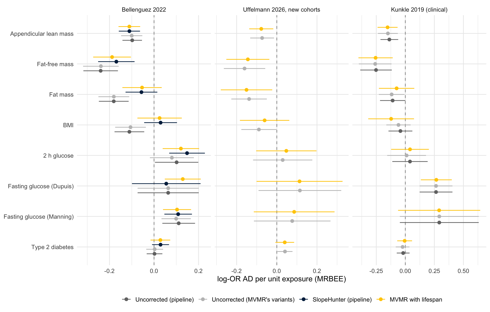

## Why this analysis

Zhang et al. 2026 (AJHG; medRxiv 2026.02.26.26347193) compared corrections for index-event bias in
MR. SlopeHunter, our pre-specified correction, had about 50% Type I error in their simulations.
Their recommended strategy, when distinct variants drive the selection event, is multivariable MR
with the selection trait as a second exposure (their eq. 4). For us the selection event is surviving
to the age at which AD is ascertained, so the second exposure is lifespan:

$$\hat\beta_{AD,j} = \theta_x\,\hat\beta_{x,j} + \theta_{life}\,\hat\beta_{life,j} + \varepsilon_j$$

Every AD GWAS is a sample of survivors, so each variant's AD association carries
$b \times \beta_{life,j}$ on top of its true effect (Dudbridge 2019). $\theta_{life}$ absorbs that
slope: it is an estimate of $b$, to compare with SlopeHunter's $b_{SH} = -0.944$. $\theta_x$ is the
exposure effect with the selection term removed. That is the same correction as the SlopeHunter
arm, but here $b$ comes from strong lifespan instruments rather than a mixture model, and its
uncertainty is carried by the regression.

**This does not condition on a collider.** Nobody is stratified or adjusted on their own survival.
The model is a regression across variants of their AD associations on their exposure and lifespan
associations, and the lifespan associations come from a GWAS that is not selected on AD. The
conditioning on survival already happened when the AD GWAS was done in survivors; the lifespan
term models the bias that conditioning left behind. Two real risks remain:

- **Lifespan variants that affect AD directly.** Their AD association is not just $b \times \beta_{life}$,
  so they bias $\theta_{life}$ and, through it, $\theta_x$ (Zhang et al., Supp. Table S6). Lifespan
  instruments at established AD loci (APOE, PTK2B–CLU, the MHC/HLA-DQA1 region) are therefore
  excluded from the primary set; the sensitivity set keeps all but APOE, and every remaining lifespan
  variant is dropped in turn.
- **What is removed.** Lifespan has no causal effect on the age-specific risk of AD, so the only path
  through it is mortality: survival selection and death as a competing risk. $\theta_x$ is therefore
  the exposure's effect on AD among people who survive, which is what the SlopeHunter arm also
  estimates.

Uncertainty from overlapping samples (UK Biobank is in the lifespan GWAS, Bellenguez and several
exposures) is handled by MRBEE, which uses the error correlations between the three GWAS. IVW-MRE is
reported beside it. Estimates are log-odds of AD per unit of each exposure GWAS's beta, the scale of
the classical rows in `results/pipeline/results.csv`.


::: {.cell}

```{.r .cell-code}
library(dplyr)
library(tidyr)
library(readr)
library(ggplot2)
library(knitr)

out_dir <- "results/mvmr_lifespan"
exposures <- c(leanmass_pei = "Appendicular lean mass", ffm_ukb = "Fat-free mass",
               fatmass_ukb = "Fat mass", bmi_ukb = "BMI", glu2h_chen = "2 h glucose",
               fg_dupuis = "Fasting glucose (Dupuis)", fg_manning = "Fasting glucose (Manning)",
               t2d_xue = "Type 2 diabetes")
outcomes <- c(ad_bellenguez = "Bellenguez 2022", ad_uffelmann_newc = "Uffelmann 2026, new cohorts",
              ad_kunkle = "Kunkle 2019 (clinical)")

# The fit reads the GWAS from the targets store and takes ~30 min; by default the notebook reads
# the CSVs it wrote. Render with -P refit:true to refit.
if (isTRUE(params$refit) || !file.exists(file.path(out_dir, "results.csv"))) {
  suppressPackageStartupMessages(library(targets))
  tar_source("pipeline/R")
  source("R/mvmr_lifespan.R")
  cfg <- yaml::read_yaml("pipeline/config.yml")
  run_mvmr_lifespan(names(exposures), names(outcomes), cfg$paths$ld_bfile,
                    resolve_plink2(cfg$paths$plink2), out_dir)
}
rd <- \(f) read_csv(file.path(out_dir, f), show_col_types = FALSE)
iv    <- rd("life_instruments.csv")
slope <- rd("life_slope.csv")
res   <- rd("results.csv")
cf    <- rd("cond_f.csv")
loo   <- rd("loo.csv")
pipe  <- read_csv("results/pipeline/results.csv", show_col_types = FALSE, name_repair = "minimal",
                  guess_max = Inf)
sh_cfg <- yaml::read_yaml("pipeline/config.yml")$slopehunter$fits$ad_bellenguez
sh_fit <- read_csv(sh_cfg$fits_csv, show_col_types = FALSE) |> filter(set == sh_cfg$fit_set)
fmt_p <- \(p) ifelse(p < 0.001, formatC(p, format = "e", digits = 1), sprintf("%.3f", p))
lab_x <- \(k) factor(exposures[k], levels = rev(exposures))
lab_y <- \(k) factor(outcomes[k], levels = outcomes)
```
:::


## Lifespan instruments

Genome-wide significant parental-lifespan variants (p < 5×10⁻⁸, r² < 0.001 within 10 Mb). Lifespan
is a Martingale residual, so positive betas mean shorter life. AD effects are on the same allele.
NA means the variant cannot be harmonised. Bellenguez lacks rs429358. rs1556516 (9p21) is a C/G
palindrome at allele frequency 0.50, so its strand cannot be inferred and every fit loses it. That
leaves 7 usable variants in the primary set.


::: {.cell}

```{.r .cell-code}
iv |> filter(outcome == "ad_bellenguez") |>
  arrange(p_l) |>
  transmute(SNP, chr, pos, `excluded (AD locus)` = coalesce(region, ""),
            `lifespan beta` = signif(beta_l, 3), `lifespan p` = fmt_p(p_l),
            `Bellenguez beta` = signif(beta_y, 3), `Bellenguez p` = fmt_p(p_y),
            `ratio (AD / lifespan)` = signif(beta_y / beta_l, 3)) |>
  kable(caption = "Lifespan instruments and their Bellenguez AD associations")
```

::: {.cell-output-display}


Table: Lifespan instruments and their Bellenguez AD associations

|SNP         | chr|       pos|excluded (AD locus) | lifespan beta|lifespan p | Bellenguez beta|Bellenguez p | ratio (AD / lifespan)|
|:-----------|---:|---------:|:-------------------|-------------:|:----------|---------------:|:------------|---------------------:|
|rs429358    |  19|  45411941|APOE                |       -0.0566|1.4e-74    |              NA|NA           |                    NA|
|rs1317286   |  15|  78896129|                    |       -0.0254|1.2e-26    |          0.0230|0.007        |                -0.905|
|rs55730499  |   6| 161005610|                    |       -0.0361|1.7e-18    |          0.0556|4.7e-04      |                -1.540|
|rs1556516   |   9|  22100176|                    |       -0.0181|4.7e-16    |              NA|NA           |                    NA|
|rs7137828   |  12| 111932800|                    |        0.0170|3.4e-14    |         -0.0155|0.056        |                -0.912|
|rs117733303 |   6| 160922870|                    |       -0.0552|3.4e-11    |          0.0407|0.209        |                -0.737|
|rs28383322  |   6|  32592796|MHC                 |        0.0182|5.3e-11    |         -0.0058|0.553        |                -0.318|
|rs17514846  |  15|  91416550|                    |       -0.0139|7.1e-10    |          0.0235|0.004        |                -1.690|
|rs7844965   |   8|  27442064|PTK2B-CLU           |        0.0154|7.7e-09    |         -0.0481|5.1e-07      |                -3.130|
|rs61978928  |  14|  75321714|                    |        0.0136|2.0e-08    |         -0.0069|0.428        |                -0.508|
|rs602633    |   1| 109821511|                    |       -0.0150|2.7e-08    |          0.0166|0.091        |                -1.100|


:::
:::


## The selection slope from lifespan instruments alone

Regressing AD effects on lifespan effects across the lifespan instruments estimates the selection
slope directly. It is what $\theta_{life}$ estimates, without an exposure in the model.


::: {.cell}

```{.r .cell-code}
sh_row <- tibble(outcome = "ad_bellenguez", set = "SlopeHunter (genome-wide mixture)",
                 method = "SlopeHunter", b = sh_fit$b_SH, se = sh_fit$se_SH, p = NA_real_,
                 n_iv = sh_fit$n_fit, Q_p = NA_real_, egger_intercept_p = NA_real_)
bind_rows(slope, sh_row) |>
  mutate(outcome = lab_y(outcome),
         set = recode(set, primary = "primary (APOE, CLU, MHC excluded)", all_but_apoe = "all but APOE")) |>
  arrange(outcome, set) |>
  transmute(outcome, `instrument set` = set, method, n = n_iv, b = signif(b, 3), se = signif(se, 2),
            p = fmt_p(p), `heterogeneity p` = signif(Q_p, 2), `Egger intercept p` = signif(egger_intercept_p, 2)) |>
  kable(caption = "AD on lifespan: the selection slope b")
```

::: {.cell-output-display}


Table: AD on lifespan: the selection slope b

|outcome                     |instrument set                    |method          |    n|      b|   se|p       | heterogeneity p| Egger intercept p|
|:---------------------------|:---------------------------------|:---------------|----:|------:|----:|:-------|---------------:|-----------------:|
|Bellenguez 2022             |SlopeHunter (genome-wide mixture) |SlopeHunter     | 2250| -0.944| 0.07|NA      |              NA|                NA|
|Bellenguez 2022             |all but APOE                      |IVW-MRE         |    9| -1.140| 0.24|2.5e-06 |           0.037|                NA|
|Bellenguez 2022             |all but APOE                      |Weighted median |    9| -0.908| 0.24|1.7e-04 |           0.037|                NA|
|Bellenguez 2022             |all but APOE                      |MR-Egger        |    9| -0.854| 0.75|0.255   |           0.037|              0.70|
|Bellenguez 2022             |primary (APOE, CLU, MHC excluded) |IVW-MRE         |    7| -1.060| 0.19|1.1e-08 |           0.720|                NA|
|Bellenguez 2022             |primary (APOE, CLU, MHC excluded) |Weighted median |    7| -0.909| 0.25|2.6e-04 |           0.720|                NA|
|Bellenguez 2022             |primary (APOE, CLU, MHC excluded) |MR-Egger        |    7| -1.100| 0.50|0.029   |           0.720|              0.94|
|Uffelmann 2026, new cohorts |all but APOE                      |IVW-MRE         |    8| -0.393| 0.29|0.182   |           0.060|                NA|
|Uffelmann 2026, new cohorts |all but APOE                      |Weighted median |    8| -0.721| 0.30|0.017   |           0.060|                NA|
|Uffelmann 2026, new cohorts |all but APOE                      |MR-Egger        |    8| -0.980| 1.10|0.354   |           0.060|              0.58|
|Uffelmann 2026, new cohorts |primary (APOE, CLU, MHC excluded) |IVW-MRE         |    6| -0.412| 0.25|0.103   |           0.330|                NA|
|Uffelmann 2026, new cohorts |primary (APOE, CLU, MHC excluded) |Weighted median |    6| -0.725| 0.32|0.023   |           0.330|                NA|
|Uffelmann 2026, new cohorts |primary (APOE, CLU, MHC excluded) |MR-Egger        |    6| -1.270| 0.76|0.093   |           0.330|              0.30|
|Kunkle 2019 (clinical)      |all but APOE                      |IVW-MRE         |    9| -0.600| 0.32|0.062   |           0.370|                NA|
|Kunkle 2019 (clinical)      |all but APOE                      |Weighted median |    9| -1.020| 0.41|0.012   |           0.370|                NA|
|Kunkle 2019 (clinical)      |all but APOE                      |MR-Egger        |    9| -1.680| 0.93|0.072   |           0.370|              0.26|
|Kunkle 2019 (clinical)      |primary (APOE, CLU, MHC excluded) |IVW-MRE         |    7| -0.594| 0.34|0.078   |           0.470|                NA|
|Kunkle 2019 (clinical)      |primary (APOE, CLU, MHC excluded) |Weighted median |    7| -1.030| 0.46|0.024   |           0.470|                NA|
|Kunkle 2019 (clinical)      |primary (APOE, CLU, MHC excluded) |MR-Egger        |    7| -1.920| 0.93|0.039   |           0.470|              0.19|


:::
:::


## Exposure effects with lifespan in the model

Each exposure's classical instruments (p < 5×10⁻⁸) are pooled with the lifespan instruments and
re-clumped (r² < 0.001 within 10 Mb), with **lifespan variants winning LD conflicts**. Clumping on
the smaller p-value, the usual construction, let hundreds of body-composition instruments displace
all but 1–3 lifespan variants. That left a lifespan conditional F of about 2, so the selection term
was not identified (the same failure `mr_mediation.qmd` met and fixed the same way). The
fasting-glucose GWAS are HapMap-era and miss most lifespan variants. No proxies are sought, so
those fits rest on 3 lifespan variants.


::: {.cell}

```{.r .cell-code}
res |> filter(set == "primary", !is.na(term)) |>
  select(exposure, outcome, step, estimator, term, b, se, p, n_snp, n_life_snp) |>
  pivot_wider(names_from = c(step, term), values_from = c(b, se, p, n_snp, n_life_snp)) |>
  left_join(cf |> filter(set == "primary") |> select(exposure, outcome, cond_F_exposure, cond_F_lifespan),
            by = c("exposure", "outcome")) |>
  arrange(lab_y(outcome), desc(lab_x(exposure)), estimator) |>
  transmute(outcome = outcomes[outcome], exposure = exposures[exposure], estimator,
            `uncorrected (same variants)` = sprintf("%.3f (p %s)", b_univariable_exposure, fmt_p(p_univariable_exposure)),
            `MVMR exposure` = sprintf("%.3f (p %s)", b_MVMR_exposure, fmt_p(p_MVMR_exposure)),
            `MVMR lifespan (b)` = sprintf("%.2f (SE %.2f)", b_MVMR_lifespan, se_MVMR_lifespan),
            `variants (lifespan-selected)` = sprintf("%d (%d)", n_snp_MVMR_exposure, n_life_snp_MVMR_exposure),
            `cond. F exposure` = round(cond_F_exposure, 1), `cond. F lifespan` = round(cond_F_lifespan, 1)) |>
  kable(caption = "MVMR with lifespan, primary lifespan instrument set (log-OR AD per unit exposure)")
```

::: {.cell-output-display}


Table: MVMR with lifespan, primary lifespan instrument set (log-OR AD per unit exposure)

|outcome                     |exposure                  |estimator |uncorrected (same variants) |MVMR exposure      |MVMR lifespan (b) |variants (lifespan-selected) | cond. F exposure| cond. F lifespan|
|:---------------------------|:-------------------------|:---------|:---------------------------|:------------------|:-----------------|:----------------------------|----------------:|----------------:|
|Bellenguez 2022             |Appendicular lean mass    |IVW-MRE   |-0.104 (p 2.3e-05)          |-0.104 (p 2.6e-05) |-0.52 (SE 0.13)   |516 (7)                      |             98.8|              2.5|
|Bellenguez 2022             |Appendicular lean mass    |MRBEE     |-0.100 (p 3.7e-05)          |-0.111 (p 8.1e-06) |-0.90 (SE 0.19)   |516 (7)                      |             98.8|              2.5|
|Bellenguez 2022             |Fat-free mass             |IVW-MRE   |-0.249 (p 3.4e-10)          |-0.217 (p 9.3e-08) |-0.40 (SE 0.13)   |492 (7)                      |             44.4|              2.6|
|Bellenguez 2022             |Fat-free mass             |MRBEE     |-0.239 (p 4.9e-09)          |-0.188 (p 1.4e-05) |-0.63 (SE 0.22)   |492 (7)                      |             44.4|              2.6|
|Bellenguez 2022             |Fat mass                  |IVW-MRE   |-0.193 (p 1.2e-08)          |-0.110 (p 0.005)   |-0.57 (SE 0.14)   |385 (7)                      |             12.7|              2.8|
|Bellenguez 2022             |Fat mass                  |MRBEE     |-0.181 (p 3.2e-07)          |-0.054 (p 0.232)   |-0.87 (SE 0.20)   |385 (7)                      |             12.7|              2.8|
|Bellenguez 2022             |BMI                       |IVW-MRE   |-0.120 (p 4.9e-04)          |-0.038 (p 0.354)   |-0.53 (SE 0.15)   |396 (7)                      |             11.2|              2.7|
|Bellenguez 2022             |BMI                       |MRBEE     |-0.106 (p 0.003)            |0.025 (p 0.623)    |-0.84 (SE 0.22)   |396 (7)                      |             11.2|              2.7|
|Bellenguez 2022             |2 h glucose               |IVW-MRE   |0.079 (p 0.114)             |0.116 (p 0.005)    |-1.09 (SE 0.18)   |18 (7)                       |             35.3|             24.3|
|Bellenguez 2022             |2 h glucose               |MRBEE     |0.080 (p 0.112)             |0.121 (p 0.004)    |-1.14 (SE 0.18)   |18 (7)                       |             35.3|             24.3|
|Bellenguez 2022             |Fasting glucose (Dupuis)  |IVW-MRE   |0.062 (p 0.435)             |0.055 (p 0.493)    |-1.00 (SE 0.25)   |14 (3)                       |             52.7|             15.5|
|Bellenguez 2022             |Fasting glucose (Dupuis)  |MRBEE     |0.064 (p 0.365)             |0.129 (p 0.002)    |-1.14 (SE 0.41)   |14 (3)                       |             52.7|             15.5|
|Bellenguez 2022             |Fasting glucose (Manning) |IVW-MRE   |0.022 (p 0.793)             |0.055 (p 0.517)    |-0.88 (SE 0.37)   |24 (3)                       |             42.7|              9.2|
|Bellenguez 2022             |Fasting glucose (Manning) |MRBEE     |0.099 (p 0.003)             |0.103 (p 0.001)    |-1.15 (SE 0.55)   |24 (3)                       |             42.7|              9.2|
|Bellenguez 2022             |Type 2 diabetes           |IVW-MRE   |-0.002 (p 0.922)            |0.019 (p 0.348)    |-0.82 (SE 0.26)   |109 (4)                      |             22.5|              4.1|
|Bellenguez 2022             |Type 2 diabetes           |MRBEE     |0.003 (p 0.882)             |0.028 (p 0.207)    |-1.02 (SE 0.27)   |109 (4)                      |             22.5|              4.1|
|Uffelmann 2026, new cohorts |Appendicular lean mass    |IVW-MRE   |-0.077 (p 0.010)            |-0.079 (p 0.008)   |-0.20 (SE 0.16)   |449 (6)                      |             86.7|              2.5|
|Uffelmann 2026, new cohorts |Appendicular lean mass    |MRBEE     |-0.073 (p 0.015)            |-0.077 (p 0.011)   |-0.38 (SE 0.26)   |449 (6)                      |             86.7|              2.5|
|Uffelmann 2026, new cohorts |Fat-free mass             |IVW-MRE   |-0.165 (p 7.0e-04)          |-0.156 (p 0.002)   |-0.17 (SE 0.15)   |423 (6)                      |             46.1|              2.7|
|Uffelmann 2026, new cohorts |Fat-free mass             |MRBEE     |-0.161 (p 0.002)            |-0.144 (p 0.008)   |-0.30 (SE 0.26)   |423 (6)                      |             46.1|              2.7|
|Uffelmann 2026, new cohorts |Fat mass                  |IVW-MRE   |-0.136 (p 6.5e-04)          |-0.145 (p 0.002)   |0.07 (SE 0.17)    |342 (6)                      |              9.2|              2.8|
|Uffelmann 2026, new cohorts |Fat mass                  |MRBEE     |-0.138 (p 0.002)            |-0.151 (p 0.021)   |0.10 (SE 0.33)    |342 (6)                      |              9.2|              2.8|
|Uffelmann 2026, new cohorts |BMI                       |IVW-MRE   |-0.088 (p 0.021)            |-0.071 (p 0.116)   |-0.12 (SE 0.16)   |349 (6)                      |              8.4|              2.7|
|Uffelmann 2026, new cohorts |BMI                       |MRBEE     |-0.089 (p 0.045)            |-0.061 (p 0.333)   |-0.19 (SE 0.27)   |349 (6)                      |              8.4|              2.7|
|Uffelmann 2026, new cohorts |2 h glucose               |IVW-MRE   |0.029 (p 0.680)             |0.045 (p 0.475)    |-0.47 (SE 0.30)   |17 (6)                       |             37.3|             22.6|
|Uffelmann 2026, new cohorts |2 h glucose               |MRBEE     |0.029 (p 0.697)             |0.047 (p 0.537)    |-0.49 (SE 0.32)   |17 (6)                       |             37.3|             22.6|
|Uffelmann 2026, new cohorts |Fasting glucose (Dupuis)  |IVW-MRE   |0.113 (p 0.241)             |0.111 (p 0.251)    |-0.47 (SE 0.30)   |13 (3)                       |             61.3|             16.4|
|Uffelmann 2026, new cohorts |Fasting glucose (Dupuis)  |MRBEE     |0.115 (p 0.274)             |0.113 (p 0.301)    |-0.50 (SE 0.44)   |13 (3)                       |             61.3|             16.4|
|Uffelmann 2026, new cohorts |Fasting glucose (Manning) |IVW-MRE   |0.076 (p 0.393)             |0.085 (p 0.339)    |-0.36 (SE 0.40)   |23 (3)                       |             44.7|              9.5|
|Uffelmann 2026, new cohorts |Fasting glucose (Manning) |MRBEE     |0.077 (p 0.431)             |0.086 (p 0.400)    |-0.41 (SE 0.61)   |23 (3)                       |             44.7|              9.5|
|Uffelmann 2026, new cohorts |Type 2 diabetes           |IVW-MRE   |0.040 (p 0.067)             |0.039 (p 0.092)    |0.06 (SE 0.30)    |96 (4)                       |             21.7|              4.4|
|Uffelmann 2026, new cohorts |Type 2 diabetes           |MRBEE     |0.041 (p 0.034)             |0.039 (p 0.098)    |0.07 (SE 0.52)    |96 (4)                       |             21.7|              4.4|
|Kunkle 2019 (clinical)      |Appendicular lean mass    |IVW-MRE   |-0.137 (p 0.001)            |-0.138 (p 0.001)   |-0.19 (SE 0.22)   |478 (7)                      |             99.0|              2.5|
|Kunkle 2019 (clinical)      |Appendicular lean mass    |MRBEE     |-0.150 (p 5.9e-04)          |-0.153 (p 5.1e-04) |-0.32 (SE 0.38)   |478 (7)                      |             99.0|              2.5|
|Kunkle 2019 (clinical)      |Fat-free mass             |IVW-MRE   |-0.242 (p 3.0e-04)          |-0.237 (p 5.0e-04) |-0.00 (SE 0.21)   |460 (7)                      |             43.5|              2.7|
|Kunkle 2019 (clinical)      |Fat-free mass             |MRBEE     |-0.259 (p 3.0e-04)          |-0.256 (p 6.8e-04) |0.03 (SE 0.41)    |460 (7)                      |             43.5|              2.7|
|Kunkle 2019 (clinical)      |Fat mass                  |IVW-MRE   |-0.134 (p 0.015)            |-0.112 (p 0.074)   |-0.13 (SE 0.23)   |348 (7)                      |             14.4|              2.9|
|Kunkle 2019 (clinical)      |Fat mass                  |MRBEE     |-0.118 (p 0.037)            |-0.075 (p 0.335)   |-0.29 (SE 0.38)   |348 (7)                      |             14.4|              2.9|
|Kunkle 2019 (clinical)      |BMI                       |IVW-MRE   |-0.064 (p 0.252)            |-0.105 (p 0.110)   |0.31 (SE 0.24)    |358 (7)                      |             12.2|              2.8|
|Kunkle 2019 (clinical)      |BMI                       |MRBEE     |-0.059 (p 0.269)            |-0.122 (p 0.224)   |0.45 (SE 0.58)    |358 (7)                      |             12.2|              2.8|
|Kunkle 2019 (clinical)      |2 h glucose               |IVW-MRE   |0.011 (p 0.883)             |0.038 (p 0.606)    |-0.63 (SE 0.33)   |17 (7)                       |             35.9|             25.7|
|Kunkle 2019 (clinical)      |2 h glucose               |MRBEE     |0.011 (p 0.897)             |0.040 (p 0.626)    |-0.66 (SE 0.38)   |17 (7)                       |             35.9|             25.7|
|Kunkle 2019 (clinical)      |Fasting glucose (Dupuis)  |IVW-MRE   |0.210 (p 0.146)             |0.199 (p 0.168)    |-0.32 (SE 0.44)   |14 (3)                       |             52.7|             15.5|
|Kunkle 2019 (clinical)      |Fasting glucose (Dupuis)  |MRBEE     |0.264 (p 2.4e-04)           |0.267 (p 8.5e-05)  |0.69 (SE 0.25)    |14 (3)                       |             52.7|             15.5|
|Kunkle 2019 (clinical)      |Fasting glucose (Manning) |IVW-MRE   |0.188 (p 0.386)             |0.185 (p 0.386)    |-0.23 (SE 0.80)   |22 (3)                       |             37.0|             10.0|
|Kunkle 2019 (clinical)      |Fasting glucose (Manning) |MRBEE     |0.292 (p 0.091)             |0.291 (p 0.107)    |-0.29 (SE 1.62)   |22 (3)                       |             37.0|             10.0|
|Kunkle 2019 (clinical)      |Type 2 diabetes           |IVW-MRE   |-0.023 (p 0.430)            |-0.010 (p 0.740)   |-0.57 (SE 0.40)   |104 (4)                      |             23.7|              4.1|
|Kunkle 2019 (clinical)      |Type 2 diabetes           |MRBEE     |-0.023 (p 0.436)            |-0.006 (p 0.858)   |-0.76 (SE 0.46)   |104 (4)                      |             23.7|              4.1|


:::
:::


## Against the SlopeHunter arm

Bellenguez and Kunkle can be set beside the pipeline's univariable rows. The pipeline's SlopeHunter
arm (Bellenguez only) now carries the uncertainty in $b_{SH}$. The uncorrected rows use the
pipeline's classical instruments; the MVMR's uncorrected comparator uses the exposure-selected
variants of its own joint set, which can differ by a variant or two.


::: {.cell}

```{.r .cell-code}
cmp <- bind_rows(
  pipe |> filter(outcome %in% names(outcomes), method %in% c("IVW-MRE", "MRBEE"), exposure %in% names(exposures)) |>
    transmute(exposure, outcome, estimator = method, b, se, p, n_snp,
              approach = if_else(arm == "raw", "Uncorrected (pipeline)", "SlopeHunter (pipeline)")),
  res |> filter(set == "primary", term == "exposure") |>
    transmute(exposure, outcome, estimator, b, se, p, n_snp,
              approach = if_else(step == "MVMR", "MVMR with lifespan", "Uncorrected (MVMR's variants)"))) |>
  mutate(approach = factor(approach, levels = c("Uncorrected (pipeline)", "Uncorrected (MVMR's variants)",
                                                "SlopeHunter (pipeline)", "MVMR with lifespan")),
         lo = b - 1.96 * se, hi = b + 1.96 * se)

cmp |> filter(estimator == "MRBEE") |>
  mutate(cell = sprintf("%.3f [%.3f, %.3f]", b, lo, hi)) |>
  select(outcome, exposure, approach, cell) |>
  pivot_wider(names_from = approach, values_from = cell) |>
  arrange(lab_y(outcome), desc(lab_x(exposure))) |>
  mutate(outcome = outcomes[outcome], exposure = exposures[exposure]) |>
  kable(caption = "MRBEE, log-OR AD per unit exposure [95% CI]")
```

::: {.cell-output-display}


Table: MRBEE, log-OR AD per unit exposure [95% CI]

|outcome                     |exposure                  |Uncorrected (pipeline)  |SlopeHunter (pipeline)  |MVMR with lifespan      |Uncorrected (MVMR's variants) |
|:---------------------------|:-------------------------|:-----------------------|:-----------------------|:-----------------------|:-----------------------------|
|Bellenguez 2022             |Appendicular lean mass    |-0.098 [-0.142, -0.054] |-0.111 [-0.158, -0.063] |-0.111 [-0.160, -0.062] |-0.100 [-0.148, -0.053]       |
|Bellenguez 2022             |Fat-free mass             |-0.240 [-0.317, -0.162] |-0.169 [-0.251, -0.087] |-0.188 [-0.273, -0.104] |-0.239 [-0.319, -0.159]       |
|Bellenguez 2022             |Fat mass                  |-0.181 [-0.248, -0.114] |-0.057 [-0.128, 0.015]  |-0.054 [-0.142, 0.035]  |-0.181 [-0.250, -0.111]       |
|Bellenguez 2022             |BMI                       |-0.111 [-0.178, -0.044] |0.029 [-0.044, 0.103]   |0.025 [-0.075, 0.125]   |-0.106 [-0.175, -0.037]       |
|Bellenguez 2022             |2 h glucose               |0.101 [0.004, 0.199]    |0.148 [0.068, 0.228]    |0.121 [0.039, 0.203]    |0.080 [-0.019, 0.179]         |
|Bellenguez 2022             |Fasting glucose (Dupuis)  |0.064 [-0.074, 0.201]   |0.055 [-0.099, 0.209]   |0.129 [0.048, 0.210]    |0.064 [-0.074, 0.201]         |
|Bellenguez 2022             |Fasting glucose (Manning) |0.111 [0.037, 0.184]    |0.108 [0.046, 0.170]    |0.103 [0.040, 0.166]    |0.099 [0.033, 0.165]          |
|Bellenguez 2022             |Type 2 diabetes           |0.002 [-0.033, 0.037]   |0.029 [-0.009, 0.067]   |0.028 [-0.016, 0.073]   |0.003 [-0.035, 0.041]         |
|Uffelmann 2026, new cohorts |Appendicular lean mass    |NA                      |NA                      |-0.077 [-0.137, -0.018] |-0.073 [-0.132, -0.014]       |
|Uffelmann 2026, new cohorts |Fat-free mass             |NA                      |NA                      |-0.144 [-0.251, -0.037] |-0.161 [-0.264, -0.058]       |
|Uffelmann 2026, new cohorts |Fat mass                  |NA                      |NA                      |-0.151 [-0.279, -0.023] |-0.138 [-0.226, -0.050]       |
|Uffelmann 2026, new cohorts |BMI                       |NA                      |NA                      |-0.061 [-0.184, 0.062]  |-0.089 [-0.177, -0.002]       |
|Uffelmann 2026, new cohorts |2 h glucose               |NA                      |NA                      |0.047 [-0.103, 0.197]   |0.029 [-0.118, 0.177]         |
|Uffelmann 2026, new cohorts |Fasting glucose (Dupuis)  |NA                      |NA                      |0.113 [-0.101, 0.327]   |0.115 [-0.091, 0.321]         |
|Uffelmann 2026, new cohorts |Fasting glucose (Manning) |NA                      |NA                      |0.086 [-0.115, 0.287]   |0.077 [-0.114, 0.267]         |
|Uffelmann 2026, new cohorts |Type 2 diabetes           |NA                      |NA                      |0.039 [-0.007, 0.086]   |0.041 [0.003, 0.078]          |
|Kunkle 2019 (clinical)      |Appendicular lean mass    |-0.138 [-0.214, -0.061] |NA                      |-0.153 [-0.239, -0.067] |-0.150 [-0.235, -0.064]       |
|Kunkle 2019 (clinical)      |Fat-free mass             |-0.252 [-0.388, -0.116] |NA                      |-0.256 [-0.404, -0.108] |-0.259 [-0.400, -0.119]       |
|Kunkle 2019 (clinical)      |Fat mass                  |-0.109 [-0.218, -0.001] |NA                      |-0.075 [-0.227, 0.077]  |-0.118 [-0.228, -0.007]       |
|Kunkle 2019 (clinical)      |BMI                       |-0.042 [-0.145, 0.061]  |NA                      |-0.122 [-0.319, 0.075]  |-0.059 [-0.163, 0.046]        |
|Kunkle 2019 (clinical)      |2 h glucose               |0.040 [-0.112, 0.192]   |NA                      |0.040 [-0.122, 0.203]   |0.011 [-0.156, 0.178]         |
|Kunkle 2019 (clinical)      |Fasting glucose (Dupuis)  |0.264 [0.123, 0.406]    |NA                      |0.267 [0.134, 0.400]    |0.264 [0.123, 0.406]          |
|Kunkle 2019 (clinical)      |Fasting glucose (Manning) |0.292 [-0.047, 0.632]   |NA                      |0.291 [-0.063, 0.645]   |0.292 [-0.047, 0.632]         |
|Kunkle 2019 (clinical)      |Type 2 diabetes           |-0.019 [-0.074, 0.037]  |NA                      |-0.006 [-0.070, 0.058]  |-0.023 [-0.082, 0.036]        |


:::
:::


::: {.cell}

```{.r .cell-code}
cols <- c("Uncorrected (pipeline)" = "grey45", "Uncorrected (MVMR's variants)" = "grey75",
          "SlopeHunter (pipeline)" = "#00274c", "MVMR with lifespan" = "#ffcb05")
cmp |> filter(estimator == "MRBEE") |>
  mutate(exposure = lab_x(exposure), outcome = lab_y(outcome)) |>
  ggplot(aes(b, exposure, colour = approach)) +
  geom_vline(xintercept = 0, linetype = 2, colour = "grey60") +
  geom_pointrange(aes(xmin = lo, xmax = hi), position = position_dodge(width = 0.6), size = 0.35) +
  facet_wrap(~outcome, scales = "free_x") +
  scale_colour_manual(values = cols, drop = FALSE) +
  labs(x = "log-OR AD per unit exposure (MRBEE)", y = NULL, colour = NULL) +
  theme_minimal(base_size = 12) + theme(legend.position = "bottom")
```

::: {.cell-output-display}
{width=1056}
:::
:::


## Sensitivity

### Keeping the lifespan variants at AD loci


::: {.cell}

```{.r .cell-code}
res |> filter(step == "MVMR", estimator == "MRBEE", !is.na(term)) |>
  select(exposure, outcome, set, term, b, se) |>
  mutate(cell = sprintf("%.3f (%.3f)", b, se)) |>
  select(-b, -se) |>
  pivot_wider(names_from = c(term, set), values_from = cell) |>
  arrange(lab_y(outcome), desc(lab_x(exposure))) |>
  mutate(outcome = outcomes[outcome], exposure = exposures[exposure]) |>
  kable(caption = "MRBEE estimate (SE): primary lifespan set vs all lifespan variants but APOE")
```

::: {.cell-output-display}


Table: MRBEE estimate (SE): primary lifespan set vs all lifespan variants but APOE

|exposure                  |outcome                     |exposure_primary |lifespan_primary |exposure_all_but_apoe |lifespan_all_but_apoe |
|:-------------------------|:---------------------------|:----------------|:----------------|:---------------------|:---------------------|
|Appendicular lean mass    |Bellenguez 2022             |-0.111 (0.025)   |-0.899 (0.194)   |-0.116 (0.025)        |-0.978 (0.202)        |
|Fat-free mass             |Bellenguez 2022             |-0.188 (0.043)   |-0.626 (0.219)   |-0.181 (0.044)        |-0.666 (0.223)        |
|Fat mass                  |Bellenguez 2022             |-0.054 (0.045)   |-0.875 (0.201)   |-0.042 (0.046)        |-0.918 (0.214)        |
|BMI                       |Bellenguez 2022             |0.025 (0.051)    |-0.839 (0.222)   |0.034 (0.052)         |-0.910 (0.230)        |
|2 h glucose               |Bellenguez 2022             |0.121 (0.042)    |-1.141 (0.176)   |0.120 (0.043)         |-1.059 (0.172)        |
|Fasting glucose (Dupuis)  |Bellenguez 2022             |0.129 (0.041)    |-1.145 (0.411)   |0.056 (0.087)         |-1.057 (0.287)        |
|Fasting glucose (Manning) |Bellenguez 2022             |0.103 (0.032)    |-1.153 (0.550)   |0.142 (0.042)         |-1.041 (0.303)        |
|Type 2 diabetes           |Bellenguez 2022             |0.028 (0.023)    |-1.020 (0.270)   |0.034 (0.023)         |-1.167 (0.347)        |
|Appendicular lean mass    |Uffelmann 2026, new cohorts |-0.077 (0.031)   |-0.376 (0.259)   |-0.074 (0.031)        |-0.366 (0.259)        |
|Fat-free mass             |Uffelmann 2026, new cohorts |-0.144 (0.055)   |-0.304 (0.262)   |-0.150 (0.055)        |-0.339 (0.256)        |
|Fat mass                  |Uffelmann 2026, new cohorts |-0.151 (0.065)   |0.103 (0.335)    |-0.149 (0.064)        |0.084 (0.319)         |
|BMI                       |Uffelmann 2026, new cohorts |-0.061 (0.063)   |-0.194 (0.274)   |-0.058 (0.062)        |-0.198 (0.270)        |
|2 h glucose               |Uffelmann 2026, new cohorts |0.047 (0.077)    |-0.490 (0.322)   |0.048 (0.076)         |-0.462 (0.331)        |
|Fasting glucose (Dupuis)  |Uffelmann 2026, new cohorts |0.113 (0.109)    |-0.503 (0.435)   |0.107 (0.108)         |-0.712 (0.306)        |
|Fasting glucose (Manning) |Uffelmann 2026, new cohorts |0.086 (0.103)    |-0.412 (0.608)   |0.093 (0.103)         |-0.643 (0.330)        |
|Type 2 diabetes           |Uffelmann 2026, new cohorts |0.039 (0.024)    |0.072 (0.523)    |0.045 (0.023)         |-0.108 (0.462)        |
|Appendicular lean mass    |Kunkle 2019 (clinical)      |-0.153 (0.044)   |-0.322 (0.377)   |-0.156 (0.044)        |-0.362 (0.352)        |
|Fat-free mass             |Kunkle 2019 (clinical)      |-0.256 (0.075)   |0.031 (0.411)    |-0.256 (0.074)        |0.036 (0.390)         |
|Fat mass                  |Kunkle 2019 (clinical)      |-0.075 (0.078)   |-0.288 (0.380)   |-0.060 (0.076)        |-0.275 (0.359)        |
|BMI                       |Kunkle 2019 (clinical)      |-0.122 (0.101)   |0.448 (0.576)    |-0.102 (0.091)        |0.326 (0.499)         |
|2 h glucose               |Kunkle 2019 (clinical)      |0.040 (0.083)    |-0.657 (0.381)   |0.041 (0.083)         |-0.658 (0.353)        |
|Fasting glucose (Dupuis)  |Kunkle 2019 (clinical)      |0.267 (0.068)    |0.687 (0.245)    |0.193 (0.122)         |-0.600 (0.785)        |
|Fasting glucose (Manning) |Kunkle 2019 (clinical)      |0.291 (0.180)    |-0.288 (1.624)   |0.199 (0.208)         |-0.530 (0.913)        |
|Type 2 diabetes           |Kunkle 2019 (clinical)      |-0.006 (0.033)   |-0.758 (0.458)   |-0.002 (0.032)        |-0.885 (0.410)        |


:::
:::


### Leaving out one lifespan variant at a time


::: {.cell}

```{.r .cell-code}
loo |> filter(term == "exposure") |>
  group_by(outcome, exposure, estimator) |>
  summarise(n_dropped = n(), min = min(b), max = max(b),
            any_ns = any(p >= 0.05), any_sig = any(p < 0.05), .groups = "drop") |>
  left_join(res |> filter(set == "primary", step == "MVMR", term == "exposure") |>
              select(outcome, exposure, estimator, full = b, full_p = p),
            by = c("outcome", "exposure", "estimator")) |>
  arrange(lab_y(outcome), desc(lab_x(exposure)), estimator) |>
  transmute(outcome = outcomes[outcome], exposure = exposures[exposure], estimator,
            `all variants` = sprintf("%.3f (p %s)", full, fmt_p(full_p)),
            `range leaving one out` = sprintf("%.3f to %.3f", min, max),
            `p = 0.05 crossed by any drop` = if_else(full_p < 0.05, any_ns, any_sig)) |>
  kable(caption = "Exposure estimate when each lifespan-selected variant is dropped")
```

::: {.cell-output-display}


Table: Exposure estimate when each lifespan-selected variant is dropped

|outcome                     |exposure                  |estimator |all variants       |range leaving one out |p = 0.05 crossed by any drop |
|:---------------------------|:-------------------------|:---------|:------------------|:---------------------|:----------------------------|
|Bellenguez 2022             |Appendicular lean mass    |IVW-MRE   |-0.104 (p 2.6e-05) |-0.104 to -0.103      |FALSE                        |
|Bellenguez 2022             |Appendicular lean mass    |MRBEE     |-0.111 (p 8.1e-06) |-0.111 to -0.110      |FALSE                        |
|Bellenguez 2022             |Fat-free mass             |IVW-MRE   |-0.217 (p 9.3e-08) |-0.222 to -0.218      |FALSE                        |
|Bellenguez 2022             |Fat-free mass             |MRBEE     |-0.188 (p 1.4e-05) |-0.194 to -0.188      |FALSE                        |
|Bellenguez 2022             |Fat mass                  |IVW-MRE   |-0.110 (p 0.005)   |-0.120 to -0.110      |FALSE                        |
|Bellenguez 2022             |Fat mass                  |MRBEE     |-0.054 (p 0.232)   |-0.065 to -0.052      |FALSE                        |
|Bellenguez 2022             |BMI                       |IVW-MRE   |-0.038 (p 0.354)   |-0.049 to -0.038      |FALSE                        |
|Bellenguez 2022             |BMI                       |MRBEE     |0.025 (p 0.623)    |0.012 to 0.027        |FALSE                        |
|Bellenguez 2022             |2 h glucose               |IVW-MRE   |0.116 (p 0.005)    |0.111 to 0.119        |FALSE                        |
|Bellenguez 2022             |2 h glucose               |MRBEE     |0.121 (p 0.004)    |0.120 to 0.135        |FALSE                        |
|Bellenguez 2022             |Fasting glucose (Dupuis)  |IVW-MRE   |0.055 (p 0.493)    |0.053 to 0.055        |FALSE                        |
|Bellenguez 2022             |Fasting glucose (Dupuis)  |MRBEE     |0.129 (p 0.002)    |0.053 to 0.126        |TRUE                         |
|Bellenguez 2022             |Fasting glucose (Manning) |IVW-MRE   |0.055 (p 0.517)    |0.047 to 0.054        |FALSE                        |
|Bellenguez 2022             |Fasting glucose (Manning) |MRBEE     |0.103 (p 0.001)    |0.110 to 0.148        |FALSE                        |
|Bellenguez 2022             |Type 2 diabetes           |IVW-MRE   |0.019 (p 0.348)    |0.018 to 0.019        |FALSE                        |
|Bellenguez 2022             |Type 2 diabetes           |MRBEE     |0.028 (p 0.207)    |0.028 to 0.030        |FALSE                        |
|Uffelmann 2026, new cohorts |Appendicular lean mass    |IVW-MRE   |-0.079 (p 0.008)   |-0.080 to -0.078      |FALSE                        |
|Uffelmann 2026, new cohorts |Appendicular lean mass    |MRBEE     |-0.077 (p 0.011)   |-0.078 to -0.077      |FALSE                        |
|Uffelmann 2026, new cohorts |Fat-free mass             |IVW-MRE   |-0.156 (p 0.002)   |-0.160 to -0.151      |FALSE                        |
|Uffelmann 2026, new cohorts |Fat-free mass             |MRBEE     |-0.144 (p 0.008)   |-0.149 to -0.136      |FALSE                        |
|Uffelmann 2026, new cohorts |Fat mass                  |IVW-MRE   |-0.145 (p 0.002)   |-0.163 to -0.139      |FALSE                        |
|Uffelmann 2026, new cohorts |Fat mass                  |MRBEE     |-0.151 (p 0.021)   |-0.182 to -0.142      |FALSE                        |
|Uffelmann 2026, new cohorts |BMI                       |IVW-MRE   |-0.071 (p 0.116)   |-0.085 to -0.061      |FALSE                        |
|Uffelmann 2026, new cohorts |BMI                       |MRBEE     |-0.061 (p 0.333)   |-0.081 to -0.045      |FALSE                        |
|Uffelmann 2026, new cohorts |2 h glucose               |IVW-MRE   |0.045 (p 0.475)    |0.040 to 0.050        |FALSE                        |
|Uffelmann 2026, new cohorts |2 h glucose               |MRBEE     |0.047 (p 0.537)    |0.041 to 0.052        |FALSE                        |
|Uffelmann 2026, new cohorts |Fasting glucose (Dupuis)  |IVW-MRE   |0.111 (p 0.251)    |0.110 to 0.114        |FALSE                        |
|Uffelmann 2026, new cohorts |Fasting glucose (Dupuis)  |MRBEE     |0.113 (p 0.301)    |0.112 to 0.116        |FALSE                        |
|Uffelmann 2026, new cohorts |Fasting glucose (Manning) |IVW-MRE   |0.085 (p 0.339)    |0.075 to 0.090        |FALSE                        |
|Uffelmann 2026, new cohorts |Fasting glucose (Manning) |MRBEE     |0.086 (p 0.400)    |0.075 to 0.093        |FALSE                        |
|Uffelmann 2026, new cohorts |Type 2 diabetes           |IVW-MRE   |0.039 (p 0.092)    |0.031 to 0.041        |FALSE                        |
|Uffelmann 2026, new cohorts |Type 2 diabetes           |MRBEE     |0.039 (p 0.098)    |0.027 to 0.042        |FALSE                        |
|Kunkle 2019 (clinical)      |Appendicular lean mass    |IVW-MRE   |-0.138 (p 0.001)   |-0.139 to -0.137      |FALSE                        |
|Kunkle 2019 (clinical)      |Appendicular lean mass    |MRBEE     |-0.153 (p 5.1e-04) |-0.154 to -0.151      |FALSE                        |
|Kunkle 2019 (clinical)      |Fat-free mass             |IVW-MRE   |-0.237 (p 5.0e-04) |-0.247 to -0.235      |FALSE                        |
|Kunkle 2019 (clinical)      |Fat-free mass             |MRBEE     |-0.256 (p 6.8e-04) |-0.271 to -0.253      |FALSE                        |
|Kunkle 2019 (clinical)      |Fat mass                  |IVW-MRE   |-0.112 (p 0.074)   |-0.134 to -0.107      |TRUE                         |
|Kunkle 2019 (clinical)      |Fat mass                  |MRBEE     |-0.075 (p 0.335)   |-0.105 to -0.066      |FALSE                        |
|Kunkle 2019 (clinical)      |BMI                       |IVW-MRE   |-0.105 (p 0.110)   |-0.139 to -0.102      |TRUE                         |
|Kunkle 2019 (clinical)      |BMI                       |MRBEE     |-0.122 (p 0.224)   |-0.187 to -0.119      |FALSE                        |
|Kunkle 2019 (clinical)      |2 h glucose               |IVW-MRE   |0.038 (p 0.606)    |0.032 to 0.046        |FALSE                        |
|Kunkle 2019 (clinical)      |2 h glucose               |MRBEE     |0.040 (p 0.626)    |0.033 to 0.048        |FALSE                        |
|Kunkle 2019 (clinical)      |Fasting glucose (Dupuis)  |IVW-MRE   |0.199 (p 0.168)    |0.197 to 0.217        |FALSE                        |
|Kunkle 2019 (clinical)      |Fasting glucose (Dupuis)  |MRBEE     |0.267 (p 8.5e-05)  |0.137 to 0.267        |TRUE                         |
|Kunkle 2019 (clinical)      |Fasting glucose (Manning) |IVW-MRE   |0.185 (p 0.386)    |0.155 to 0.197        |FALSE                        |
|Kunkle 2019 (clinical)      |Fasting glucose (Manning) |MRBEE     |0.291 (p 0.107)    |0.190 to 0.305        |FALSE                        |
|Kunkle 2019 (clinical)      |Type 2 diabetes           |IVW-MRE   |-0.010 (p 0.740)   |-0.016 to -0.007      |FALSE                        |
|Kunkle 2019 (clinical)      |Type 2 diabetes           |MRBEE     |-0.006 (p 0.858)   |-0.012 to -0.001      |FALSE                        |


:::
:::


## Conclusions


::: {.cell}

```{.r .cell-code}
cmp |> filter(estimator == "MRBEE", outcome == "ad_bellenguez", approach != "Uncorrected (MVMR's variants)") |>
  mutate(cell = sprintf("%.3f (p %s)", b, fmt_p(p))) |>
  select(exposure, approach, cell) |>
  pivot_wider(names_from = approach, values_from = cell) |>
  left_join(res |> filter(outcome == "ad_bellenguez", set == "primary", step == "MVMR", estimator == "MRBEE",
                          term == "lifespan") |>
              transmute(exposure, `MVMR lifespan slope` = sprintf("%.2f (SE %.2f)", b, se)), by = "exposure") |>
  arrange(desc(lab_x(exposure))) |>
  mutate(exposure = exposures[exposure]) |>
  kable(caption = "Bellenguez, MRBEE: uncorrected, SlopeHunter arm and MVMR with lifespan (b_SH = -0.944)")
```

::: {.cell-output-display}


Table: Bellenguez, MRBEE: uncorrected, SlopeHunter arm and MVMR with lifespan (b_SH = -0.944)

|exposure                  |Uncorrected (pipeline) |SlopeHunter (pipeline) |MVMR with lifespan |MVMR lifespan slope |
|:-------------------------|:----------------------|:----------------------|:------------------|:-------------------|
|Appendicular lean mass    |-0.098 (p 1.2e-05)     |-0.111 (p 5.5e-06)     |-0.111 (p 8.1e-06) |-0.90 (SE 0.19)     |
|Fat-free mass             |-0.240 (p 1.4e-09)     |-0.169 (p 5.0e-05)     |-0.188 (p 1.4e-05) |-0.63 (SE 0.22)     |
|Fat mass                  |-0.181 (p 1.1e-07)     |-0.057 (p 0.121)       |-0.054 (p 0.232)   |-0.87 (SE 0.20)     |
|BMI                       |-0.111 (p 0.001)       |0.029 (p 0.434)        |0.025 (p 0.623)    |-0.84 (SE 0.22)     |
|2 h glucose               |0.101 (p 0.041)        |0.148 (p 2.9e-04)      |0.121 (p 0.004)    |-1.14 (SE 0.18)     |
|Fasting glucose (Dupuis)  |0.064 (p 0.365)        |0.055 (p 0.485)        |0.129 (p 0.002)    |-1.14 (SE 0.41)     |
|Fasting glucose (Manning) |0.111 (p 0.003)        |0.108 (p 6.0e-04)      |0.103 (p 0.001)    |-1.15 (SE 0.55)     |
|Type 2 diabetes           |0.002 (p 0.904)        |0.029 (p 0.133)        |0.028 (p 0.207)    |-1.02 (SE 0.27)     |


:::
:::


Run of 2026-11-11 (primary lifespan set, MRBEE unless stated).

1. **In Bellenguez, step 2 reproduces the SlopeHunter arm.** The lifespan coefficient lands
   between −0.63 and −1.15 across exposures, around b_SH = −0.944. The lifespan instruments alone
   give −1.06 (IVW) and −0.91 (weighted median). The exposure estimates match the SlopeHunter arm:
   lean mass −0.111 vs −0.111, fat-free mass −0.188 vs −0.169, fat mass −0.054 vs −0.057, BMI
   +0.025 vs +0.029, 2 h glucose 0.121 vs 0.148. None of these moves materially when each lifespan
   variant is dropped, or when the CLU and MHC variants are kept.
2. **IVW-MRE under-corrects for the body-composition exposures.** Seven lifespan variants among
   400–500 exposure variants give lifespan a mean conditional F of about 2.5. IVW's lifespan
   coefficient is diluted toward zero (−0.40 to −0.57), so it removes too little. MRBEE corrects for
   this and is the estimator to read, the same rule the glucose contrast analysis uses when
   conditional F < 10. For 2 h glucose (conditional F 24) the two agree.
3. **In Kunkle and the Uffelmann new cohorts, MVMR cannot identify the selection term.** The lifespan
   coefficient's interval covers both 0 and −0.9, so MVMR there is close to uncorrected. The lifespan
   instruments alone give negative but imprecise slopes (weighted median −1.03 in Kunkle, −0.73 in
   Uffelmann). In both cohorts lean mass and fat-free mass are protective and 2 h glucose is null.
   Fat mass is protective in the Uffelmann new cohorts (−0.151, p = 0.02), and survival selection
   can neither be removed nor ruled out there. So "the adiposity protection is survival bias" is
   shown in Bellenguez only; the independent cohorts cannot test it.
4. **The fasting-glucose MRBEE signals are not interpreted.** Dupuis (0.129) and Manning (0.103) are
   positive by MRBEE but null by IVW. Dupuis is unstable when one lifespan variant is dropped
   (p 0.003–0.55) or the sensitivity set is used (p = 0.52). Both fits rest on only 3 lifespan
   variants, because these HapMap-era GWAS miss the rest.

Against Zhang et al.'s decision tree, step 2 is now done. In the cohort where the selection slope
can be estimated, it gives the same answer as the pre-specified SlopeHunter arm.
