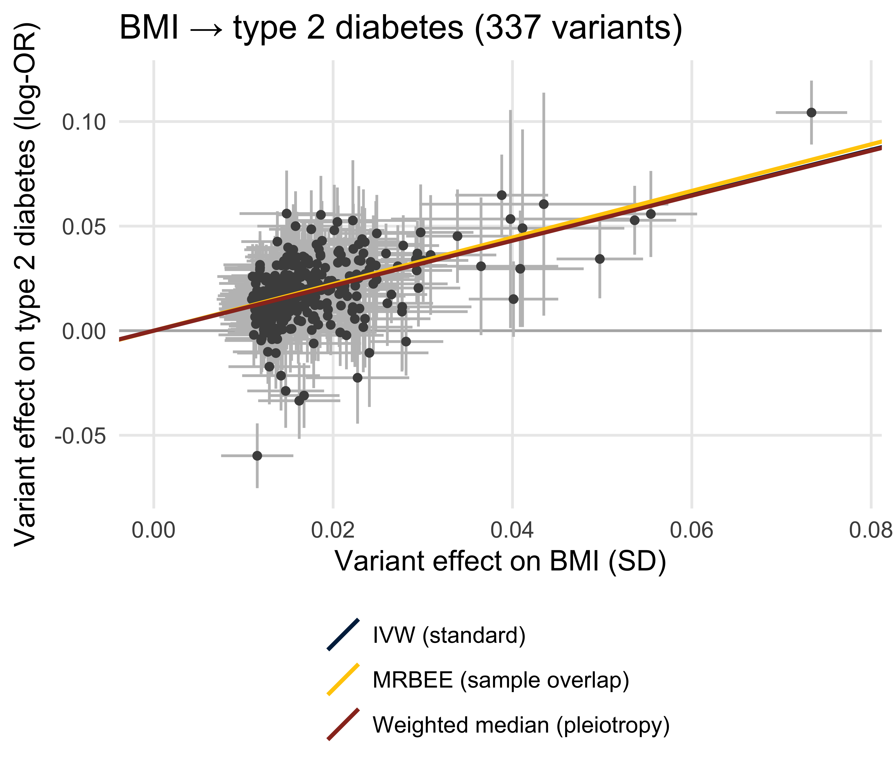
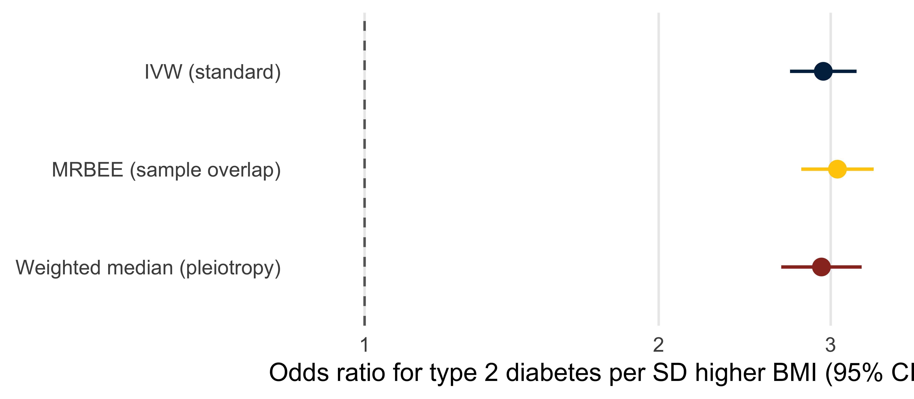
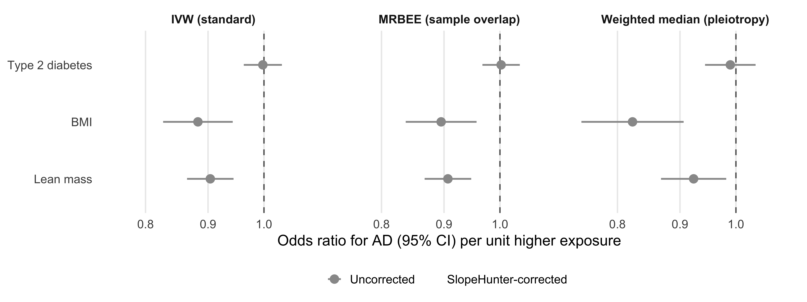
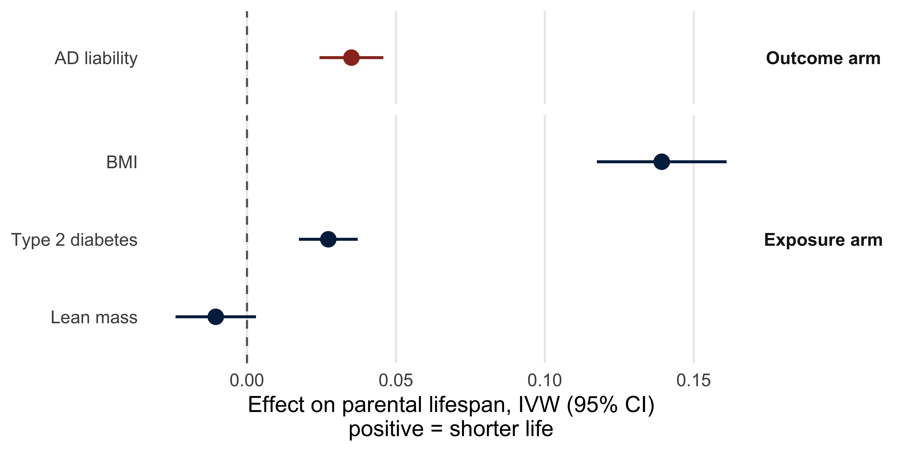
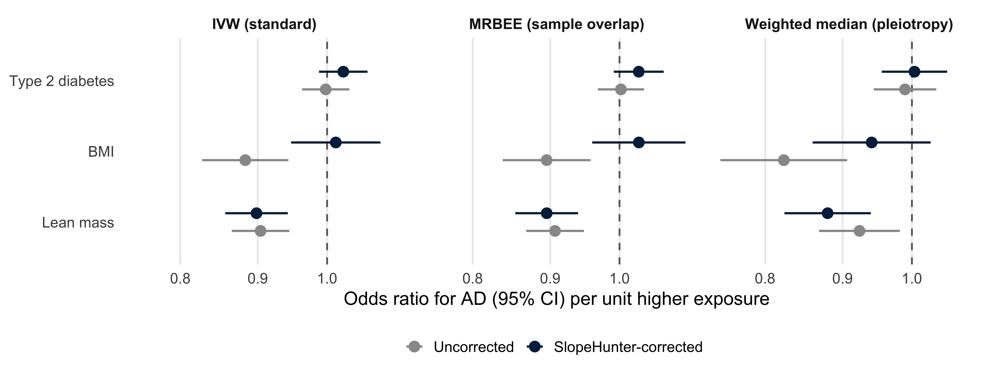
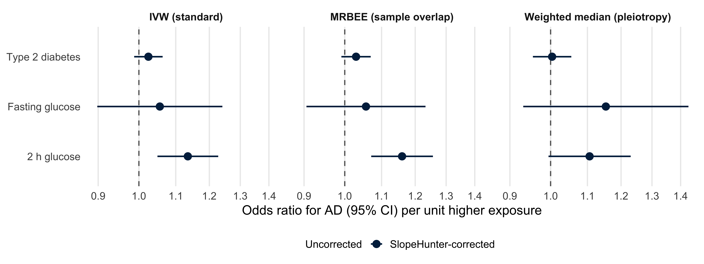
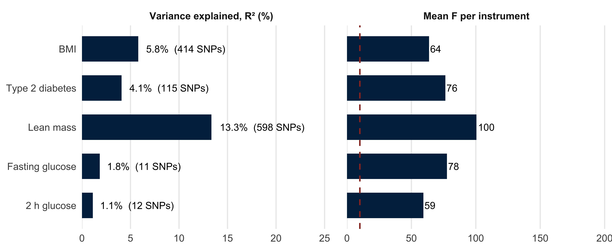
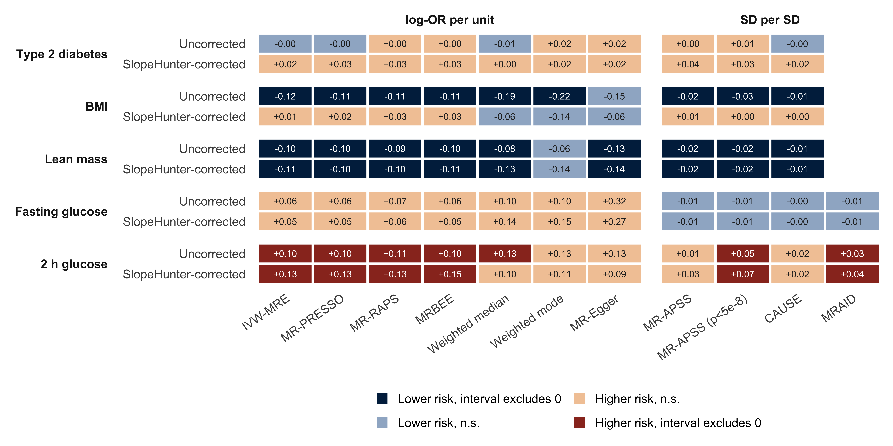

Slide-ready figures, in talk order. Everything is read from `results/pipeline/` (nothing is
recomputed), so the numbers always match `results.csv` and `SUMMARY.md`. Figures are written to
`figures/talk-*.png` / `.pdf`.

**What is shown.** Three methods on a common scale (log-OR per unit of the exposure GWAS, plotted
as odds ratios), one per job: **IVW** (the standard), **MRBEE** (corrects sample overlap and
weak-instrument bias) and **weighted median** (robust to up to half the instrument weight being
pleiotropic). MR-APSS, CAUSE and MRAID are on an SD-per-SD scale and cannot share that axis; they
appear in the concordance grid at the end, which compares all methods on sign and whether the
interval excludes zero.


::: {.cell}

```{.r .cell-code}
library(dplyr)
library(tidyr)
library(readr)
library(ggplot2)
library(knitr)

res_dir <- "results/pipeline"
res  <- read_csv(file.path(res_dir, "results.csv"), show_col_types = FALSE)
inst <- read_csv(file.path(res_dir, "instruments_classical.csv"), show_col_types = FALSE)

# ---- talk settings: edit here ------------------------------------------------------------
talk_methods <- c("IVW-MRE"         = "IVW (standard)",
                  "MRBEE"           = "MRBEE (sample overlap)",
                  "Weighted median" = "Weighted median (pleiotropy)")
method_cols  <- setNames(c("#00274c", "#ffcb05", "#9a3324"), talk_methods)
arm_labels   <- c(raw = "Uncorrected", slopehunter = "SlopeHunter-corrected")
arm_cols     <- setNames(c("grey60", "#00274c"), arm_labels)
short <- c(bmi_ukb = "BMI", fatmass_ukb = "Fat mass", leanmass_pei = "Lean mass",
           ffm_ukb = "Fat-free mass", t2d_xue = "Type 2 diabetes",
           fg_dupuis = "Fasting glucose", glu2h_chen = "2 h glucose")
ad_outcome     <- "ad_bellenguez"
body_exposures <- c("t2d_xue", "bmi_ukb", "leanmass_pei")     # slides 2 and 3
glyc_exposures <- c("t2d_xue", "fg_dupuis", "glu2h_chen")         # slide 4
# -------------------------------------------------------------------------------------------

theme_talk <- theme_minimal(base_size = 16) +
  theme(legend.position = "bottom", panel.grid.minor = element_blank(),
        panel.grid.major.y = element_blank(), strip.text = element_text(face = "bold"))

# Rows for a set of exposures -> one outcome, restricted to the talk methods.
talk_rows <- function(exposures, out, arms = c("raw", "slopehunter")) {
  res |>
    filter(exposure %in% exposures, outcome == out, arm %in% arms, method %in% names(talk_methods)) |>
    mutate(method_label = factor(talk_methods[method], levels = talk_methods),
           arm_label    = factor(arm_labels[arm], levels = arm_labels),
           exposure_label = factor(short[exposure], levels = rev(short[exposures])))
}

# Forest of odds ratios: one panel per method, so agreement across methods reads left to right.
forest_or <- function(dat, xlim, xlab = "Odds ratio for AD (95% CI) per unit higher exposure") {
  ggplot(dat, aes(x = exp(b), xmin = exp(ci_lo), xmax = exp(ci_hi),
                  y = exposure_label, colour = arm_label)) +
    geom_vline(xintercept = 1, linetype = "dashed", colour = "grey40") +
    geom_pointrange(position = position_dodge(width = 0.5), linewidth = 0.9, size = 0.7) +
    facet_wrap(~ method_label, nrow = 1) +
    scale_x_log10(limits = xlim) +
    scale_colour_manual(values = arm_cols, drop = FALSE) +
    labs(x = xlab, y = NULL, colour = NULL) +
    theme_talk
}

fmt_table <- function(dat) {
  dat |>
    arrange(desc(exposure_label), arm_label, method_label) |>
    transmute(Exposure = exposure_label, Arm = arm_label, Method = method,
              `OR (95% CI)` = sprintf("%.2f (%.2f, %.2f)", exp(b), exp(ci_lo), exp(ci_hi)),
              p = signif(p, 2), SNPs = n_snp)
}
```
:::


## 1. Positive control: BMI → type 2 diabetes

A relationship everyone accepts, to show what a clean MR result looks like. Each point is one
BMI-associated variant; the slope of a line through the origin is the causal estimate.


::: {.cell}

```{.r .cell-code}
ctl <- res |>
  filter(exposure == "bmi_ukb", outcome == "t2d_xue", arm == "raw", method %in% names(talk_methods)) |>
  mutate(method_label = factor(talk_methods[method], levels = talk_methods))

# Orient every variant to its BMI-raising allele so the cloud sits in one half-plane.
ctl_snps <- inst |>
  filter(assoc_id == "bmi_ukb__t2d_xue__raw") |>
  mutate(flip = if_else(beta_exposure < 0, -1, 1),
         beta_exposure = beta_exposure * flip, beta_outcome = beta_outcome * flip)
```
:::


::: {.cell}

```{.r .cell-code}
ggplot(ctl_snps, aes(beta_exposure, beta_outcome)) +
  geom_hline(yintercept = 0, colour = "grey70") +
  geom_errorbar(aes(ymin = beta_outcome - 1.96 * se_outcome, ymax = beta_outcome + 1.96 * se_outcome),
                colour = "grey75", width = 0) +
  geom_errorbar(aes(xmin = beta_exposure - 1.96 * se_exposure, xmax = beta_exposure + 1.96 * se_exposure),
                colour = "grey75", width = 0, orientation = "y") +
  geom_point(colour = "grey30", size = 1.6) +
  geom_abline(data = ctl, aes(slope = b, intercept = 0, colour = method_label), linewidth = 1.1) +
  scale_colour_manual(values = method_cols) +
  expand_limits(x = 0) +
  guides(colour = guide_legend(nrow = 3)) +
  labs(x = "Variant effect on BMI (SD)", y = "Variant effect on type 2 diabetes (log-OR)",
       colour = NULL, title = sprintf("BMI → type 2 diabetes (%d variants)", nrow(ctl_snps))) +
  theme_talk + theme(panel.grid.major.y = element_line())
```

::: {.cell-output-display}
{width=2100}
:::
:::


::: {.cell}

```{.r .cell-code}
ggplot(ctl, aes(x = exp(b), xmin = exp(ci_lo), xmax = exp(ci_hi),
                y = forcats::fct_rev(method_label), colour = method_label)) +
  geom_vline(xintercept = 1, linetype = "dashed", colour = "grey40") +
  geom_pointrange(linewidth = 1, size = 0.9) +
  scale_x_log10(limits = c(0.9, NA)) +
  scale_colour_manual(values = method_cols, guide = "none") +
  labs(x = "Odds ratio for type 2 diabetes per SD higher BMI (95% CI)", y = NULL) +
  theme_talk
```

::: {.cell-output-display}
{width=2400}
:::
:::


::: {.cell}

```{.r .cell-code}
ctl |>
  transmute(Method = method, `OR (95% CI)` = sprintf("%.2f (%.2f, %.2f)", exp(b), exp(ci_lo), exp(ci_hi)),
            p = signif(p, 2), SNPs = n_snp) |>
  kable()
```

::: {.cell-output-display}


|Method          |OR (95% CI)       |  p| SNPs|
|:---------------|:-----------------|--:|----:|
|IVW-MRE         |2.95 (2.73, 3.19) |  0|  337|
|MRBEE           |3.05 (2.80, 3.32) |  0|  337|
|Weighted median |2.94 (2.67, 3.23) |  0|  337|


:::
:::


## 2. The paradox: uncorrected estimates for AD

Type 2 diabetes shows nothing, and **both** BMI and lean mass look protective. Higher BMI
protecting against AD is the result that should make the audience suspicious.


::: {.cell}

```{.r .cell-code}
body <- talk_rows(body_exposures, ad_outcome)
# One x-range for slides 2 and 3, so slide 3 is slide 2 with the corrected points added.
body_xlim <- range(exp(c(body$ci_lo, body$ci_hi)))
```
:::


::: {.cell}

```{.r .cell-code}
forest_or(filter(body, arm == "raw"), body_xlim)
```

::: {.cell-output-display}
{width=3600}
:::
:::


## 3. Survival bias and its correction

AD cases have to live long enough to be diagnosed, so anything that shortens life is depleted
among cases and looks protective. SlopeHunter estimates that selection slope from the genome-wide
lifespan–AD relationship and removes it.

### Who survives? Both arms of the collider

Survival is a collider only if **both** the exposure and AD liability affect it. AD liability
shortens parental lifespan, and so do BMI and type 2 diabetes; lean mass does not. That
predicts which estimates the correction should move. IVW only: the AD → lifespan arm comes from
the Step 1 screen (`ad_longevity_arm.csv`), which has standard errors for IVW alone. Units differ
by row (log-odds of AD or T2D, SD of BMI or lean mass), so read direction and whether the interval
excludes zero, not relative size.


::: {.cell}

```{.r .cell-code}
ad_life <- read_csv("ad_longevity_arm.csv", show_col_types = FALSE) |>
  filter(grepl("Bellenguez", exposure), grepl("Martingale", survival)) |>
  transmute(label = "AD liability", arm = "Outcome arm", b, ci_lo = b - 1.96 * se, ci_hi = b + 1.96 * se,
            p, n_snp)

survival <- res |>
  filter(exposure %in% body_exposures, outcome == "lifespan", method == "IVW-MRE") |>
  transmute(label = short[exposure], arm = "Exposure arm", b, ci_lo, ci_hi, p, n_snp) |>
  bind_rows(ad_life) |>
  mutate(label = factor(label, levels = rev(c("AD liability", short[c("bmi_ukb", "t2d_xue", "leanmass_pei")]))),
         arm = factor(arm, levels = c("Outcome arm", "Exposure arm")))
```
:::


::: {.cell}

```{.r .cell-code}
ggplot(survival, aes(x = b, xmin = ci_lo, xmax = ci_hi, y = label, colour = arm)) +
  geom_vline(xintercept = 0, linetype = "dashed", colour = "grey40") +
  geom_pointrange(linewidth = 1, size = 0.9) +
  facet_grid(arm ~ ., scales = "free_y", space = "free_y") +
  scale_colour_manual(values = c("Outcome arm" = "#9a3324", "Exposure arm" = "#00274c"), guide = "none") +
  labs(x = "Effect on parental lifespan, IVW (95% CI)\npositive = shorter life", y = NULL) +
  theme_talk + theme(strip.text.y = element_text(angle = 0))
```

::: {.cell-output-display}
{width=2700}
:::
:::


::: {.cell}

```{.r .cell-code}
survival |>
  arrange(arm, desc(label)) |>
  transmute(Arm = arm, Trait = label, `b (95% CI)` = sprintf("%.3f (%.3f, %.3f)", b, ci_lo, ci_hi),
            p = signif(p, 2), SNPs = n_snp) |>
  kable()
```

::: {.cell-output-display}


|Arm          |Trait           |b (95% CI)             |       p| SNPs|
|:------------|:---------------|:----------------------|-------:|----:|
|Outcome arm  |AD liability    |0.035 (0.024, 0.046)   | 0.0e+00|   54|
|Exposure arm |BMI             |0.139 (0.117, 0.161)   | 0.0e+00|  419|
|Exposure arm |Type 2 diabetes |0.027 (0.017, 0.037)   | 1.0e-07|  109|
|Exposure arm |Lean mass       |-0.010 (-0.024, 0.003) | 1.3e-01|  548|


:::
:::


### Corrected estimates


::: {.cell}

```{.r .cell-code}
forest_or(body, body_xlim)
```

::: {.cell-output-display}
{width=3600}
:::
:::


::: {.cell}

```{.r .cell-code}
kable(fmt_table(body))
```

::: {.cell-output-display}


|Exposure        |Arm                   |Method          |OR (95% CI)       |       p| SNPs|
|:---------------|:---------------------|:---------------|:-----------------|-------:|----:|
|Type 2 diabetes |Uncorrected           |IVW-MRE         |1.00 (0.96, 1.03) | 9.1e-01|  115|
|Type 2 diabetes |Uncorrected           |MRBEE           |1.00 (0.97, 1.04) | 9.0e-01|  115|
|Type 2 diabetes |Uncorrected           |Weighted median |0.99 (0.94, 1.04) | 6.6e-01|  115|
|Type 2 diabetes |SlopeHunter-corrected |IVW-MRE         |1.02 (0.99, 1.06) | 1.9e-01|  109|
|Type 2 diabetes |SlopeHunter-corrected |MRBEE           |1.03 (0.99, 1.07) | 1.3e-01|  109|
|Type 2 diabetes |SlopeHunter-corrected |Weighted median |1.00 (0.96, 1.06) | 8.8e-01|  109|
|BMI             |Uncorrected           |IVW-MRE         |0.88 (0.83, 0.94) | 2.0e-04|  414|
|BMI             |Uncorrected           |MRBEE           |0.90 (0.84, 0.96) | 1.1e-03|  414|
|BMI             |Uncorrected           |Weighted median |0.82 (0.75, 0.91) | 7.3e-05|  414|
|BMI             |SlopeHunter-corrected |IVW-MRE         |1.01 (0.95, 1.08) | 7.0e-01|  403|
|BMI             |SlopeHunter-corrected |MRBEE           |1.03 (0.96, 1.11) | 4.2e-01|  403|
|BMI             |SlopeHunter-corrected |Weighted median |0.94 (0.86, 1.03) | 1.8e-01|  403|
|Lean mass       |Uncorrected           |IVW-MRE         |0.90 (0.87, 0.94) | 6.0e-06|  598|
|Lean mass       |Uncorrected           |MRBEE           |0.91 (0.87, 0.95) | 1.2e-05|  598|
|Lean mass       |Uncorrected           |Weighted median |0.92 (0.87, 0.98) | 1.1e-02|  598|
|Lean mass       |SlopeHunter-corrected |IVW-MRE         |0.90 (0.86, 0.94) | 9.6e-06|  531|
|Lean mass       |SlopeHunter-corrected |MRBEE           |0.90 (0.85, 0.94) | 5.4e-06|  531|
|Lean mass       |SlopeHunter-corrected |Weighted median |0.88 (0.82, 0.94) | 1.3e-04|  531|


:::
:::


## 4. Glycemic traits → AD, SlopeHunter-corrected


::: {.cell}

```{.r .cell-code}
glyc <- talk_rows(glyc_exposures, ad_outcome)
forest_or(filter(glyc, arm == "slopehunter"), range(exp(c(glyc$ci_lo, glyc$ci_hi))))
```

::: {.cell-output-display}
{width=3600}
:::
:::


::: {.cell}

```{.r .cell-code}
kable(fmt_table(glyc))
```

::: {.cell-output-display}


|Exposure        |Arm                   |Method          |OR (95% CI)       |       p| SNPs|
|:---------------|:---------------------|:---------------|:-----------------|-------:|----:|
|Type 2 diabetes |Uncorrected           |IVW-MRE         |1.00 (0.96, 1.03) | 0.91000|  115|
|Type 2 diabetes |Uncorrected           |MRBEE           |1.00 (0.97, 1.04) | 0.90000|  115|
|Type 2 diabetes |Uncorrected           |Weighted median |0.99 (0.94, 1.04) | 0.66000|  115|
|Type 2 diabetes |SlopeHunter-corrected |IVW-MRE         |1.02 (0.99, 1.06) | 0.19000|  109|
|Type 2 diabetes |SlopeHunter-corrected |MRBEE           |1.03 (0.99, 1.07) | 0.13000|  109|
|Type 2 diabetes |SlopeHunter-corrected |Weighted median |1.00 (0.96, 1.06) | 0.88000|  109|
|Fasting glucose |Uncorrected           |IVW-MRE         |1.06 (0.91, 1.25) | 0.43000|   11|
|Fasting glucose |Uncorrected           |MRBEE           |1.07 (0.93, 1.22) | 0.36000|   11|
|Fasting glucose |Uncorrected           |Weighted median |1.10 (0.89, 1.36) | 0.36000|   11|
|Fasting glucose |SlopeHunter-corrected |IVW-MRE         |1.06 (0.90, 1.24) | 0.51000|   11|
|Fasting glucose |SlopeHunter-corrected |MRBEE           |1.06 (0.91, 1.23) | 0.48000|   11|
|Fasting glucose |SlopeHunter-corrected |Weighted median |1.15 (0.93, 1.43) | 0.19000|   11|
|2 h glucose     |Uncorrected           |IVW-MRE         |1.10 (1.01, 1.21) | 0.03500|   12|
|2 h glucose     |Uncorrected           |MRBEE           |1.11 (1.00, 1.22) | 0.04100|   12|
|2 h glucose     |Uncorrected           |Weighted median |1.14 (1.03, 1.27) | 0.01400|   12|
|2 h glucose     |SlopeHunter-corrected |IVW-MRE         |1.14 (1.05, 1.23) | 0.00160|   12|
|2 h glucose     |SlopeHunter-corrected |MRBEE           |1.16 (1.07, 1.26) | 0.00027|   12|
|2 h glucose     |SlopeHunter-corrected |Weighted median |1.11 (0.99, 1.23) | 0.06300|   12|


:::
:::


## Instrument strength

For the genome-wide-significant (p < 5×10⁻⁸) instrument sets behind the three plotted methods,
as used for the Bellenguez AD outcome. **F** is strength per instrument and governs weak-instrument
bias (conventional floor of 10); **R²** is the share of exposure variance the whole set explains
and governs power. Every exposure clears F > 10 comfortably. They differ in R² and in instrument
count, which is why the glucose intervals are wide. R² for type 2 diabetes is converted from the
observed case/control scale to the **liability scale** (Lee et al. 2011), so it is comparable with
the continuous traits and with heritability; the conversion depends on the assumed population
prevalence set below. F is scale-free and is unchanged.


::: {.cell}

```{.r .cell-code}
strength_exposures <- unique(c("bmi_ukb", body_exposures, glyc_exposures))
# Binary exposures: observed-scale R² -> liability scale. VERIFY the counts against the GWAS paper
# and choose the prevalence deliberately; the factor is about 2.8 at 8% and 3.1 at 10%.
binary_exposures <- tibble::tibble(exposure = "t2d_xue", n_case = 62892, n_control = 596424,
                                   prevalence = 0.10)
liability_factor <- function(K, P) {
  z <- dnorm(qnorm(1 - K))                 # normal density at the liability threshold
  K^2 * (1 - K)^2 / (z^2 * P * (1 - P))    # K = population prevalence, P = sample case fraction
}

strength <- res |>
  filter(exposure %in% strength_exposures, outcome == ad_outcome, arm == "raw", method == "IVW-MRE") |>
  left_join(binary_exposures, by = "exposure") |>
  mutate(R2_observed = R2,
         R2 = R2 * coalesce(liability_factor(prevalence, n_case / (n_case + n_control)), 1)) |>
  transmute(exposure_label = factor(short[exposure], levels = rev(short[strength_exposures])),
            n_snp, `Variance explained, R² (%)` = 100 * R2, `Mean F per instrument` = mean_F,
            total_F, N_exposure, R2_observed, binary = !is.na(prevalence))
```
:::


::: {.cell}

```{.r .cell-code}
strength |>
  pivot_longer(c(`Variance explained, R² (%)`, `Mean F per instrument`), names_to = "metric") |>
  mutate(metric = factor(metric, levels = c("Variance explained, R² (%)", "Mean F per instrument")),
         label = if_else(metric == "Mean F per instrument", sprintf("%.0f", value),
                         sprintf("%.1f%%  (%d SNPs)", value, n_snp))) |>
  ggplot(aes(value, exposure_label)) +
  geom_col(fill = "#00274c", width = 0.65) +
  geom_vline(data = data.frame(metric = factor("Mean F per instrument"), x = 10),
             aes(xintercept = x), linetype = "dashed", colour = "#9a3324", linewidth = 0.9) +
  geom_text(aes(label = label), hjust = -0.1, size = 4.5) +
  facet_wrap(~ metric, scales = "free_x") +
  scale_x_continuous(expand = expansion(mult = c(0, 1))) +
  labs(x = NULL, y = NULL) +
  theme_talk
```

::: {.cell-output-display}
{width=3300}
:::
:::


::: {.cell}

```{.r .cell-code}
strength |>
  arrange(desc(exposure_label)) |>
  transmute(Exposure = exposure_label, SNPs = n_snp, `GWAS N` = N_exposure,
            `R² (%)` = round(`Variance explained, R² (%)`, 2),
            `R² observed scale (%)` = if_else(binary, as.character(round(100 * R2_observed, 2)), "—"),
            `Mean F` = round(`Mean F per instrument`, 1), `Overall F` = round(total_F, 1)) |>
  kable()
```

::: {.cell-output-display}


|Exposure        | SNPs| GWAS N| R² (%)|R² observed scale (%) | Mean F| Overall F|
|:---------------|----:|------:|------:|:---------------------|------:|---------:|
|BMI             |  414| 454884|   5.80|—                     |   63.7|      67.6|
|Type 2 diabetes |  115| 655666|   4.08|1.34                  |   76.4|      77.4|
|Lean mass       |  598| 450243|  13.34|—                     |  100.5|     115.7|
|Fasting glucose |   11|  46368|   1.84|—                     |   77.6|      78.8|
|2 h glucose     |   12|  63396|   1.12|—                     |   59.3|      59.9|


:::
:::


## 5. Concordance across every method

The three methods above share a scale. This grid adds the rest (MR-APSS, CAUSE and MRAID are
SD-per-SD), comparing them the only way that is valid across scales: direction, and whether the
95% interval excludes zero. Blank cells were not run for that pair.


::: {.cell}

```{.r .cell-code}
grid_methods <- c("IVW-MRE", "MR-PRESSO", "MR-RAPS", "MRBEE", "Weighted median", "Weighted mode",
                  "MR-Egger", "MR-APSS", "MR-APSS (p<5e-8)", "CAUSE", "MRAID")
grid_exposures <- unique(c(body_exposures, glyc_exposures))
calls <- c("Lower risk, interval excludes 0", "Lower risk, n.s.",
           "Higher risk, n.s.", "Higher risk, interval excludes 0")

conc <- res |>
  filter(exposure %in% grid_exposures, outcome == ad_outcome, method %in% grid_methods) |>
  mutate(excl = ci_lo * ci_hi > 0,
         call = factor(case_when(b < 0 & excl ~ calls[1], b < 0 ~ calls[2],
                                 b >= 0 & !excl ~ calls[3], TRUE ~ calls[4]), levels = calls),
         method = factor(method, levels = grid_methods),
         family = if_else(grepl("^SD", scale), "SD per SD", "log-OR per unit"),
         arm_label = factor(arm_labels[arm], levels = rev(arm_labels)),
         exposure_label = factor(short[exposure], levels = short[grid_exposures]))

ggplot(conc, aes(method, arm_label, fill = call)) +
  geom_tile(colour = "white", linewidth = 1.2) +
  geom_text(aes(label = sprintf("%+.2f", b), colour = excl), size = 3.4, show.legend = FALSE) +
  facet_grid(exposure_label ~ family, scales = "free_x", space = "free_x", switch = "y") +
  scale_fill_manual(values = setNames(c("#00274c", "#9fb4cc", "#f2c9a5", "#9a3324"), calls), drop = FALSE) +
  scale_colour_manual(values = c(`TRUE` = "white", `FALSE` = "grey15")) +
  guides(fill = guide_legend(nrow = 2)) +
  labs(x = NULL, y = NULL, fill = NULL) +
  theme_talk +
  theme(axis.text.x = element_text(angle = 35, hjust = 1), strip.placement = "outside",
        strip.text.y.left = element_text(angle = 0, hjust = 1), panel.grid = element_blank())
```

::: {.cell-output-display}
{width=3900}
:::
:::


::: {.cell}

```{.r .cell-code}
conc |>
  group_by(Exposure = exposure_label, Arm = arm_label) |>
  summarise(Methods = n(),
            `Lower risk` = sum(b < 0), `Higher risk` = sum(b >= 0),
            `Interval excludes 0` = sum(excl), .groups = "drop") |>
  arrange(Exposure, desc(Arm)) |>
  kable()
```

::: {.cell-output-display}


|Exposure        |Arm                   | Methods| Lower risk| Higher risk| Interval excludes 0|
|:---------------|:---------------------|-------:|----------:|-----------:|-------------------:|
|Type 2 diabetes |Uncorrected           |      10|          4|           6|                   0|
|Type 2 diabetes |SlopeHunter-corrected |      10|          0|          10|                   0|
|BMI             |Uncorrected           |      10|         10|           0|                   9|
|BMI             |SlopeHunter-corrected |      10|          3|           7|                   0|
|Lean mass       |Uncorrected           |      10|         10|           0|                   9|
|Lean mass       |SlopeHunter-corrected |      10|         10|           0|                   9|
|Fasting glucose |Uncorrected           |      11|          4|           7|                   0|
|Fasting glucose |SlopeHunter-corrected |      11|          4|           7|                   0|
|2 h glucose     |Uncorrected           |      11|          0|          11|                   7|
|2 h glucose     |SlopeHunter-corrected |      11|          0|          11|                   6|


:::
:::

