Slide-ready figures, in talk order. Everything is read from `results/pipeline/` (nothing is
recomputed), so the numbers always match `results.csv` and `SUMMARY.md`. Figures are written to
`figures/talk-*.png` / `.pdf`.

**What is shown.** Three methods on a common scale (log-OR per unit of the exposure GWAS, plotted
as odds ratios), one per job: **IVW** (the standard), **MRBEE** (corrects sample overlap and
weak-instrument bias) and **weighted median** (robust to up to half the instrument weight being
pleiotropic). MR-APSS, CAUSE and MRAID are on an SD-per-SD scale and cannot share that axis; they
appear in the concordance grid at the end, which compares all methods on sign and whether the
interval excludes zero.


::: {.cell}

```{.r .cell-code}
library(dplyr)
library(tidyr)
library(readr)
library(ggplot2)
library(knitr)

res_dir <- "results/pipeline"
res  <- read_csv(file.path(res_dir, "results.csv"), show_col_types = FALSE)
inst <- read_csv(file.path(res_dir, "instruments_classical.csv"), show_col_types = FALSE)

# ---- talk settings: edit here ------------------------------------------------------------
talk_methods <- c("IVW-MRE"         = "IVW (standard)",
                  "MRBEE"           = "MRBEE (sample overlap)",
                  "Weighted median" = "Weighted median (pleiotropy)")
method_cols  <- setNames(c("#00274c", "#ffcb05", "#9a3324"), talk_methods)
arm_labels   <- c(raw = "Uncorrected", slopehunter = "SlopeHunter-corrected")
arm_cols     <- setNames(c("grey60", "#00274c"), arm_labels)
short <- c(bmi_ukb = "BMI", fatmass_ukb = "Fat mass", leanmass_pei = "Lean mass",
           ffm_ukb = "Fat-free mass", t2d_xue = "Type 2 diabetes",
           fg_dupuis = "Fasting glucose", glu2h_chen = "2 h glucose")
ad_outcome     <- "ad_bellenguez"
body_exposures <- c("t2d_xue", "bmi_ukb", "leanmass_pei")     # slides 2 and 3
glyc_exposures <- c("t2d_xue", "fg_dupuis", "glu2h_chen")         # slide 4
# -------------------------------------------------------------------------------------------

theme_talk <- theme_minimal(base_size = 16) +
  theme(legend.position = "bottom", panel.grid.minor = element_blank(),
        panel.grid.major.y = element_blank(), strip.text = element_text(face = "bold"))

# Rows for a set of exposures -> one outcome, restricted to the talk methods.
talk_rows <- function(exposures, out, arms = c("raw", "slopehunter")) {
  res |>
    filter(exposure %in% exposures, outcome == out, arm %in% arms, method %in% names(talk_methods)) |>
    mutate(method_label = factor(talk_methods[method], levels = talk_methods),
           arm_label    = factor(arm_labels[arm], levels = arm_labels),
           exposure_label = factor(short[exposure], levels = rev(short[exposures])))
}

# Forest of odds ratios: one panel per method, so agreement across methods reads left to right.
forest_or <- function(dat, xlim, xlab = "Odds ratio for AD (95% CI) per unit higher exposure") {
  ggplot(dat, aes(x = exp(b), xmin = exp(ci_lo), xmax = exp(ci_hi),
                  y = exposure_label, colour = arm_label)) +
    geom_vline(xintercept = 1, linetype = "dashed", colour = "grey40") +
    geom_pointrange(position = position_dodge(width = 0.5), linewidth = 0.9, size = 0.7) +
    facet_wrap(~ method_label, nrow = 1) +
    scale_x_log10(limits = xlim) +
    scale_colour_manual(values = arm_cols, drop = FALSE) +
    labs(x = xlab, y = NULL, colour = NULL) +
    theme_talk
}

fmt_table <- function(dat) {
  dat |>
    arrange(desc(exposure_label), arm_label, method_label) |>
    transmute(Exposure = exposure_label, Arm = arm_label, Method = method,
              `OR (95% CI)` = sprintf("%.2f (%.2f, %.2f)", exp(b), exp(ci_lo), exp(ci_hi)),
              p = signif(p, 2), SNPs = n_snp)
}
```
:::


## 1. Positive control: BMI → type 2 diabetes

A relationship everyone accepts, to show what a clean MR result looks like. Each point is one
BMI-associated variant; the slope of a line through the origin is the causal estimate.


::: {.cell}

```{.r .cell-code}
ctl <- res |>
  filter(exposure == "bmi_ukb", outcome == "t2d_xue", arm == "raw", method %in% names(talk_methods)) |>
  mutate(method_label = factor(talk_methods[method], levels = talk_methods))

# Orient every variant to its BMI-raising allele so the cloud sits in one half-plane.
ctl_snps <- inst |>
  filter(assoc_id == "bmi_ukb__t2d_xue__raw") |>
  mutate(flip = if_else(beta_exposure < 0, -1, 1),
         beta_exposure = beta_exposure * flip, beta_outcome = beta_outcome * flip)
```
:::


::: {.cell}

```{.r .cell-code}
ggplot(ctl_snps, aes(beta_exposure, beta_outcome)) +
  geom_hline(yintercept = 0, colour = "grey70") +
  geom_errorbar(aes(ymin = beta_outcome - 1.96 * se_outcome, ymax = beta_outcome + 1.96 * se_outcome),
                colour = "grey75", width = 0) +
  geom_errorbar(aes(xmin = beta_exposure - 1.96 * se_exposure, xmax = beta_exposure + 1.96 * se_exposure),
                colour = "grey75", width = 0, orientation = "y") +
  geom_point(colour = "grey30", size = 1.6) +
  geom_abline(data = ctl, aes(slope = b, intercept = 0, colour = method_label), linewidth = 1.1) +
  scale_colour_manual(values = method_cols) +
  expand_limits(x = 0) +
  guides(colour = guide_legend(nrow = 3)) +
  labs(x = "Variant effect on BMI (SD)", y = "Variant effect on type 2 diabetes (log-OR)",
       colour = NULL, title = sprintf("BMI → type 2 diabetes (%d variants)", nrow(ctl_snps))) +
  theme_talk + theme(panel.grid.major.y = element_line())
```

::: {.cell-output-display}
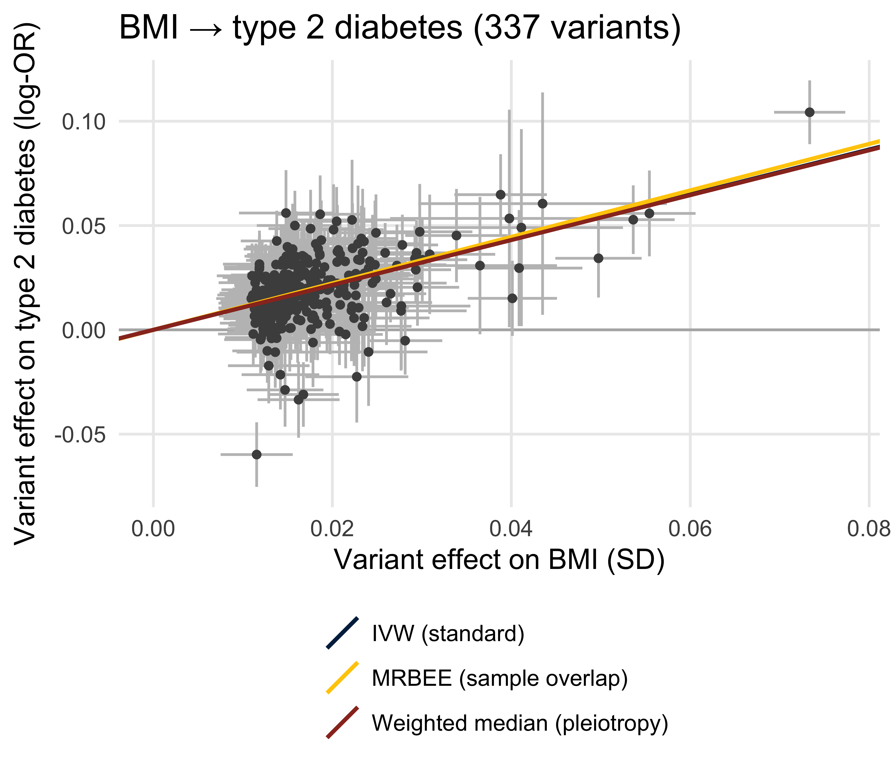{width=2100}
:::
:::


::: {.cell}

```{.r .cell-code}
ggplot(ctl, aes(x = exp(b), xmin = exp(ci_lo), xmax = exp(ci_hi),
                y = forcats::fct_rev(method_label), colour = method_label)) +
  geom_vline(xintercept = 1, linetype = "dashed", colour = "grey40") +
  geom_pointrange(linewidth = 1, size = 0.9) +
  scale_x_log10(limits = c(0.9, NA)) +
  scale_colour_manual(values = method_cols, guide = "none") +
  labs(x = "Odds ratio for type 2 diabetes per SD higher BMI (95% CI)", y = NULL) +
  theme_talk
```

::: {.cell-output-display}
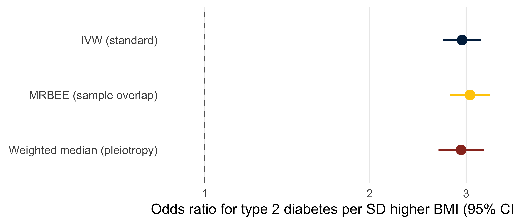{width=2400}
:::
:::


::: {.cell}

```{.r .cell-code}
ctl |>
  transmute(Method = method, `OR (95% CI)` = sprintf("%.2f (%.2f, %.2f)", exp(b), exp(ci_lo), exp(ci_hi)),
            p = signif(p, 2), SNPs = n_snp) |>
  kable()
```

::: {.cell-output-display}


|Method          |OR (95% CI)       |  p| SNPs|
|:---------------|:-----------------|--:|----:|
|IVW-MRE         |2.95 (2.73, 3.19) |  0|  337|
|MRBEE           |3.05 (2.80, 3.32) |  0|  337|
|Weighted median |2.94 (2.67, 3.23) |  0|  337|


:::
:::


## 2. The paradox: uncorrected estimates for AD

Type 2 diabetes shows nothing, and **both** BMI and lean mass look protective. Higher BMI
protecting against AD is the result that should make the audience suspicious.


::: {.cell}

```{.r .cell-code}
body <- talk_rows(body_exposures, ad_outcome)
# One x-range for slides 2 and 3, so slide 3 is slide 2 with the corrected points added.
body_xlim <- range(exp(c(body$ci_lo, body$ci_hi)))
```
:::


::: {.cell}

```{.r .cell-code}
forest_or(filter(body, arm == "raw"), body_xlim)
```

::: {.cell-output-display}
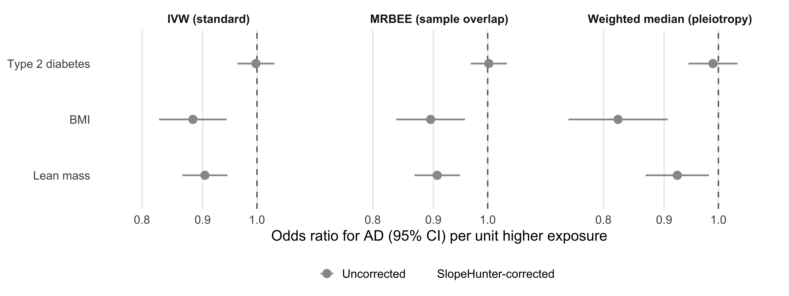{width=3600}
:::
:::


## 3. Survival bias and its correction

AD cases have to live long enough to be diagnosed, so anything that shortens life is depleted
among cases and looks protective. SlopeHunter estimates that selection slope from the genome-wide
lifespan–AD relationship and removes it.

### Who survives? Both arms of the collider

Survival is a collider only if **both** the exposure and AD liability affect it. AD liability
shortens parental lifespan, and so do BMI and type 2 diabetes; lean mass does not. That
predicts which estimates the correction should move. IVW only: the AD → lifespan arm comes from
the Step 1 screen (`ad_longevity_arm.csv`), which has standard errors for IVW alone. Units differ
by row (log-odds of AD or T2D, SD of BMI or lean mass), so read direction and whether the interval
excludes zero, not relative size.


::: {.cell}

```{.r .cell-code}
ad_life <- read_csv("ad_longevity_arm.csv", show_col_types = FALSE) |>
  filter(grepl("Bellenguez", exposure), grepl("Martingale", survival)) |>
  transmute(label = "AD liability", arm = "Outcome arm", b, ci_lo = b - 1.96 * se, ci_hi = b + 1.96 * se,
            p, n_snp)

survival <- res |>
  filter(exposure %in% body_exposures, outcome == "lifespan", method == "IVW-MRE") |>
  transmute(label = short[exposure], arm = "Exposure arm", b, ci_lo, ci_hi, p, n_snp) |>
  bind_rows(ad_life) |>
  mutate(label = factor(label, levels = rev(c("AD liability", short[c("bmi_ukb", "t2d_xue", "leanmass_pei")]))),
         arm = factor(arm, levels = c("Outcome arm", "Exposure arm")))
```
:::


::: {.cell}

```{.r .cell-code}
ggplot(survival, aes(x = b, xmin = ci_lo, xmax = ci_hi, y = label, colour = arm)) +
  geom_vline(xintercept = 0, linetype = "dashed", colour = "grey40") +
  geom_pointrange(linewidth = 1, size = 0.9) +
  facet_grid(arm ~ ., scales = "free_y", space = "free_y") +
  scale_colour_manual(values = c("Outcome arm" = "#9a3324", "Exposure arm" = "#00274c"), guide = "none") +
  labs(x = "Effect on parental lifespan, IVW (95% CI)\npositive = shorter life", y = NULL) +
  theme_talk + theme(strip.text.y = element_text(angle = 0))
```

::: {.cell-output-display}
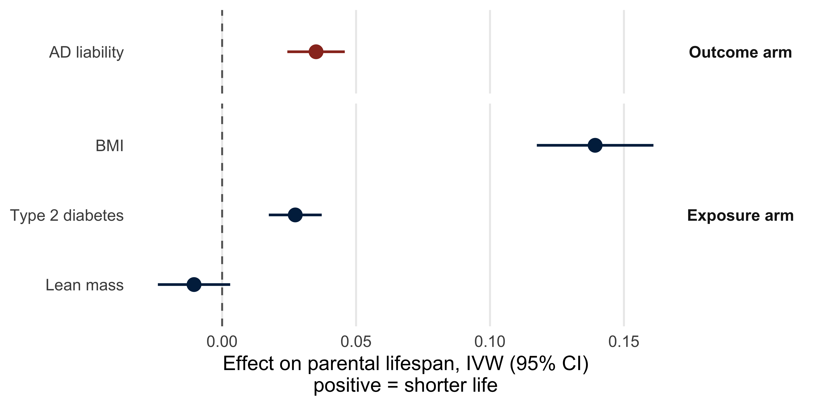{width=2700}
:::
:::


::: {.cell}

```{.r .cell-code}
survival |>
  arrange(arm, desc(label)) |>
  transmute(Arm = arm, Trait = label, `b (95% CI)` = sprintf("%.3f (%.3f, %.3f)", b, ci_lo, ci_hi),
            p = signif(p, 2), SNPs = n_snp) |>
  kable()
```

::: {.cell-output-display}


|Arm          |Trait           |b (95% CI)             |       p| SNPs|
|:------------|:---------------|:----------------------|-------:|----:|
|Outcome arm  |AD liability    |0.035 (0.024, 0.046)   | 0.0e+00|   54|
|Exposure arm |BMI             |0.139 (0.117, 0.161)   | 0.0e+00|  419|
|Exposure arm |Type 2 diabetes |0.027 (0.017, 0.037)   | 1.0e-07|  109|
|Exposure arm |Lean mass       |-0.010 (-0.024, 0.003) | 1.3e-01|  548|


:::
:::


### Corrected estimates


::: {.cell}

```{.r .cell-code}
forest_or(body, body_xlim)
```

::: {.cell-output-display}
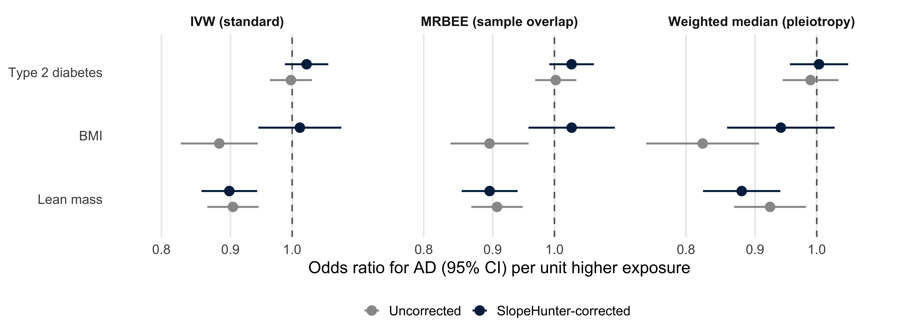{width=3600}
:::
:::


::: {.cell}

```{.r .cell-code}
kable(fmt_table(body))
```

::: {.cell-output-display}


|Exposure        |Arm                   |Method          |OR (95% CI)       |       p| SNPs|
|:---------------|:---------------------|:---------------|:-----------------|-------:|----:|
|Type 2 diabetes |Uncorrected           |IVW-MRE         |1.00 (0.96, 1.03) | 9.1e-01|  115|
|Type 2 diabetes |Uncorrected           |MRBEE           |1.00 (0.97, 1.04) | 9.0e-01|  115|
|Type 2 diabetes |Uncorrected           |Weighted median |0.99 (0.94, 1.04) | 6.6e-01|  115|
|Type 2 diabetes |SlopeHunter-corrected |IVW-MRE         |1.02 (0.99, 1.06) | 1.9e-01|  109|
|Type 2 diabetes |SlopeHunter-corrected |MRBEE           |1.03 (0.99, 1.07) | 1.3e-01|  109|
|Type 2 diabetes |SlopeHunter-corrected |Weighted median |1.00 (0.96, 1.06) | 8.8e-01|  109|
|BMI             |Uncorrected           |IVW-MRE         |0.88 (0.83, 0.94) | 2.0e-04|  414|
|BMI             |Uncorrected           |MRBEE           |0.90 (0.84, 0.96) | 1.1e-03|  414|
|BMI             |Uncorrected           |Weighted median |0.82 (0.75, 0.91) | 7.3e-05|  414|
|BMI             |SlopeHunter-corrected |IVW-MRE         |1.01 (0.95, 1.08) | 7.0e-01|  403|
|BMI             |SlopeHunter-corrected |MRBEE           |1.03 (0.96, 1.11) | 4.2e-01|  403|
|BMI             |SlopeHunter-corrected |Weighted median |0.94 (0.86, 1.03) | 1.8e-01|  403|
|Lean mass       |Uncorrected           |IVW-MRE         |0.90 (0.87, 0.94) | 6.0e-06|  598|
|Lean mass       |Uncorrected           |MRBEE           |0.91 (0.87, 0.95) | 1.2e-05|  598|
|Lean mass       |Uncorrected           |Weighted median |0.92 (0.87, 0.98) | 1.1e-02|  598|
|Lean mass       |SlopeHunter-corrected |IVW-MRE         |0.90 (0.86, 0.94) | 9.6e-06|  531|
|Lean mass       |SlopeHunter-corrected |MRBEE           |0.90 (0.85, 0.94) | 5.4e-06|  531|
|Lean mass       |SlopeHunter-corrected |Weighted median |0.88 (0.82, 0.94) | 1.3e-04|  531|


:::
:::


## 4. Glycemic traits → AD, SlopeHunter-corrected


::: {.cell}

```{.r .cell-code}
glyc <- talk_rows(glyc_exposures, ad_outcome)
forest_or(filter(glyc, arm == "slopehunter"), range(exp(c(glyc$ci_lo, glyc$ci_hi))))
```

::: {.cell-output-display}
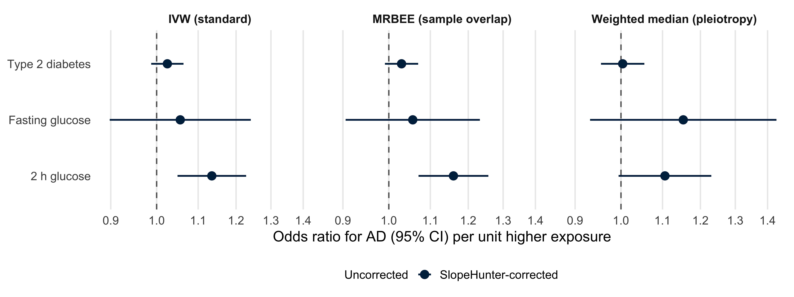{width=3600}
:::
:::


::: {.cell}

```{.r .cell-code}
kable(fmt_table(glyc))
```

::: {.cell-output-display}


|Exposure        |Arm                   |Method          |OR (95% CI)       |       p| SNPs|
|:---------------|:---------------------|:---------------|:-----------------|-------:|----:|
|Type 2 diabetes |Uncorrected           |IVW-MRE         |1.00 (0.96, 1.03) | 0.91000|  115|
|Type 2 diabetes |Uncorrected           |MRBEE           |1.00 (0.97, 1.04) | 0.90000|  115|
|Type 2 diabetes |Uncorrected           |Weighted median |0.99 (0.94, 1.04) | 0.66000|  115|
|Type 2 diabetes |SlopeHunter-corrected |IVW-MRE         |1.02 (0.99, 1.06) | 0.19000|  109|
|Type 2 diabetes |SlopeHunter-corrected |MRBEE           |1.03 (0.99, 1.07) | 0.13000|  109|
|Type 2 diabetes |SlopeHunter-corrected |Weighted median |1.00 (0.96, 1.06) | 0.88000|  109|
|Fasting glucose |Uncorrected           |IVW-MRE         |1.06 (0.91, 1.25) | 0.43000|   11|
|Fasting glucose |Uncorrected           |MRBEE           |1.07 (0.93, 1.22) | 0.36000|   11|
|Fasting glucose |Uncorrected           |Weighted median |1.10 (0.89, 1.36) | 0.36000|   11|
|Fasting glucose |SlopeHunter-corrected |IVW-MRE         |1.06 (0.90, 1.24) | 0.51000|   11|
|Fasting glucose |SlopeHunter-corrected |MRBEE           |1.06 (0.91, 1.23) | 0.48000|   11|
|Fasting glucose |SlopeHunter-corrected |Weighted median |1.15 (0.93, 1.43) | 0.19000|   11|
|2 h glucose     |Uncorrected           |IVW-MRE         |1.10 (1.01, 1.21) | 0.03500|   12|
|2 h glucose     |Uncorrected           |MRBEE           |1.11 (1.00, 1.22) | 0.04100|   12|
|2 h glucose     |Uncorrected           |Weighted median |1.14 (1.03, 1.27) | 0.01400|   12|
|2 h glucose     |SlopeHunter-corrected |IVW-MRE         |1.14 (1.05, 1.23) | 0.00160|   12|
|2 h glucose     |SlopeHunter-corrected |MRBEE           |1.16 (1.07, 1.26) | 0.00027|   12|
|2 h glucose     |SlopeHunter-corrected |Weighted median |1.11 (0.99, 1.23) | 0.06300|   12|


:::
:::


## Instrument strength

For the genome-wide-significant (p < 5×10⁻⁸) instrument sets behind the three plotted methods,
as used for the Bellenguez AD outcome. **F** is strength per instrument and governs weak-instrument
bias (conventional floor of 10); **R²** is the share of exposure variance the whole set explains
and governs power. Every exposure clears F > 10 comfortably. They differ in R² and in instrument
count, which is why the glucose intervals are wide. R² for type 2 diabetes is converted from the
observed case/control scale to the **liability scale** (Lee et al. 2011), so it is comparable with
the continuous traits and with heritability; the conversion depends on the assumed population
prevalence set below. F is scale-free and is unchanged.


::: {.cell}

```{.r .cell-code}
strength_exposures <- unique(c("bmi_ukb", body_exposures, glyc_exposures))
# Binary exposures: observed-scale R² -> liability scale. VERIFY the counts against the GWAS paper
# and choose the prevalence deliberately; the factor is about 2.8 at 8% and 3.1 at 10%.
binary_exposures <- tibble::tibble(exposure = "t2d_xue", n_case = 62892, n_control = 596424,
                                   prevalence = 0.10)
liability_factor <- function(K, P) {
  z <- dnorm(qnorm(1 - K))                 # normal density at the liability threshold
  K^2 * (1 - K)^2 / (z^2 * P * (1 - P))    # K = population prevalence, P = sample case fraction
}

strength <- res |>
  filter(exposure %in% strength_exposures, outcome == ad_outcome, arm == "raw", method == "IVW-MRE") |>
  left_join(binary_exposures, by = "exposure") |>
  mutate(R2_observed = R2,
         R2 = R2 * coalesce(liability_factor(prevalence, n_case / (n_case + n_control)), 1)) |>
  transmute(exposure_label = factor(short[exposure], levels = rev(short[strength_exposures])),
            n_snp, `Variance explained, R² (%)` = 100 * R2, `Mean F per instrument` = mean_F,
            total_F, N_exposure, R2_observed, binary = !is.na(prevalence))
```
:::


::: {.cell}

```{.r .cell-code}
strength |>
  pivot_longer(c(`Variance explained, R² (%)`, `Mean F per instrument`), names_to = "metric") |>
  mutate(metric = factor(metric, levels = c("Variance explained, R² (%)", "Mean F per instrument")),
         label = if_else(metric == "Mean F per instrument", sprintf("%.0f", value),
                         sprintf("%.1f%%  (%d SNPs)", value, n_snp))) |>
  ggplot(aes(value, exposure_label)) +
  geom_col(fill = "#00274c", width = 0.65) +
  geom_vline(data = data.frame(metric = factor("Mean F per instrument"), x = 10),
             aes(xintercept = x), linetype = "dashed", colour = "#9a3324", linewidth = 0.9) +
  geom_text(aes(label = label), hjust = -0.1, size = 4.5) +
  facet_wrap(~ metric, scales = "free_x") +
  scale_x_continuous(expand = expansion(mult = c(0, 1))) +
  labs(x = NULL, y = NULL) +
  theme_talk
```

::: {.cell-output-display}
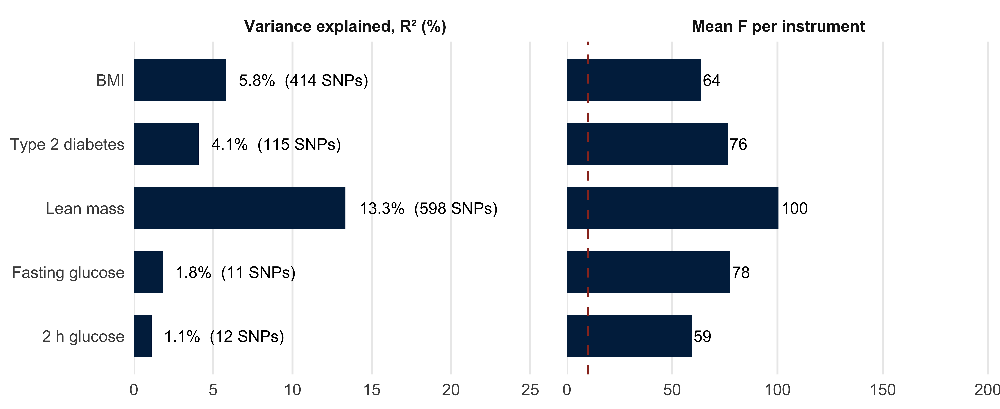{width=3300}
:::
:::


::: {.cell}

```{.r .cell-code}
strength |>
  arrange(desc(exposure_label)) |>
  transmute(Exposure = exposure_label, SNPs = n_snp, `GWAS N` = N_exposure,
            `R² (%)` = round(`Variance explained, R² (%)`, 2),
            `R² observed scale (%)` = if_else(binary, as.character(round(100 * R2_observed, 2)), "—"),
            `Mean F` = round(`Mean F per instrument`, 1), `Overall F` = round(total_F, 1)) |>
  kable()
```

::: {.cell-output-display}


|Exposure        | SNPs| GWAS N| R² (%)|R² observed scale (%) | Mean F| Overall F|
|:---------------|----:|------:|------:|:---------------------|------:|---------:|
|BMI             |  414| 454884|   5.80|—                     |   63.7|      67.6|
|Type 2 diabetes |  115| 655666|   4.08|1.34                  |   76.4|      77.4|
|Lean mass       |  598| 450243|  13.34|—                     |  100.5|     115.7|
|Fasting glucose |   11|  46368|   1.84|—                     |   77.6|      78.8|
|2 h glucose     |   12|  63396|   1.12|—                     |   59.3|      59.9|


:::
:::


## 5. Concordance across every method

The three methods above share a scale. This grid adds the rest (MR-APSS, CAUSE and MRAID are
SD-per-SD), comparing them the only way that is valid across scales: direction, and whether the
95% interval excludes zero. Blank cells were not run for that pair.


::: {.cell}

```{.r .cell-code}
grid_methods <- c("IVW-MRE", "MR-PRESSO", "MR-RAPS", "MRBEE", "Weighted median", "Weighted mode",
                  "MR-Egger", "MR-APSS", "MR-APSS (p<5e-8)", "CAUSE", "MRAID")
grid_exposures <- unique(c(body_exposures, glyc_exposures))
calls <- c("Lower risk, interval excludes 0", "Lower risk, n.s.",
           "Higher risk, n.s.", "Higher risk, interval excludes 0")

conc <- res |>
  filter(exposure %in% grid_exposures, outcome == ad_outcome, method %in% grid_methods) |>
  mutate(excl = ci_lo * ci_hi > 0,
         call = factor(case_when(b < 0 & excl ~ calls[1], b < 0 ~ calls[2],
                                 b >= 0 & !excl ~ calls[3], TRUE ~ calls[4]), levels = calls),
         method = factor(method, levels = grid_methods),
         family = if_else(grepl("^SD", scale), "SD per SD", "log-OR per unit"),
         arm_label = factor(arm_labels[arm], levels = rev(arm_labels)),
         exposure_label = factor(short[exposure], levels = short[grid_exposures]))

ggplot(conc, aes(method, arm_label, fill = call)) +
  geom_tile(colour = "white", linewidth = 1.2) +
  geom_text(aes(label = sprintf("%+.2f", b), colour = excl), size = 3.4, show.legend = FALSE) +
  facet_grid(exposure_label ~ family, scales = "free_x", space = "free_x", switch = "y") +
  scale_fill_manual(values = setNames(c("#00274c", "#9fb4cc", "#f2c9a5", "#9a3324"), calls), drop = FALSE) +
  scale_colour_manual(values = c(`TRUE` = "white", `FALSE` = "grey15")) +
  guides(fill = guide_legend(nrow = 2)) +
  labs(x = NULL, y = NULL, fill = NULL) +
  theme_talk +
  theme(axis.text.x = element_text(angle = 35, hjust = 1), strip.placement = "outside",
        strip.text.y.left = element_text(angle = 0, hjust = 1), panel.grid = element_blank())
```

::: {.cell-output-display}
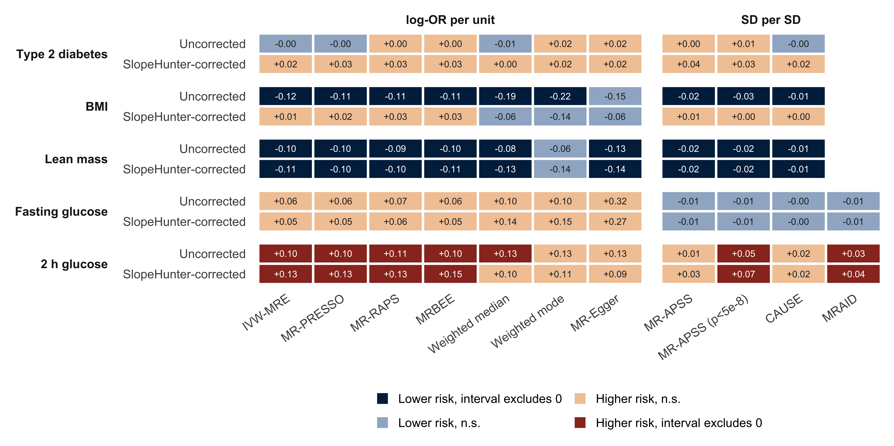{width=3900}
:::
:::


::: {.cell}

```{.r .cell-code}
conc |>
  group_by(Exposure = exposure_label, Arm = arm_label) |>
  summarise(Methods = n(),
            `Lower risk` = sum(b < 0), `Higher risk` = sum(b >= 0),
            `Interval excludes 0` = sum(excl), .groups = "drop") |>
  arrange(Exposure, desc(Arm)) |>
  kable()
```

::: {.cell-output-display}


|Exposure        |Arm                   | Methods| Lower risk| Higher risk| Interval excludes 0|
|:---------------|:---------------------|-------:|----------:|-----------:|-------------------:|
|Type 2 diabetes |Uncorrected           |      10|          4|           6|                   0|
|Type 2 diabetes |SlopeHunter-corrected |      10|          0|          10|                   0|
|BMI             |Uncorrected           |      10|         10|           0|                   9|
|BMI             |SlopeHunter-corrected |      10|          3|           7|                   0|
|Lean mass       |Uncorrected           |      10|         10|           0|                   9|
|Lean mass       |SlopeHunter-corrected |      10|         10|           0|                   9|
|Fasting glucose |Uncorrected           |      11|          4|           7|                   0|
|Fasting glucose |SlopeHunter-corrected |      11|          4|           7|                   0|
|2 h glucose     |Uncorrected           |      11|          0|          11|                   7|
|2 h glucose     |SlopeHunter-corrected |      11|          0|          11|                   6|


:::
:::


## 6. Is 2 h glucose different from fasting glucose?

Sections 6–8 read `results/pipeline/contrast/` (the fasting vs 2 h glucose extension; see
`pipeline/README.md`). Instruments are T2D-associated variants; each variant's effects on fasting
and 2 h glucose (Chen 2021, both BMI-adjusted) enter one multivariable model, so each estimate is
adjusted for the other. The outcome is SlopeHunter-corrected Bellenguez AD.

**Which instrument set.** The figure shows the **Xue 2018** T2D instruments (109 variants), a
pre-declared sensitivity set. The pre-specified primary set (Suzuki 2024, 273 variants) points the
same way but is not significant; both are in the table. The larger set adds many variants with
almost no effect on 2 h glucose.

### How the model works

**Instruments.** Variants associated with type 2 diabetes at $p < 5\times10^{-8}$, clumped to
independence ($r^2 < 0.001$ within 10 Mb), with variants within 500 kb of *APOE* removed. For each
variant $j = 1,\dots,J$ we take three numbers from three different studies, all aligned to the
T2D risk-raising allele:

- $\hat\beta_{Fj}$: effect on fasting glucose (mmol/L, Chen 2021)
- $\hat\beta_{2j}$: effect on 2 h glucose (mmol/L, Chen 2021)
- $\hat\beta_{Yj}$: effect on AD (log-odds, Bellenguez 2022 after SlopeHunter correction)

Selecting on T2D rather than on either glucose trait means the variants were not chosen for being
strong on fasting or on 2 h glucose specifically, and the T2D GWAS is a different study from the
glucose GWAS, so selection does not inflate the glucose effects.

**Model (multivariable MR).** Each variant's effect on AD is modelled as the sum of what it does
through fasting glucose and what it does through 2 h glucose:

$$
\hat\beta_{Yj} \;=\; \theta_F\,\hat\beta_{Fj} \;+\; \theta_2\,\hat\beta_{2j} \;+\; \varepsilon_j,
\qquad \varepsilon_j \sim N\!\left(0,\ \phi\,\sigma_{Yj}^2\right)
$$

with no intercept and $\sigma_{Yj}$ the standard error of $\hat\beta_{Yj}$. $\theta_2$ is the effect
on AD of 1 mmol/L higher 2 h glucose **at fixed fasting glucose**, and $\theta_F$ the reverse; the
plot shows $e^{\theta}$ as odds ratios. This is identified only because the variants differ in their
*mix* of fasting and 2 h effects (see the validation figure below): if every variant moved the two
in the same proportion, $\theta_F$ and $\theta_2$ could not be told apart.

**Is 2 h different from fasting?** The headline test is the difference, with its standard error
from the full covariance of the two estimates (they are strongly negatively correlated, so comparing
their two confidence intervals would be wrong):

$$
\Delta = \theta_2 - \theta_F, \qquad
\operatorname{SE}(\hat\Delta) = \sqrt{\operatorname{Var}(\hat\theta_2) + \operatorname{Var}(\hat\theta_F) - 2\operatorname{Cov}(\hat\theta_2, \hat\theta_F)}
$$

In the plot, $e^{\Delta}$ is the ratio of the two odds ratios.

**Two estimators.**

- *IVW (multiplicative random effects).* Weighted least squares of $\hat\beta_{Yj}$ on
  $(\hat\beta_{Fj}, \hat\beta_{2j})$ with weights $1/\sigma_{Yj}^2$; standard errors scaled by
  $\sqrt{\phi}$, the residual standard error, floored at 1. It treats the glucose effects as known
  exactly, so noise in them (weak instruments) biases the estimates; in the multivariable setting the
  bias can go in either direction.
- *MRBEE (bias-corrected estimating equations).* Subtracts the expected contribution of that noise.
  With $\mathbf{x}_j = (\hat\beta_{Fj}, \hat\beta_{2j})^\top$, weights $w_j = 1/\sigma_{Yj}^2$ and
  $\boldsymbol\Sigma_j$ the covariance of the estimation errors in $\mathbf{x}_j$ (built from their
  standard errors and the fasting/2 h error correlation, $\rho = 0.11$, which comes from the shared
  MAGIC cohorts),

$$
\hat{\boldsymbol\theta}_{\text{MRBEE}} \;=\; \Big(\textstyle\sum_j w_j\big(\mathbf{x}_j\mathbf{x}_j^\top - \boldsymbol\Sigma_j\big)\Big)^{-1}
\textstyle\sum_j w_j\big(\mathbf{x}_j\,\hat\beta_{Yj} - \boldsymbol\sigma_{xY,j}\big)
$$

  where $\boldsymbol\sigma_{xY,j}$ is the error covariance between the glucose and AD estimates
  (near zero here: about 0.003). It also removes variants flagged as pleiotropic outliers.

**Instrument strength (conditional F).** The usual F asks whether the variants predict an exposure;
the multivariable question is whether they predict it **beyond what the other exposure explains**.
The Sanderson–Windmeijer conditional F for 2 h glucose regresses the 2 h effects on the fasting
effects and asks how much variation is left over, relative to its noise:

$$
F_{2\mid F} \;=\; \frac{1}{J-1}\sum_j
\frac{\big(\hat\beta_{2j} - \hat\delta\,\hat\beta_{Fj}\big)^2}
{\sigma_{2j}^2 + \hat\delta^2\sigma_{Fj}^2 - 2\hat\delta\,\rho\,\sigma_{2j}\sigma_{Fj}}
$$

where $\hat\delta$ is the fitted slope of $\hat\beta_{2j}$ on $\hat\beta_{Fj}$. Values above 10 are
the conventional comfort zone. For the Xue set $F_{F\mid 2} = 14.2$ and $F_{2\mid F} = 5.6$; for the
Suzuki set 11.1 and 4.1. Fasting glucose is well separated from 2 h glucose, but 2 h glucose is
only weakly separated from fasting, which is why MRBEE is the estimator to trust.


::: {.cell}

```{.r .cell-code}
con_dir <- file.path(res_dir, "contrast")
con     <- read_csv(file.path(con_dir, "results.csv"), show_col_types = FALSE)
con_cl  <- read_csv(file.path(con_dir, "cluster_results.csv"), show_col_types = FALSE)
con_dt  <- read_csv(file.path(con_dir, "drug_target_results.csv"), show_col_types = FALSE)

# ---- settings for sections 6-8: edit here ---------------------------------------------------
con_set     <- "xue"            # instrument set plotted in section 6 ("primary" = Suzuki 2024)
con_arm     <- "slopehunter"    # outcome arm for all three sections
con_scale   <- "per mmol/L"
con_methods <- c("IVW-MRE" = "IVW (standard)", "MRBEE" = "MRBEE (weak instruments, overlap)")
con_cols    <- setNames(c("#00274c", "#ffcb05"), con_methods)
# AD outcomes with display labels; Uffelmann 2026 added post-freeze as replication (raw only:
# SlopeHunter is not identified for either file)
con_outcomes <- tibble::tribble(
  ~outcome,            ~arm,          ~dataset,
  "ad_bellenguez",     "slopehunter", "Bellenguez (SlopeHunter-corrected)",
  "ad_kunkle",         "raw",         "Kunkle (clinical)",
  "ad_uffelmann_newc", "raw",         "Uffelmann 2026, new cohorts (independent)",
  "ad_uffelmann_cc",   "raw",         "Uffelmann 2026, clinical only")
# Pre-specified primary outcome and the replication cohort (shares no cohorts with Bellenguez)
rep_outcomes <- con_outcomes[c(1, 3), ]
rep_cols     <- setNames(c("#00274c", "#2F65A7"), rep_outcomes$dataset)
rep_forest <- function(d, xlab, caption = NULL) {
  ggplot(d, aes(x = exp(b), xmin = exp(b - 1.96 * se), xmax = exp(b + 1.96 * se), y = label, colour = dataset)) +
    geom_vline(xintercept = 1, linetype = "dashed", colour = "grey40") +
    geom_pointrange(position = position_dodge(width = -0.6), linewidth = 0.9, size = 0.6) +
    scale_x_log10() +
    scale_colour_manual(values = rep_cols, breaks = rep_outcomes$dataset) +
    labs(x = xlab, y = NULL, colour = NULL, caption = caption) +
    theme_talk
}
mv_terms    <- c(fg = "Fasting glucose\n(adjusted for 2 h glucose)",
                 glu2h = "2 h glucose\n(adjusted for fasting glucose)",
                 `glu2h - fg` = "Difference\n(2 h minus fasting)")
# ---------------------------------------------------------------------------------------------

mv <- con |>
  filter(outcome == ad_outcome, arm == con_arm, step == "1 MVMR", scale == con_scale,
         estimator %in% names(con_methods)) |>
  mutate(ci_lo = b - 1.96 * se, ci_hi = b + 1.96 * se,
         method_label = factor(con_methods[estimator], levels = con_methods),
         term_label = factor(mv_terms[term], levels = rev(mv_terms)))
```
:::


::: {.cell}

```{.r .cell-code}
mv |>
  filter(set == con_set) |>
  ggplot(aes(x = exp(b), xmin = exp(ci_lo), xmax = exp(ci_hi), y = term_label, colour = method_label)) +
  geom_vline(xintercept = 1, linetype = "dashed", colour = "grey40") +
  geom_pointrange(position = position_dodge(width = 0.5), linewidth = 0.9, size = 0.7) +
  scale_x_log10(breaks = c(0.7, 0.8, 1, 1.25, 1.5, 1.75)) +
  scale_colour_manual(values = con_cols) +
  labs(x = "Odds ratio for AD per mmol/L higher glucose (95% CI)\nDifference row: ratio of the two odds ratios",
       y = NULL, colour = NULL) +
  theme_talk
```

::: {.cell-output-display}
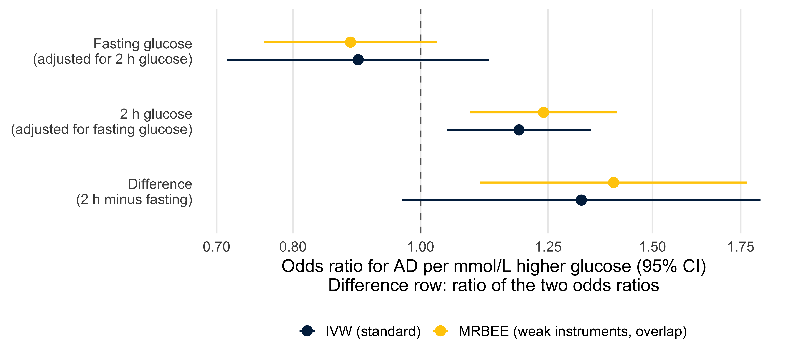{width=3000}
:::
:::


::: {.cell}

```{.r .cell-code}
mv |>
  filter(set %in% c("xue", "primary")) |>
  arrange(desc(set), method_label, desc(term_label)) |>
  transmute(`Instruments` = c(xue = "Xue 2018 (plotted)", primary = "Suzuki 2024 (pre-specified primary)")[set],
            Method = estimator, Term = gsub("\n", " ", term_label),
            `OR (95% CI)` = sprintf("%.2f (%.2f, %.2f)", exp(b), exp(ci_lo), exp(ci_hi)),
            p = signif(p, 2), SNPs = n_snp) |>
  kable()
```

::: {.cell-output-display}


|Instruments                         |Method  |Term                                       |OR (95% CI)       |      p| SNPs|
|:-----------------------------------|:-------|:------------------------------------------|:-----------------|------:|----:|
|Xue 2018 (plotted)                  |IVW-MRE |Fasting glucose (adjusted for 2 h glucose) |0.90 (0.71, 1.13) | 0.3500|  109|
|Xue 2018 (plotted)                  |IVW-MRE |2 h glucose (adjusted for fasting glucose) |1.19 (1.05, 1.35) | 0.0073|  109|
|Xue 2018 (plotted)                  |IVW-MRE |Difference (2 h minus fasting)             |1.32 (0.97, 1.81) | 0.0780|  109|
|Xue 2018 (plotted)                  |MRBEE   |Fasting glucose (adjusted for 2 h glucose) |0.88 (0.76, 1.03) | 0.1100|  109|
|Xue 2018 (plotted)                  |MRBEE   |2 h glucose (adjusted for fasting glucose) |1.24 (1.09, 1.41) | 0.0011|  109|
|Xue 2018 (plotted)                  |MRBEE   |Difference (2 h minus fasting)             |1.40 (1.11, 1.77) | 0.0046|  109|
|Suzuki 2024 (pre-specified primary) |IVW-MRE |Fasting glucose (adjusted for 2 h glucose) |1.03 (0.87, 1.23) | 0.7000|  273|
|Suzuki 2024 (pre-specified primary) |IVW-MRE |2 h glucose (adjusted for fasting glucose) |1.05 (0.97, 1.13) | 0.2400|  273|
|Suzuki 2024 (pre-specified primary) |IVW-MRE |Difference (2 h minus fasting)             |1.01 (0.81, 1.26) | 0.9000|  273|
|Suzuki 2024 (pre-specified primary) |MRBEE   |Fasting glucose (adjusted for 2 h glucose) |1.02 (0.84, 1.23) | 0.8600|  273|
|Suzuki 2024 (pre-specified primary) |MRBEE   |2 h glucose (adjusted for fasting glucose) |1.09 (0.97, 1.21) | 0.1500|  273|
|Suzuki 2024 (pre-specified primary) |MRBEE   |Difference (2 h minus fasting)             |1.07 (0.81, 1.40) | 0.6400|  273|


:::
:::


### Replication in an independent AD GWAS

The same model (Xue instruments) with AD from Uffelmann 2026 (PGC-ALZ3, Nature), added after the
outcome-blind freeze. The **new-cohorts** meta-analysis contains only cohorts that were not in
earlier AD GWAS, so it shares no participants with Bellenguez or Kunkle and is the independent test.
The **clinical-only** analysis is larger (about 70,000 cases, no family-history proxies) but overlaps
Bellenguez's cohorts. SlopeHunter could not be estimated for either file, so both are uncorrected.
One caution: the new cohorts include the Million Veteran Program, which is also in the T2D GWAS used
to select the instruments.


::: {.cell}

```{.r .cell-code}
mv_rep <- con |>
  filter(set == con_set, step == "1 MVMR", scale == con_scale, estimator %in% names(con_methods)) |>
  inner_join(con_outcomes, by = c("outcome", "arm")) |>
  mutate(ci_lo = b - 1.96 * se, ci_hi = b + 1.96 * se,
         method_label = factor(con_methods[estimator], levels = con_methods),
         term_label = factor(mv_terms[term], levels = mv_terms),
         dataset = factor(dataset, levels = rev(con_outcomes$dataset)))
```
:::


::: {.cell}

```{.r .cell-code}
mv_rep |>
  filter(term != "glu2h - fg") |>        # difference is in the table
  ggplot(aes(x = exp(b), xmin = exp(ci_lo), xmax = exp(ci_hi), y = dataset, colour = method_label)) +
  geom_vline(xintercept = 1, linetype = "dashed", colour = "grey40") +
  geom_pointrange(position = position_dodge(width = 0.5), linewidth = 0.9, size = 0.6) +
  facet_wrap(~ term_label, nrow = 1) +
  scale_x_log10(breaks = c(0.5, 0.7, 1, 1.4, 2)) +
  scale_colour_manual(values = con_cols) +
  labs(x = "Odds ratio for AD per mmol/L higher glucose (95% CI)", y = NULL, colour = NULL,
       caption = "Xue 2018 T2D instruments; glucose effects from Chen 2021 (BMI-adjusted).") +
  theme_talk
```

::: {.cell-output-display}
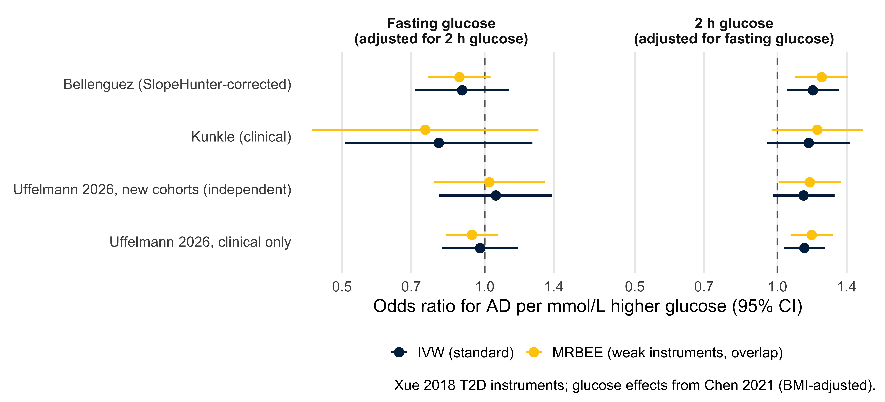{width=3300}
:::
:::


::: {.cell}

```{.r .cell-code}
mv_rep |>
  arrange(desc(dataset), method_label, term_label) |>
  transmute(`AD dataset` = dataset, Method = estimator, Term = gsub("\n", " ", term_label),
            `OR (95% CI)` = sprintf("%.2f (%.2f, %.2f)", exp(b), exp(ci_lo), exp(ci_hi)),
            p = signif(p, 2), SNPs = n_snp) |>
  kable()
```

::: {.cell-output-display}


|AD dataset                                |Method  |Term                                       |OR (95% CI)       |      p| SNPs|
|:-----------------------------------------|:-------|:------------------------------------------|:-----------------|------:|----:|
|Bellenguez (SlopeHunter-corrected)        |IVW-MRE |Fasting glucose (adjusted for 2 h glucose) |0.90 (0.71, 1.13) | 0.3500|  109|
|Bellenguez (SlopeHunter-corrected)        |IVW-MRE |2 h glucose (adjusted for fasting glucose) |1.19 (1.05, 1.35) | 0.0073|  109|
|Bellenguez (SlopeHunter-corrected)        |IVW-MRE |Difference (2 h minus fasting)             |1.32 (0.97, 1.81) | 0.0780|  109|
|Bellenguez (SlopeHunter-corrected)        |MRBEE   |Fasting glucose (adjusted for 2 h glucose) |0.88 (0.76, 1.03) | 0.1100|  109|
|Bellenguez (SlopeHunter-corrected)        |MRBEE   |2 h glucose (adjusted for fasting glucose) |1.24 (1.09, 1.41) | 0.0011|  109|
|Bellenguez (SlopeHunter-corrected)        |MRBEE   |Difference (2 h minus fasting)             |1.40 (1.11, 1.77) | 0.0046|  109|
|Kunkle (clinical)                         |IVW-MRE |Fasting glucose (adjusted for 2 h glucose) |0.80 (0.51, 1.26) | 0.3400|  109|
|Kunkle (clinical)                         |IVW-MRE |2 h glucose (adjusted for fasting glucose) |1.16 (0.95, 1.42) | 0.1400|  109|
|Kunkle (clinical)                         |IVW-MRE |Difference (2 h minus fasting)             |1.45 (0.80, 2.66) | 0.2200|  109|
|Kunkle (clinical)                         |MRBEE   |Fasting glucose (adjusted for 2 h glucose) |0.75 (0.43, 1.30) | 0.3000|  109|
|Kunkle (clinical)                         |MRBEE   |2 h glucose (adjusted for fasting glucose) |1.21 (0.97, 1.52) | 0.0880|  109|
|Kunkle (clinical)                         |MRBEE   |Difference (2 h minus fasting)             |1.62 (0.78, 3.35) | 0.1900|  109|
|Uffelmann 2026, new cohorts (independent) |IVW-MRE |Fasting glucose (adjusted for 2 h glucose) |1.06 (0.80, 1.39) | 0.7000|  100|
|Uffelmann 2026, new cohorts (independent) |IVW-MRE |2 h glucose (adjusted for fasting glucose) |1.14 (0.98, 1.32) | 0.0970|  100|
|Uffelmann 2026, new cohorts (independent) |IVW-MRE |Difference (2 h minus fasting)             |1.08 (0.73, 1.58) | 0.7100|  100|
|Uffelmann 2026, new cohorts (independent) |MRBEE   |Fasting glucose (adjusted for 2 h glucose) |1.02 (0.78, 1.34) | 0.8700|  100|
|Uffelmann 2026, new cohorts (independent) |MRBEE   |2 h glucose (adjusted for fasting glucose) |1.17 (1.01, 1.36) | 0.0420|  100|
|Uffelmann 2026, new cohorts (independent) |MRBEE   |Difference (2 h minus fasting)             |1.14 (0.77, 1.70) | 0.5100|  100|
|Uffelmann 2026, clinical only             |IVW-MRE |Fasting glucose (adjusted for 2 h glucose) |0.98 (0.81, 1.18) | 0.8100|  115|
|Uffelmann 2026, clinical only             |IVW-MRE |2 h glucose (adjusted for fasting glucose) |1.14 (1.03, 1.26) | 0.0092|  115|
|Uffelmann 2026, clinical only             |IVW-MRE |Difference (2 h minus fasting)             |1.17 (0.91, 1.50) | 0.2300|  115|
|Uffelmann 2026, clinical only             |MRBEE   |Fasting glucose (adjusted for 2 h glucose) |0.94 (0.83, 1.07) | 0.3400|  115|
|Uffelmann 2026, clinical only             |MRBEE   |2 h glucose (adjusted for fasting glucose) |1.18 (1.07, 1.31) | 0.0014|  115|
|Uffelmann 2026, clinical only             |MRBEE   |Difference (2 h minus fasting)             |1.26 (1.02, 1.54) | 0.0280|  115|


:::
:::


**Reading the replication.** The 2 h glucose effect, adjusted for fasting glucose, replicates. In the
independent new cohorts, MRBEE gives OR 1.17 (1.01, 1.36) per mmol/L (p = 0.04; IVW 1.14, 0.98–1.32),
a little smaller than in Bellenguez (1.24); in the clinical-only file it is 1.18 (1.07, 1.31). Fasting
glucose, adjusted for 2 h glucose, is null in every dataset (ORs 0.88–1.06). What does **not**
replicate in the independent cohorts is the formal difference between the two: 1.14 (0.77, 1.70),
against 1.40 (1.11, 1.77) in Bellenguez. The fasting estimate there is imprecise and slightly above 1,
so the data cannot yet show that 2 h glucose matters *more* than fasting glucose, only that 2 h glucose
has an effect at fixed fasting glucose and fasting glucose shows none at fixed 2 h glucose. The
clinical-only file supports the difference (1.26, 1.02–1.54) but is not independent of Bellenguez.

### Validation: are the two exposures separable, and what does "adjusted" look like?

Two checks on the plotted (Xue) instrument set.

**Left: the instruments vary their mix.** Each point is a variant's effect on fasting glucose
against its effect on 2 h glucose. If all points lay on one line through the origin, the model could
not separate the two traits. They are correlated ($r$ shown) but spread widely, including variants
that move 2 h glucose with little effect on fasting glucose; that spread is what the conditional F
measures.

**Right: the added-variable plot for 2 h glucose.** Both the AD effects and the 2 h effects are
regressed on the fasting effects (same weights as the model), and the residuals are plotted against
each other. By the Frisch–Waugh–Lovell theorem the slope through these residuals is exactly the IVW
estimate of $\theta_2$, so this panel is what "2 h glucose adjusted for fasting glucose" means:
what is left of each variant's 2 h effect once its fasting effect is accounted for, against what is
left of its AD effect. Point size is the weight ($1/\sigma_{Yj}^2$). The line is the IVW slope;
MRBEE corrects that slope for noise in the glucose effects, so it is somewhat steeper.


::: {.cell}

```{.r .cell-code}
val <- read_csv(file.path(con_dir, "instrument_outcome_data.csv"), show_col_types = FALSE) |>
  filter(set == con_set, outcome == ad_outcome, arm == con_arm) |>
  mutate(w = 1 / se_y^2)
val_strength <- read_csv(file.path(con_dir, "step0_strength.csv"), show_col_types = FALSE) |>
  filter(set == con_set)

# Frisch-Waugh-Lovell: residualise AD and 2 h effects on the fasting effects (weighted, no intercept);
# the slope of one set of residuals on the other is the multivariable IVW coefficient for 2 h glucose.
val <- val |>
  mutate(resid_y  = resid(lm(beta_y ~ 0 + beta_fg, weights = w)),
         resid_2h = resid(lm(beta_2h ~ 0 + beta_fg, weights = w)))
fwl_slope <- coef(lm(resid_y ~ 0 + resid_2h, data = val, weights = w))[[1]]
mv_slope  <- coef(lm(beta_y ~ 0 + beta_fg + beta_2h, data = val, weights = w))[["beta_2h"]]
stopifnot(abs(fwl_slope - mv_slope) < 1e-10)   # the added-variable slope IS the MVMR estimate
mrbee_2h <- mv |> filter(set == con_set, estimator == "MRBEE", term == "glu2h") |> pull(b)
```
:::


::: {.cell}

```{.r .cell-code}
p_mix <- ggplot(val, aes(beta_fg, beta_2h)) +
  geom_hline(yintercept = 0, colour = "grey70") + geom_vline(xintercept = 0, colour = "grey70") +
  geom_errorbar(aes(ymin = beta_2h - 1.96 * se_2h, ymax = beta_2h + 1.96 * se_2h), colour = "grey80", width = 0) +
  geom_errorbar(aes(xmin = beta_fg - 1.96 * se_fg, xmax = beta_fg + 1.96 * se_fg), colour = "grey80",
                width = 0, orientation = "y") +
  geom_point(colour = "#00274c", size = 1.8) +
  annotate("text", x = Inf, y = -Inf, hjust = 1.02, vjust = -0.3, size = 4.2, lineheight = 0.95,
           label = sprintf("r = %.2f\nConditional F, 2 h | fasting = %.1f\nConditional F, fasting | 2 h = %.1f",
                           cor(val$beta_fg, val$beta_2h), val_strength$cond_F_2h, val_strength$cond_F_fg)) +
  labs(x = "Effect on fasting glucose (mmol/L)", y = "Effect on 2 h glucose (mmol/L)",
       title = "Instruments vary their fasting / 2 h mix") +
  theme_talk + theme(panel.grid.major.y = element_line(), plot.title = element_text(size = 15))

p_avp <- ggplot(val, aes(resid_2h, resid_y)) +
  geom_hline(yintercept = 0, colour = "grey70") + geom_vline(xintercept = 0, colour = "grey70") +
  geom_point(aes(size = w), colour = "#00274c", alpha = 0.7, show.legend = FALSE) +
  geom_abline(aes(slope = fwl_slope, intercept = 0, colour = "IVW"), linewidth = 1.1) +
  geom_abline(aes(slope = mrbee_2h, intercept = 0, colour = "MRBEE"), linewidth = 1.1, linetype = "dashed") +
  scale_size_area(max_size = 4) +
  scale_colour_manual(values = c(IVW = "#00274c", MRBEE = "#ffcb05"),
                      labels = c(IVW = sprintf("IVW slope = %.3f", fwl_slope),
                                 MRBEE = sprintf("MRBEE = %.3f", mrbee_2h))) +
  labs(x = "2 h glucose effect beyond fasting (mmol/L)",
       y = "AD effect beyond fasting (log-OR)", colour = NULL,
       title = "2 h glucose adjusted for fasting glucose") +
  theme_talk + theme(panel.grid.major.y = element_line(), plot.title = element_text(size = 15))

patchwork::wrap_plots(p_mix, p_avp, nrow = 1)
```

::: {.cell-output-display}
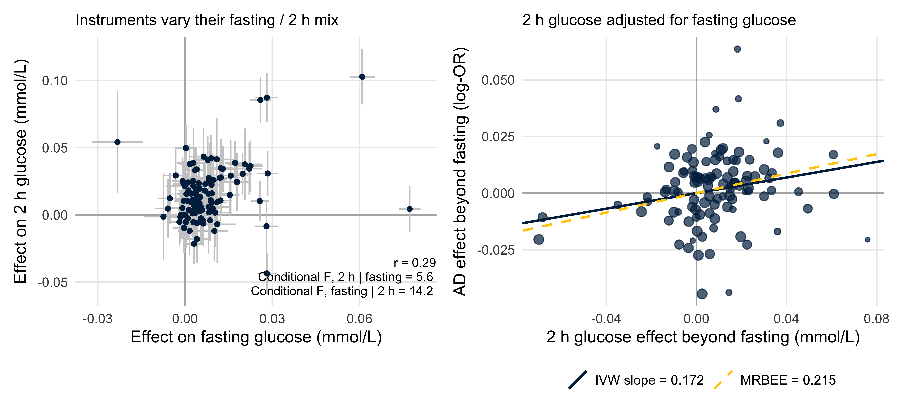{width=3600}
:::
:::


## 7. T2D liability → AD by mechanistic cluster

The Suzuki 2024 instruments split by the paper's mechanistic clusters (assigned before any AD data
were used). Each row is the effect on AD of T2D liability carried by that cluster's variants. No
cluster is individually significant and the clusters do not differ significantly from each other;
the beta-cell clusters have the largest estimates. IVW only, so these are attenuated toward the
null. The liver/lipid cluster (2 variants) is in the table but not the plot.


::: {.cell}

```{.r .cell-code}
beta_levels <- c("All beta cell", "Beta cell -PI", "Beta cell +PI")
cl <- con_cl |>
  filter(set == "primary", outcome == ad_outcome, arm == con_arm,
         model == "T2D effect x cluster" | (model == "T2D effect x beta-cell" & grepl("^Beta", group))) |>
  mutate(group = if_else(model == "T2D effect x beta-cell", "All beta cell", group),
         ci_lo = b - 1.96 * se, ci_hi = b + 1.96 * se,
         kind = if_else(group %in% beta_levels, "Beta-cell clusters", "Other clusters")) |>
  arrange(kind != "Beta-cell clusters", match(group, beta_levels), desc(b)) |>
  mutate(label = sprintf("%s (%d)", group, n_snp), label = factor(label, levels = rev(label)))
cl_het <- con_cl |>
  filter(set == "primary", outcome == ad_outcome, arm == con_arm, model == "T2D effect x cluster") |>
  distinct(het_Q, het_df, het_p)
```
:::


::: {.cell}

```{.r .cell-code}
cl |>
  filter(group != "other (small)") |>
  ggplot(aes(x = exp(b), xmin = exp(ci_lo), xmax = exp(ci_hi), y = label, colour = kind)) +
  geom_vline(xintercept = 1, linetype = "dashed", colour = "grey40") +
  geom_pointrange(linewidth = 0.9, size = 0.7) +
  facet_grid(kind ~ ., scales = "free_y", space = "free_y") +
  scale_x_log10() +
  scale_colour_manual(values = c("Beta-cell clusters" = "#9a3324", "Other clusters" = "#00274c"), guide = "none") +
  labs(x = "Odds ratio for AD per unit higher log-odds of T2D (95% CI)", y = NULL,
       caption = sprintf("Variants per cluster in brackets. Heterogeneity across the 8 clusters: Q = %.1f, df = %d, p = %.2f",
                         cl_het$het_Q, cl_het$het_df, cl_het$het_p)) +
  theme_talk + theme(strip.text.y = element_blank())
```

::: {.cell-output-display}
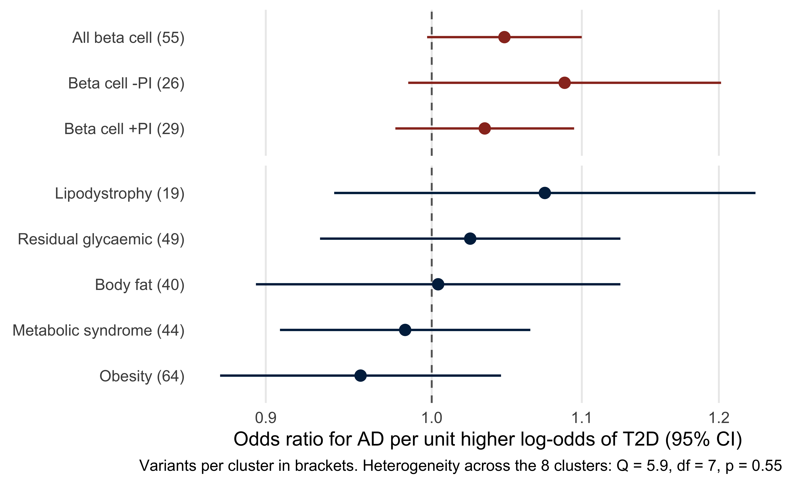{width=2700}
:::
:::


::: {.cell}

```{.r .cell-code}
cl |>
  transmute(Cluster = group, SNPs = n_snp,
            `OR (95% CI)` = sprintf("%.2f (%.2f, %.2f)", exp(b), exp(ci_lo), exp(ci_hi)), p = signif(p, 2)) |>
  kable()
```

::: {.cell-output-display}


|Cluster            | SNPs|OR (95% CI)       |     p|
|:------------------|----:|:-----------------|-----:|
|All beta cell      |   55|1.05 (1.00, 1.10) | 0.065|
|Beta cell -PI      |   26|1.09 (0.99, 1.20) | 0.095|
|Beta cell +PI      |   29|1.03 (0.98, 1.09) | 0.240|
|Lipodystrophy      |   19|1.07 (0.94, 1.23) | 0.290|
|Residual glycaemic |   49|1.02 (0.93, 1.13) | 0.620|
|Body fat           |   40|1.00 (0.89, 1.13) | 0.940|
|Metabolic syndrome |   44|0.98 (0.91, 1.06) | 0.680|
|Obesity            |   64|0.96 (0.87, 1.04) | 0.320|
|other (small)      |    2|0.88 (0.58, 1.34) | 0.550|


:::
:::


::: {.cell}

```{.r .cell-code}
con_cl |>
  filter(set == "primary",
         model == "T2D effect x cluster" | (model == "T2D effect x beta-cell" & grepl("^Beta", group))) |>
  mutate(group = if_else(model == "T2D effect x beta-cell", "All beta cell", group)) |>
  inner_join(con_outcomes, by = c("outcome", "arm")) |>
  filter(group != "other (small)") |>
  mutate(est = sprintf("%.2f (%.2f, %.2f)", exp(b), exp(b - 1.96 * se), exp(b + 1.96 * se)),
         dataset = factor(dataset, levels = con_outcomes$dataset)) |>
  arrange(dataset) |>
  select(Cluster = group, dataset, est) |>
  pivot_wider(names_from = dataset, values_from = est) |>
  arrange(match(Cluster, cl$group)) |>
  kable(caption = "Cluster estimates (AD OR per unit log-odds of T2D, 95% CI) in each AD dataset.")
```

::: {.cell-output-display}


Table: Cluster estimates (AD OR per unit log-odds of T2D, 95% CI) in each AD dataset.

|Cluster            |Bellenguez (SlopeHunter-corrected) |Kunkle (clinical) |Uffelmann 2026, new cohorts (independent) |Uffelmann 2026, clinical only |
|:------------------|:----------------------------------|:-----------------|:-----------------------------------------|:-----------------------------|
|All beta cell      |1.05 (1.00, 1.10)                  |1.01 (0.94, 1.09) |1.07 (1.02, 1.13)                         |1.05 (1.01, 1.09)             |
|Beta cell -PI      |1.09 (0.99, 1.20)                  |1.05 (0.90, 1.22) |1.04 (0.93, 1.17)                         |1.06 (0.99, 1.14)             |
|Beta cell +PI      |1.03 (0.98, 1.09)                  |1.01 (0.93, 1.09) |1.08 (1.02, 1.15)                         |1.05 (1.00, 1.09)             |
|Lipodystrophy      |1.07 (0.94, 1.23)                  |1.22 (1.02, 1.47) |0.95 (0.83, 1.08)                         |1.06 (0.97, 1.16)             |
|Residual glycaemic |1.02 (0.93, 1.13)                  |0.99 (0.84, 1.15) |1.02 (0.91, 1.14)                         |1.03 (0.95, 1.10)             |
|Body fat           |1.00 (0.89, 1.13)                  |1.13 (0.95, 1.34) |1.05 (0.91, 1.20)                         |1.06 (0.97, 1.16)             |
|Metabolic syndrome |0.98 (0.91, 1.06)                  |0.97 (0.86, 1.09) |1.08 (0.98, 1.19)                         |1.05 (0.99, 1.12)             |
|Obesity            |0.96 (0.87, 1.04)                  |0.96 (0.85, 1.10) |0.91 (0.82, 1.01)                         |0.97 (0.90, 1.03)             |


:::
:::


**Replication.** The same cluster estimates in the independent Uffelmann new cohorts beside the
primary outcome. The beta-cell clusters replicate (all beta cell OR 1.07, 1.02–1.13; the +PI cluster
carries it); obesity stays below 1 and lipodystrophy does not repeat.


::: {.cell}

```{.r .cell-code}
con_cl |>
  filter(set == "primary",
         model == "T2D effect x cluster" | (model == "T2D effect x beta-cell" & grepl("^Beta", group))) |>
  mutate(group = if_else(model == "T2D effect x beta-cell", "All beta cell", group)) |>
  inner_join(rep_outcomes, by = c("outcome", "arm")) |>
  filter(group != "other (small)", group != "Liver/lipid metabolism") |>
  mutate(label = factor(group, levels = rev(cl$group)),
         dataset = factor(dataset, levels = rep_outcomes$dataset)) |>
  rep_forest("Odds ratio for AD per unit higher log-odds of T2D (95% CI)",
             "Suzuki 2024 clusters (frozen assignments).")
```

::: {.cell-output-display}
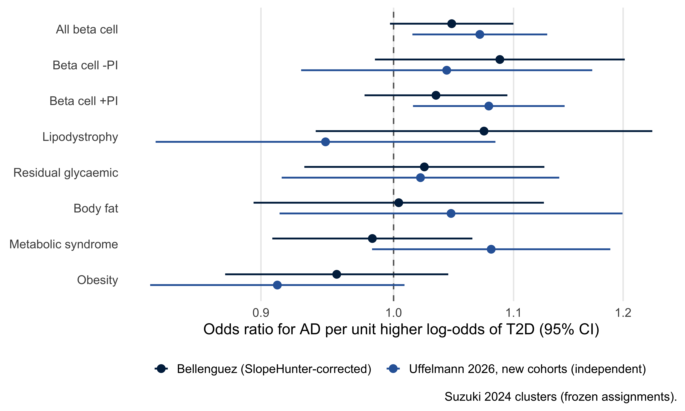{width=3000}
:::
:::


### Cluster effects on glucose beside the effect on AD

The same variants, showing how T2D liability carried by each cluster moves fasting and 2 h glucose
(right) next to its effect on AD (left). The glucose slopes are computed here from the per-variant
table (`instrument_outcome_data.csv`) with the estimator used for AD: inverse-variance weighted
regression through the origin on the variant's T2D effect, random-effects standard error.


::: {.cell}

```{.r .cell-code}
con_snps <- read_csv(file.path(con_dir, "instrument_outcome_data.csv"), show_col_types = FALSE) |>
  filter(set == "primary", outcome == ad_outcome, arm == con_arm)

# IVW slope of a trait on the T2D effect, with the residual scale floored at 1 (as pipeline wls_mre()).
ivw_slope <- function(y, se, x) {
  f <- summary(lm(y ~ 0 + x, weights = 1 / se^2))
  tibble(b = f$coefficients[1, 1], se = f$coefficients[1, 2] / f$sigma * max(1, f$sigma))
}
cl_glu <- bind_rows(con_snps, con_snps |> filter(grepl("^Beta cell", cluster)) |> mutate(cluster = "All beta cell")) |>
  group_by(group = cluster) |>
  reframe(bind_rows(`Fasting glucose` = ivw_slope(beta_fg, se_fg, beta_t2d),
                    `2 h glucose` = ivw_slope(beta_2h, se_2h, beta_t2d), .id = "series")) |>
  mutate(ci_lo = b - 1.96 * se, ci_hi = b + 1.96 * se, panel = "Glucose")

cl_both <- cl |>
  transmute(group, series = "AD", b = exp(b), ci_lo = exp(ci_lo), ci_hi = exp(ci_hi), panel = "AD risk") |>
  bind_rows(cl_glu |> select(group, series, b, ci_lo, ci_hi, panel)) |>
  inner_join(cl |> select(group, label, kind), by = "group") |>
  filter(group != "other (small)") |>
  mutate(panel = factor(panel, levels = c("AD risk", "Glucose")))
```
:::


::: {.cell}

```{.r .cell-code}
ggplot(cl_both, aes(x = b, xmin = ci_lo, xmax = ci_hi, y = label, colour = series)) +
  geom_vline(data = data.frame(panel = factor(c("AD risk", "Glucose"), levels = c("AD risk", "Glucose")), x = c(1, 0)),
             aes(xintercept = x), linetype = "dashed", colour = "grey40") +
  geom_pointrange(position = position_dodge(width = 0.5), linewidth = 0.9, size = 0.6) +
  facet_grid(kind ~ panel, scales = "free", space = "free_y",
             labeller = labeller(panel = c(`AD risk` = "Odds ratio for AD (95% CI)",
                                           Glucose = "Glucose, mmol/L (95% CI)"))) +
  scale_colour_manual(values = c(AD = "#00274c", `Fasting glucose` = "grey55", `2 h glucose` = "#9a3324"),
                      breaks = c("Fasting glucose", "2 h glucose")) +
  labs(x = "Per unit higher log-odds of T2D carried by the cluster", y = NULL, colour = NULL,
       caption = "Variants per cluster in brackets.") +
  theme_talk + theme(strip.text.y = element_blank())
```

::: {.cell-output-display}
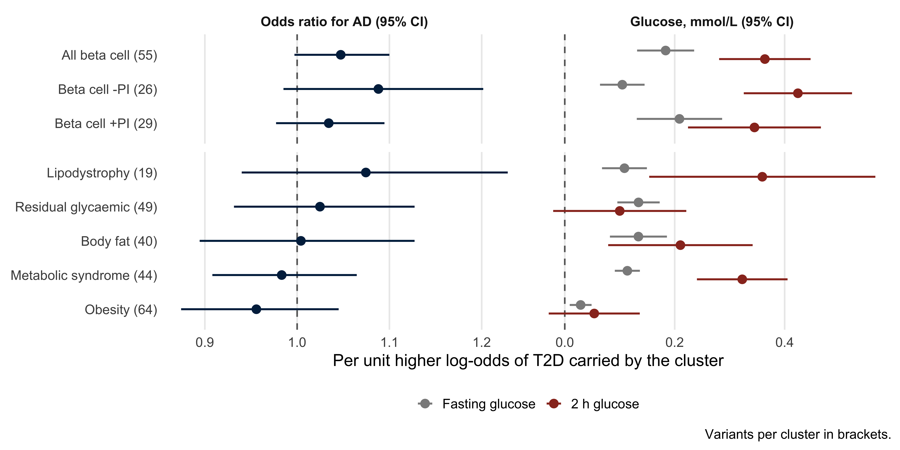{width=3600}
:::
:::


::: {.cell}

```{.r .cell-code}
cl_glu |>
  mutate(est = sprintf("%.2f (%.2f, %.2f)", b, ci_lo, ci_hi)) |>
  select(Cluster = group, series, est) |>
  pivot_wider(names_from = series, values_from = est) |>
  inner_join(cl |> transmute(Cluster = group, SNPs = n_snp,
                             `AD OR (95% CI)` = sprintf("%.2f (%.2f, %.2f)", exp(b), exp(ci_lo), exp(ci_hi))),
             by = "Cluster") |>
  arrange(match(Cluster, cl$group)) |>
  select(Cluster, SNPs, `AD OR (95% CI)`, `Fasting glucose`, `2 h glucose`) |>
  kable(caption = "Glucose columns: mmol/L per unit higher log-odds of T2D (95% CI).")
```

::: {.cell-output-display}


Table: Glucose columns: mmol/L per unit higher log-odds of T2D (95% CI).

|Cluster            | SNPs|AD OR (95% CI)    |Fasting glucose   |2 h glucose        |
|:------------------|----:|:-----------------|:-----------------|:------------------|
|All beta cell      |   55|1.05 (1.00, 1.10) |0.18 (0.13, 0.24) |0.36 (0.28, 0.45)  |
|Beta cell -PI      |   26|1.09 (0.99, 1.20) |0.10 (0.06, 0.15) |0.42 (0.33, 0.52)  |
|Beta cell +PI      |   29|1.03 (0.98, 1.09) |0.21 (0.13, 0.29) |0.35 (0.22, 0.47)  |
|Lipodystrophy      |   19|1.07 (0.94, 1.23) |0.11 (0.07, 0.15) |0.36 (0.15, 0.57)  |
|Residual glycaemic |   49|1.02 (0.93, 1.13) |0.13 (0.10, 0.17) |0.10 (-0.02, 0.22) |
|Body fat           |   40|1.00 (0.89, 1.13) |0.13 (0.08, 0.19) |0.21 (0.08, 0.34)  |
|Metabolic syndrome |   44|0.98 (0.91, 1.06) |0.11 (0.09, 0.14) |0.32 (0.24, 0.41)  |
|Obesity            |   64|0.96 (0.87, 1.04) |0.03 (0.01, 0.05) |0.05 (-0.03, 0.14) |


:::
:::


## 8. Drug targets

Variants in or near the gene for each glucose-lowering drug target (T2D-associated at
p < 1×10⁻⁴, gene ± 100 kb; targets of drugs at phase 2 or later for T2D, Open Targets). Left: effect
on AD of T2D liability acting through that target. Right: how the same variants move fasting and
2 h glucose, so each target's fasting vs post-load profile sits beside its AD estimate. KATP
channels and amylin receptors act on 2 h glucose only and show the clearest AD signals;
glucokinase moves 2 h glucose most and shows none. Classes with fewer than 3 variants are in the
table only. Fine-mapping (`diabetes_ad_fine_mapping.qmd`) qualifies both leads: the KATP signal is a
small effect on the KCNJ11 E23K haplotype, consistent across all three AD datasets but nominal in
each; the amylin signal comes from one variant that proxies the chr17q21 (*MLX*) T2D locus rather
than RAMP2, and its AD association mostly belongs to a neighbouring variant with no glycaemic effect.


::: {.cell}

```{.r .cell-code}
class_labels <- c(katp_secretagogue = "KATP channel (sulfonylureas)", amylin = "Amylin receptor",
                  pparg_sensitizer = "PPAR (glitazones)", glucokinase = "Glucokinase",
                  insulin_receptor = "Insulin receptor", incretin = "Incretin (GLP1R, GIPR, DPP4)",
                  fgf21_klb = "FGF21 / KLB", sglt = "SGLT", glucagon_receptor = "Glucagon receptor")
dt <- con_dt |>
  filter(set == "primary", level == "class") |>
  mutate(ci_lo = b - 1.96 * se, ci_hi = b + 1.96 * se,
         class = coalesce(class_labels[target], target))
dt_ad <- dt |> filter(outcome == ad_outcome, arm == con_arm, trait == "AD (log-OR)")
dt_order <- dt_ad |> arrange(b) |> mutate(label = sprintf("%s (%d)", class, n_snp))
dt_plot <- dt |>
  filter(outcome == ad_outcome, arm == con_arm, n_snp >= 3) |>
  inner_join(dt_order |> select(target, label), by = "target") |>
  mutate(label = factor(label, levels = dt_order$label),
         panel = factor(if_else(trait == "AD (log-OR)", "AD risk", "Glucose"), levels = c("AD risk", "Glucose")),
         series = case_when(trait == "AD (log-OR)" ~ "AD", grepl("^fasting", trait) ~ "Fasting glucose",
                            TRUE ~ "2 h glucose"),
         # AD as an odds ratio; glucose stays in mmol/L per unit log-odds of T2D
         across(c(b, ci_lo, ci_hi), \(v) if_else(panel == "AD risk", exp(v), v)))
```
:::


::: {.cell}

```{.r .cell-code}
ggplot(dt_plot, aes(x = b, xmin = ci_lo, xmax = ci_hi, y = label, colour = series)) +
  geom_vline(data = data.frame(panel = factor(c("AD risk", "Glucose"), levels = c("AD risk", "Glucose")), x = c(1, 0)),
             aes(xintercept = x), linetype = "dashed", colour = "grey40") +
  geom_pointrange(position = position_dodge(width = 0.5), linewidth = 0.9, size = 0.6) +
  facet_wrap(~ panel, scales = "free_x",
             labeller = as_labeller(c(`AD risk` = "Odds ratio for AD (95% CI)",
                                      Glucose = "Glucose, mmol/L (95% CI)"))) +
  scale_colour_manual(values = c(AD = "#00274c", `Fasting glucose` = "grey55", `2 h glucose` = "#9a3324"),
                      breaks = c("Fasting glucose", "2 h glucose")) +
  labs(x = "Per unit higher log-odds of T2D acting through the target", y = NULL, colour = NULL,
       caption = "Variants per class in brackets. Incretin class includes GIPR, within 2 Mb of APOE.") +
  theme_talk
```

::: {.cell-output-display}
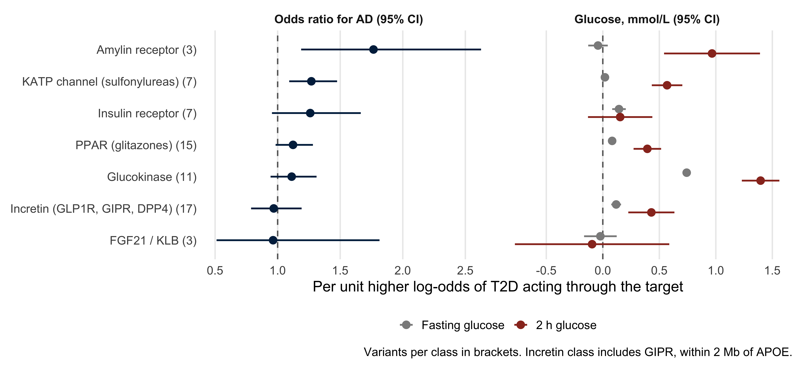{width=3600}
:::
:::


::: {.cell}

```{.r .cell-code}
dt |>
  filter(trait == "AD (log-OR)") |>
  inner_join(con_outcomes, by = c("outcome", "arm")) |>
  mutate(Outcome = factor(dataset, levels = con_outcomes$dataset)) |>
  transmute(Class = class, Outcome, SNPs = n_snp,
            `OR (95% CI)` = sprintf("%.2f (%.2f, %.2f)", exp(b), exp(ci_lo), exp(ci_hi)), p = signif(p, 2)) |>
  arrange(Class, Outcome) |>
  kable()
```

::: {.cell-output-display}


|Class                        |Outcome                                   | SNPs|OR (95% CI)       |       p|
|:----------------------------|:-----------------------------------------|----:|:-----------------|-------:|
|Amylin receptor              |Bellenguez (SlopeHunter-corrected)        |    3|1.77 (1.19, 2.62) | 0.00490|
|Amylin receptor              |Kunkle (clinical)                         |    3|1.47 (0.74, 2.93) | 0.27000|
|Amylin receptor              |Uffelmann 2026, clinical only             |    2|1.34 (0.98, 1.83) | 0.06800|
|FGF21 / KLB                  |Bellenguez (SlopeHunter-corrected)        |    3|0.96 (0.51, 1.81) | 0.91000|
|FGF21 / KLB                  |Kunkle (clinical)                         |    4|1.32 (0.57, 3.04) | 0.51000|
|FGF21 / KLB                  |Uffelmann 2026, new cohorts (independent) |    4|1.32 (0.75, 2.30) | 0.34000|
|FGF21 / KLB                  |Uffelmann 2026, clinical only             |    4|1.16 (0.83, 1.62) | 0.38000|
|Glucokinase                  |Bellenguez (SlopeHunter-corrected)        |   11|1.11 (0.94, 1.31) | 0.21000|
|Glucokinase                  |Kunkle (clinical)                         |    9|0.91 (0.67, 1.22) | 0.51000|
|Glucokinase                  |Uffelmann 2026, new cohorts (independent) |    8|1.38 (1.13, 1.68) | 0.00130|
|Glucokinase                  |Uffelmann 2026, clinical only             |    8|1.09 (0.97, 1.23) | 0.15000|
|Incretin (GLP1R, GIPR, DPP4) |Bellenguez (SlopeHunter-corrected)        |   17|0.97 (0.79, 1.19) | 0.76000|
|Incretin (GLP1R, GIPR, DPP4) |Kunkle (clinical)                         |   15|0.65 (0.45, 0.93) | 0.01900|
|Incretin (GLP1R, GIPR, DPP4) |Uffelmann 2026, new cohorts (independent) |   14|0.85 (0.67, 1.08) | 0.18000|
|Incretin (GLP1R, GIPR, DPP4) |Uffelmann 2026, clinical only             |   15|0.89 (0.77, 1.02) | 0.09400|
|Insulin receptor             |Bellenguez (SlopeHunter-corrected)        |    7|1.26 (0.95, 1.66) | 0.10000|
|Insulin receptor             |Kunkle (clinical)                         |    6|2.11 (1.30, 3.42) | 0.00270|
|Insulin receptor             |Uffelmann 2026, new cohorts (independent) |    5|1.04 (0.74, 1.45) | 0.83000|
|Insulin receptor             |Uffelmann 2026, clinical only             |    6|1.44 (1.19, 1.75) | 0.00024|
|KATP channel (sulfonylureas) |Bellenguez (SlopeHunter-corrected)        |    7|1.27 (1.09, 1.48) | 0.00190|
|KATP channel (sulfonylureas) |Kunkle (clinical)                         |    5|1.01 (0.72, 1.40) | 0.98000|
|KATP channel (sulfonylureas) |Uffelmann 2026, new cohorts (independent) |    5|1.29 (1.07, 1.54) | 0.00680|
|KATP channel (sulfonylureas) |Uffelmann 2026, clinical only             |    5|1.11 (0.99, 1.23) | 0.07200|
|PPAR (glitazones)            |Bellenguez (SlopeHunter-corrected)        |   15|1.12 (0.98, 1.28) | 0.08600|
|PPAR (glitazones)            |Kunkle (clinical)                         |   14|1.20 (0.96, 1.51) | 0.11000|
|PPAR (glitazones)            |Uffelmann 2026, new cohorts (independent) |   13|1.18 (1.02, 1.36) | 0.02600|
|PPAR (glitazones)            |Uffelmann 2026, clinical only             |   15|1.13 (1.03, 1.23) | 0.00750|
|SGLT                         |Bellenguez (SlopeHunter-corrected)        |    2|1.13 (0.54, 2.35) | 0.75000|
|SGLT                         |Kunkle (clinical)                         |    2|1.43 (0.41, 5.02) | 0.58000|
|SGLT                         |Uffelmann 2026, new cohorts (independent) |    2|0.79 (0.35, 1.77) | 0.57000|
|SGLT                         |Uffelmann 2026, clinical only             |    2|0.76 (0.46, 1.23) | 0.26000|


:::
:::


**Replication.** Drug-target classes with at least 3 variants, in the primary outcome and the
independent Uffelmann new cohorts. The KATP class replicates (OR 1.29, 1.07–1.54, per log-odds of
T2D; 5 of 7 variants, as rs113264182 and rs1557763 are missing from the Uffelmann file). Glucokinase
(1.38, 1.13–1.68) and PPAR (1.18, 1.02–1.36), null or borderline in Bellenguez, are positive there,
which fits a general beta-cell / insulin-secretion effect better than a KATP-specific one. Amylin
has no replication estimate: only one of its three variants (rs34779241) is in the Uffelmann file,
and it shows no AD association there (p = 0.57).


::: {.cell}

```{.r .cell-code}
dt_ad |> select(target, label = class) |> distinct() |>
  inner_join(dt |> filter(trait == "AD (log-OR)", n_snp >= 3) |> select(target, outcome, arm, b, se, n_snp),
             by = "target") |>
  inner_join(rep_outcomes, by = c("outcome", "arm")) |>
  filter(target %in% dt_plot$target) |>
  mutate(label = factor(label, levels = unique(dt_order$class)),
         dataset = factor(dataset, levels = rep_outcomes$dataset)) |>
  rep_forest("Odds ratio for AD per unit higher log-odds of T2D (95% CI)",
             "Classes with at least 3 variants in an outcome.")
```

::: {.cell-output-display}
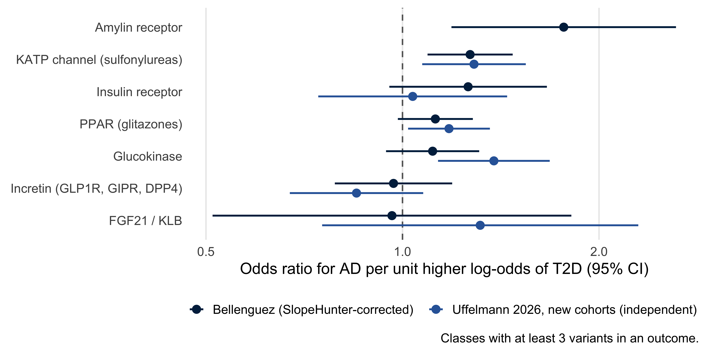{width=3000}
:::
:::


**Classes we looked at but could not evaluate.** Several drug classes have no usable genetic
instrument with this design, so their absence above means "not testable", not "no effect".

- **SGLT2 inhibitors** (SLC5A2), **alpha-glucosidase inhibitors** (MGAM, SI, GAA, AMY2A) and
  **metformin** (GPD2): no variant within 100 kb of these genes is associated with T2D, fasting or
  2 h glucose beyond what chance gives across several hundred variants (best p ≈ 10⁻³), so a lower
  threshold would only select noise. Metformin's other listed target, mitochondrial complex I, has
  about 50 subunits and was excluded as too unspecific to instrument.
- **11β-HSD1 inhibitors** (HSD11B1) and **GPR40 / GPR119 agonists** (FFAR1, GPR119), all phase 2–3
  only: no instrument at HSD11B1 or FFAR1; GPR119 is on the X chromosome, which the pipeline does not
  analyse.
- **Too thin to interpret** (1–2 variants): SGLT1 (SLC5A1, in the table), the glucagon receptor and
  DPP-4 (one variant each, folded into their classes), and **bromocriptine** (dopamine D2 agonists,
  added after the freeze because it is FDA-approved for T2D and had been left unclassed: two weak
  DRD2 variants, AD interval spanning roughly a halving to a doubling of odds;
  `post_freeze_drug_target_results.csv`).

Published drug-target studies reach some of these targets by selecting variants on HbA1c (larger
samples) or by using rare loss-of-function carriers (for example sucrase-isomaltase deficiency as a
lifelong analogue of alpha-glucosidase inhibition); neither is done here.

## 9. Getting more specific: from T2D liability to the KATP channel

The same quantity at each step: the effect on AD of one unit of T2D liability (log-odds), carried by
an increasingly specific subset of T2D variants. If the AD signal sits in one pathway, broad T2D
liability dilutes it and the estimate should grow as the instruments narrow onto that pathway.

**Instruments: Xue 2018.** This section uses the Xue T2D instruments rather than the larger Suzuki
2024 set, because the larger set adds many weak variants with little effect on 2 h glucose and
dilutes the signal (section 6). The steps:

1. **All T2D variants**: the Xue instruments.
2. **2 h glucose beyond fasting glucose**: each variant's 2 h glucose effect minus the part predicted
   by its fasting glucose effect (the adjustment in the section 6 model), keeping variants where that
   2 h-specific component is positive with z > 1.96. Chosen on glucose data only.
3. **Beta-cell clusters**: Xue variants in LD (r² ≥ 0.5, within 500 kb) with a Suzuki index variant
   assigned to either beta-cell cluster. This LD mapping was made after the freeze
   (`xue_cluster_map.csv`); 86 of 115 Xue instruments map to some cluster.
4. **KATP channel**: in the Xue set the channel is represented by a single variant, rs5215 (KCNJ11
   E23K), so this step is a single-variant ratio.

Steps 1–3 use inverse-variance weighting with random-effects standard errors. The outcome is
SlopeHunter-corrected Bellenguez; the table also gives Kunkle and the Uffelmann 2026 replication
files (section 6). Two cautions: the KATP channel was
singled out because it stood out among nine drug classes, so its estimate is probably inflated by
that selection; and the steps are not independent (each overlaps the one above).


::: {.cell}

```{.r .cell-code}
spec_set <- "xue"
snp_data <- read_csv(file.path(con_dir, "instrument_outcome_data.csv"), show_col_types = FALSE) |>
  filter(set == spec_set) |>
  select(-any_of("cluster")) |>          # frozen clusters exist only for Suzuki index variants
  left_join(read_csv(file.path(con_dir, "xue_cluster_map.csv"), show_col_types = FALSE) |> select(SNP, cluster),
            by = "SNP")
rho_fg2h <- read_csv(file.path(con_dir, "step0_strength.csv"), show_col_types = FALSE) |>
  filter(set == spec_set) |> pull(error_cor_fg_2h)

# 2 h-specific component of each variant: 2 h effect minus the fasting-predicted part (weighted slope
# of 2 h on fasting effects), with the fasting/2 h error correlation from Step 0.
two_h_specific <- function(x) {
  delta <- coef(lm(beta_2h ~ 0 + beta_fg, data = x, weights = 1 / se_2h^2))[[1]]
  x |> mutate(z_2h_spec = (beta_2h - delta * beta_fg) /
                sqrt(se_2h^2 + delta^2 * se_fg^2 - 2 * delta * rho_fg2h * se_2h * se_fg))
}
ivw_t2d <- function(x) {
  f <- summary(lm(beta_y ~ 0 + beta_t2d, data = x, weights = 1 / se_y^2))
  tibble(b = f$coefficients[1, 1], se = f$coefficients[1, 2] / f$sigma * max(1, f$sigma), n_snp = nrow(x))
}
wald <- function(x) tibble(b = x$beta_y / x$beta_t2d, se = x$se_y / x$beta_t2d, n_snp = 1L)

spec_arms <- con_outcomes
spec_steps <- c("All T2D variants", "2 h glucose beyond fasting", "Beta-cell clusters", "KATP channel (rs5215, KCNJ11 E23K)")
spec <- purrr::pmap_dfr(spec_arms, \(outcome, arm, dataset) {
  x <- snp_data |> filter(.data$outcome == !!outcome, .data$arm == !!arm)
  bind_rows(
    ivw_t2d(x) |> mutate(step = spec_steps[1]),
    ivw_t2d(filter(two_h_specific(x), z_2h_spec > 1.96)) |> mutate(step = spec_steps[2]),
    ivw_t2d(filter(x, grepl("^Beta cell", cluster))) |> mutate(step = spec_steps[3]),
    wald(filter(x, SNP == "rs5215")) |> mutate(step = spec_steps[4])) |>
    mutate(dataset = dataset)
}) |>
  mutate(ci_lo = b - 1.96 * se, ci_hi = b + 1.96 * se, step = factor(step, levels = spec_steps),
         dataset = factor(dataset, levels = spec_arms$dataset))
```
:::


::: {.cell}

```{.r .cell-code}
spec |>
  filter(dataset == spec_arms$dataset[1]) |>
  mutate(label = factor(sprintf("%s (%d)", step, n_snp), levels = rev(sprintf("%s (%d)", step, n_snp)))) |>
  ggplot(aes(x = exp(b), xmin = exp(ci_lo), xmax = exp(ci_hi), y = label)) +
  geom_vline(xintercept = 1, linetype = "dashed", colour = "grey40") +
  geom_pointrange(colour = "#00274c", linewidth = 1, size = 0.8) +
  scale_x_log10(breaks = c(0.9, 1, 1.25, 1.5, 1.75)) +
  labs(x = "Odds ratio for AD per unit higher log-odds of T2D (95% CI)", y = NULL,
       caption = "Xue 2018 T2D instruments; each row a narrower subset (variants in brackets). AD: Bellenguez, SlopeHunter-corrected.") +
  theme_talk
```

::: {.cell-output-display}
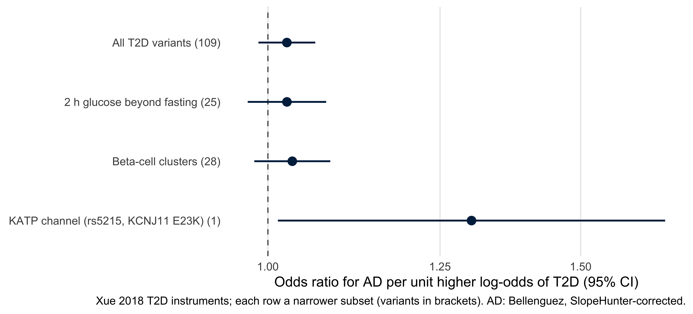{width=3300}
:::
:::


::: {.cell}

```{.r .cell-code}
spec |>
  arrange(dataset, step) |>
  transmute(Dataset = dataset, Step = step, Variants = n_snp,
            `OR (95% CI)` = sprintf("%.2f (%.2f, %.2f)", exp(b), exp(ci_lo), exp(ci_hi)),
            p = signif(2 * pnorm(-abs(b / se)), 2)) |>
  kable()
```

::: {.cell-output-display}


|Dataset                                   |Step                               | Variants|OR (95% CI)       |     p|
|:-----------------------------------------|:----------------------------------|--------:|:-----------------|-----:|
|Bellenguez (SlopeHunter-corrected)        |All T2D variants                   |      109|1.02 (0.99, 1.06) | 0.190|
|Bellenguez (SlopeHunter-corrected)        |2 h glucose beyond fasting         |       25|1.02 (0.97, 1.08) | 0.340|
|Bellenguez (SlopeHunter-corrected)        |Beta-cell clusters                 |       28|1.03 (0.98, 1.08) | 0.210|
|Bellenguez (SlopeHunter-corrected)        |KATP channel (rs5215, KCNJ11 E23K) |        1|1.30 (1.01, 1.67) | 0.039|
|Kunkle (clinical)                         |All T2D variants                   |      109|0.98 (0.93, 1.04) | 0.500|
|Kunkle (clinical)                         |2 h glucose beyond fasting         |       19|1.02 (0.94, 1.11) | 0.640|
|Kunkle (clinical)                         |Beta-cell clusters                 |       28|1.03 (0.95, 1.11) | 0.470|
|Kunkle (clinical)                         |KATP channel (rs5215, KCNJ11 E23K) |        1|1.28 (0.84, 1.97) | 0.250|
|Uffelmann 2026, new cohorts (independent) |All T2D variants                   |      100|1.03 (0.99, 1.08) | 0.110|
|Uffelmann 2026, new cohorts (independent) |2 h glucose beyond fasting         |       21|1.04 (0.99, 1.10) | 0.110|
|Uffelmann 2026, new cohorts (independent) |Beta-cell clusters                 |       29|1.05 (1.01, 1.10) | 0.027|
|Uffelmann 2026, new cohorts (independent) |KATP channel (rs5215, KCNJ11 E23K) |        1|1.12 (0.85, 1.48) | 0.430|
|Uffelmann 2026, clinical only             |All T2D variants                   |      115|1.02 (0.99, 1.05) | 0.150|
|Uffelmann 2026, clinical only             |2 h glucose beyond fasting         |       25|1.04 (0.99, 1.09) | 0.098|
|Uffelmann 2026, clinical only             |Beta-cell clusters                 |       30|1.05 (1.01, 1.08) | 0.021|
|Uffelmann 2026, clinical only             |KATP channel (rs5215, KCNJ11 E23K) |        1|1.11 (0.94, 1.32) | 0.230|


:::
:::

