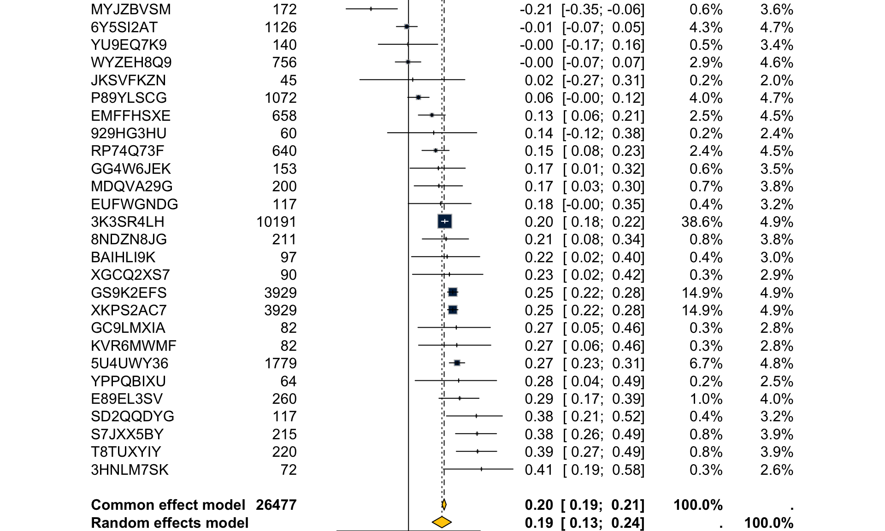
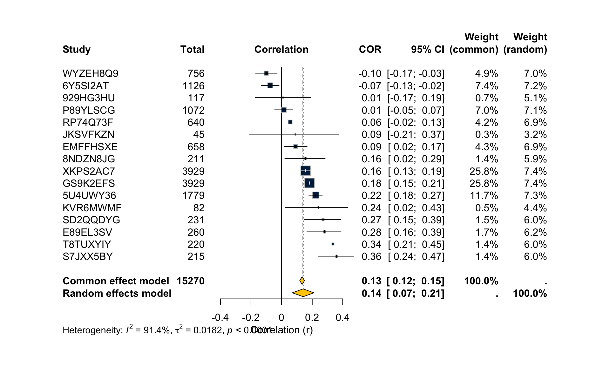
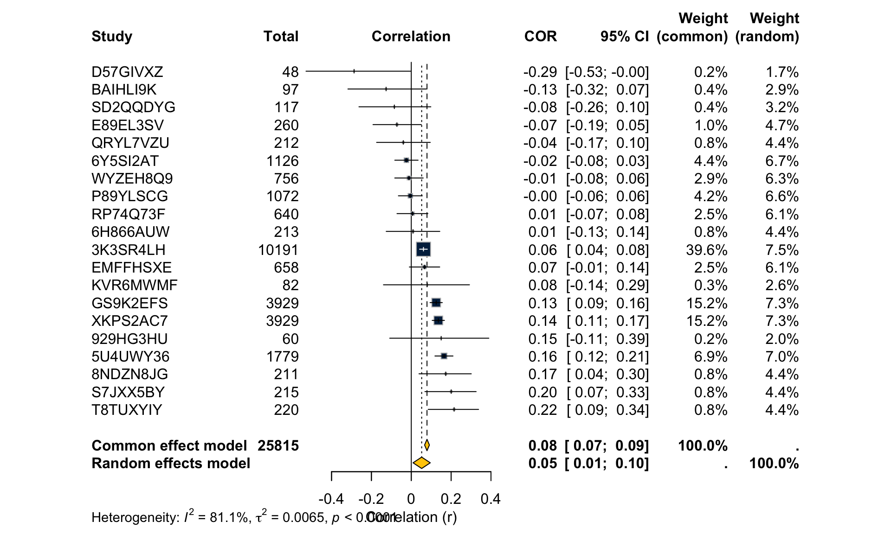
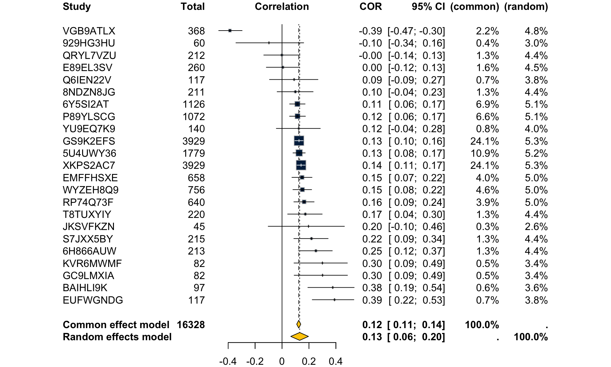
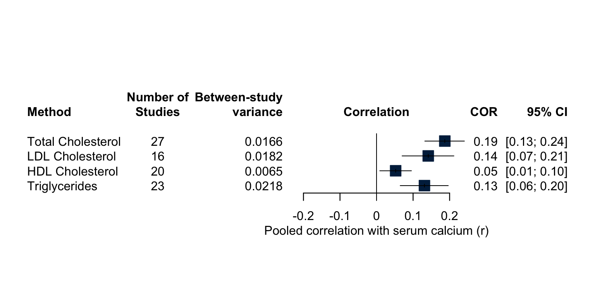
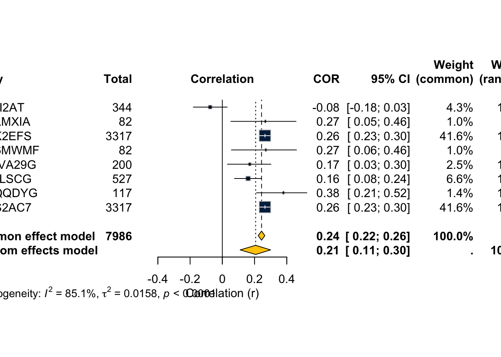
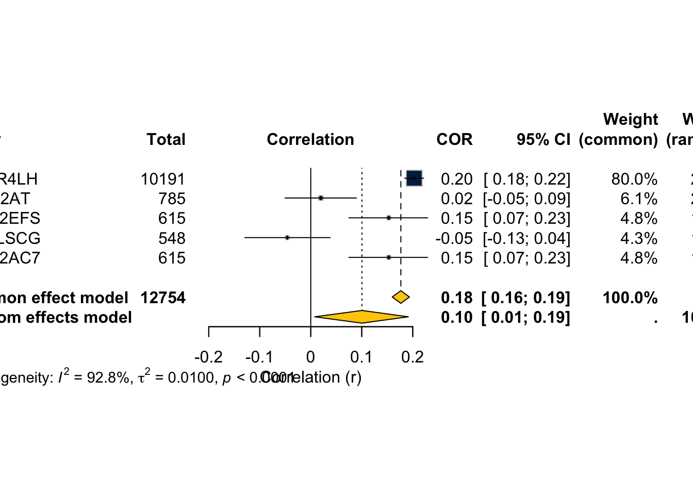

::: {.cell}

:::


## Purpose

Pre-registered meta-analysis (PROSPERO CRD420250645066) of cross-sectional
associations between serum calcium and serum cholesterol.  Correlation
coefficients are Fisher-*z* transformed for pooling and back-transformed for
presentation, as specified in the registration.  Separate meta-analyses are
run for each lipid outcome (Total Cholesterol primary; LDL, HDL, Triglycerides
secondary).  Primary calcium exposure is serum calcium; corrected calcium is a
sensitivity analysis.  When a paper reports only sex- or disease-stratified
estimates (no combined figure), stratum estimates are pooled within-study via a
Fisher-*z* weighted average before entering the between-study meta-analysis,
giving one effect per study.

## Data


::: {.cell}

```{.r .cell-code}
corr.raw <- read_csv(
  "Screening Log for Calcium and Cholesterol Meta-Analysis - Correlations.csv",
  show_col_types = FALSE
)
```
:::


## Cleaning and Coding


::: {.cell}

```{.r .cell-code}
# ── helper: fix non-standard minus signs and stray characters in r ──────────
clean_r <- function(x) {
  x |>
    str_replace_all("[−–—]", "-") |>   # em/en-dash → minus
    str_replace_all("\\.{2,}", ".")                   |>  # double decimals
    str_replace_all("[^0-9\\.\\-]", "")              |>   # anything else
    as.numeric()
}

# ── parse calcium type and lipid outcome from Association column ─────────────
corr <- corr.raw |>
  mutate(
    # fix OCR/typo variants before splitting
    assoc_clean = Association |>
      str_replace_all("Correctect", "Corrected") |>
      str_replace_all("Cholestrol|Choelstrol", "Cholesterol") |>
      str_replace_all("Triglycerdies", "Triglycerides") |>
      str_squish(),

    adjusted = str_detect(assoc_clean, "\\(adjusted\\)"),

    # everything left of " - "
    calcium_raw = str_extract(assoc_clean, "^.+?(?= - )") |> str_trim(),
    # everything right of the first " - ", strip "(adjusted)"
    lipid_raw   = str_extract(assoc_clean, "(?<= - ).+$") |>
                    str_remove("\\s*\\(adjusted\\)") |>
                    str_trim(),

    calcium_type = case_when(
      str_detect(calcium_raw, "^Serum Calcium$")           ~ "Serum",
      str_detect(calcium_raw, "Corrected Calcium")         ~ "Corrected",
      str_detect(calcium_raw, "Ionic Calcium")             ~ "Ionic",
      str_detect(calcium_raw, "Hair Calcium")              ~ "Hair",
      str_detect(calcium_raw, "Calcium Intake")            ~ "Intake",
      str_detect(calcium_raw, "Change in Serum Calcium")   ~ "Change",
      TRUE                                                  ~ "Other"
    ),

    lipid_type = case_when(
      str_detect(lipid_raw, "Total Cholesterol")           ~ "Total Cholesterol",
      str_detect(lipid_raw, "LDL Cholesterol")             ~ "LDL Cholesterol",
      str_detect(lipid_raw, "HDL Cholesterol")             ~ "HDL Cholesterol",
      str_detect(lipid_raw, "Triglycerides")               ~ "Triglycerides",
      TRUE                                                  ~ "Other"
    ),

    r_clean = clean_r(as.character(r)),
    n       = as.integer(n)
  ) |>
  filter(!is.na(r_clean), !is.na(n), abs(r_clean) < 1)
```
:::


::: {.cell}

```{.r .cell-code}
corr |>
  count(calcium_type, lipid_type, adjusted) |>
  kable(caption = "Observations by calcium type, lipid outcome, and adjustment status")
```

::: {.cell-output-display}


Table: Observations by calcium type, lipid outcome, and adjustment status

|calcium_type |lipid_type        |adjusted |  n|
|:------------|:-----------------|:--------|--:|
|Change       |Total Cholesterol |FALSE    |  1|
|Corrected    |HDL Cholesterol   |FALSE    | 15|
|Corrected    |HDL Cholesterol   |TRUE     |  2|
|Corrected    |LDL Cholesterol   |FALSE    |  7|
|Corrected    |LDL Cholesterol   |TRUE     |  2|
|Corrected    |Total Cholesterol |FALSE    | 15|
|Corrected    |Total Cholesterol |TRUE     |  2|
|Corrected    |Triglycerides     |FALSE    | 14|
|Corrected    |Triglycerides     |TRUE     |  2|
|Hair         |HDL Cholesterol   |FALSE    |  1|
|Hair         |LDL Cholesterol   |FALSE    |  1|
|Hair         |Total Cholesterol |FALSE    |  1|
|Hair         |Triglycerides     |FALSE    |  1|
|Intake       |HDL Cholesterol   |FALSE    |  1|
|Intake       |LDL Cholesterol   |FALSE    |  1|
|Intake       |Total Cholesterol |FALSE    |  1|
|Intake       |Triglycerides     |FALSE    |  1|
|Ionic        |Other             |FALSE    |  3|
|Ionic        |Total Cholesterol |FALSE    |  3|
|Serum        |HDL Cholesterol   |FALSE    | 41|
|Serum        |HDL Cholesterol   |TRUE     |  2|
|Serum        |LDL Cholesterol   |FALSE    | 39|
|Serum        |LDL Cholesterol   |TRUE     |  2|
|Serum        |Other             |FALSE    | 12|
|Serum        |Total Cholesterol |FALSE    | 56|
|Serum        |Total Cholesterol |TRUE     |  2|
|Serum        |Triglycerides     |FALSE    | 48|
|Serum        |Triglycerides     |TRUE     |  2|


:::
:::


## Within-Study Pooling

When a paper supplies only stratum-specific estimates (e.g. males and females
separately), a single study-level estimate is computed via Fisher-*z* weighted
average before the between-study meta-analysis.


::: {.cell}

```{.r .cell-code}
# Fisher-z weighted mean within study × calcium_type × lipid_type × adjusted
pool_within_study <- function(r_vec, n_vec) {
  # variance of Fisher z is 1/(n-3); weight = n-3
  w    <- n_vec - 3
  z    <- atanh(r_vec)
  z_p  <- sum(z * w) / sum(w)
  n_p  <- sum(w) + 3L          # effective n preserving total precision
  list(r_pooled = tanh(z_p), n_pooled = as.integer(round(n_p)))
}

corr.study <- corr |>
  group_by(StudyID, calcium_type, lipid_type, adjusted) |>
  summarise(
    pool_within_study(r_clean, n) |> as_tibble(),
    k_strata = n(),
    .groups = "drop"
  )

corr.study |>
  filter(calcium_type == "Serum", !adjusted, lipid_type != "Other") |>
  count(lipid_type) |>
  kable(caption = "Studies contributing to each primary serum-calcium analysis")
```

::: {.cell-output-display}


Table: Studies contributing to each primary serum-calcium analysis

|lipid_type        |  n|
|:-----------------|--:|
|HDL Cholesterol   | 20|
|LDL Cholesterol   | 16|
|Total Cholesterol | 27|
|Triglycerides     | 23|


:::
:::


## Meta-Analysis

### Helper function


::: {.cell}

```{.r .cell-code}
run_metacor <- function(data, calcium, lipid, adj = FALSE,
                        label = NULL) {
  d <- data |>
    filter(
      calcium_type == calcium,
      lipid_type   == lipid,
      adjusted     == adj
    )

  if (nrow(d) < 2) {
    message("Fewer than 2 studies for ", calcium, " – ", lipid,
            " (adjusted=", adj, "); skipping.")
    return(invisible(NULL))
  }

  title_str <- label %||%
    paste0(calcium, " Calcium vs ", lipid, if (adj) " (adjusted)")

  metacor(
    cor      = r_pooled,
    n        = n_pooled,
    studlab  = StudyID,
    data     = d,
    common   = TRUE,
    random   = TRUE,
    method.tau = "REML",
    title    = title_str
  )
}
```
:::


### Primary analyses — Serum Calcium (unadjusted)


::: {.cell}

```{.r .cell-code}
ma.tc <- run_metacor(corr.study, "Serum", "Total Cholesterol")
summary(ma.tc)
```

::: {.cell-output .cell-output-stdout}

```
Review:     Serum Calcium vs Total Cholesterol

             COR             95% CI %W(common) %W(random)
3HNLM7SK  0.4076 [ 0.1943;  0.5841]        0.3        2.6
3K3SR4LH  0.2028 [ 0.1841;  0.2214]       38.6        4.9
5U4UWY36  0.2717 [ 0.2281;  0.3142]        6.7        4.8
6Y5SI2AT -0.0092 [-0.0676;  0.0492]        4.3        4.7
8NDZN8JG  0.2100 [ 0.0771;  0.3356]        0.8        3.8
929HG3HU  0.1410 [-0.1171;  0.3813]        0.2        2.4
BAIHLI9K  0.2159 [ 0.0172;  0.3982]        0.4        3.0
E89EL3SV  0.2860 [ 0.1703;  0.3939]        1.0        4.0
EMFFHSXE  0.1310 [ 0.0551;  0.2054]        2.5        4.5
EUFWGNDG  0.1800 [-0.0016;  0.3501]        0.4        3.2
GC9LMXIA  0.2670 [ 0.0531;  0.4575]        0.3        2.8
GG4W6JEK  0.1670 [ 0.0085;  0.3173]        0.6        3.5
GS9K2EFS  0.2475 [ 0.2179;  0.2766]       14.9        4.9
JKSVFKZN  0.0236 [-0.2718;  0.3150]        0.2        2.0
KVR6MWMF  0.2700 [ 0.0563;  0.4601]        0.3        2.8
MDQVA29G  0.1700 [ 0.0320;  0.3016]        0.7        3.8
MYJZBVSM -0.2098 [-0.3485; -0.0621]        0.6        3.6
P89YLSCG  0.0556 [-0.0043;  0.1151]        4.0        4.7
RP74Q73F  0.1520 [ 0.0754;  0.2268]        2.4        4.5
S7JXX5BY  0.3832 [ 0.2629;  0.4918]        0.8        3.9
SD2QQDYG  0.3791 [ 0.2122;  0.5245]        0.4        3.2
T8TUXYIY  0.3860 [ 0.2674;  0.4931]        0.8        3.9
WYZEH8Q9 -0.0025 [-0.0738;  0.0689]        2.9        4.6
XGCQ2XS7  0.2285 [ 0.0225;  0.4159]        0.3        2.9
XKPS2AC7  0.2475 [ 0.2179;  0.2766]       14.9        4.9
YPPQBIXU  0.2805 [ 0.0372;  0.4923]        0.2        2.5
YU9EQ7K9 -0.0027 [-0.1685;  0.1633]        0.5        3.4

Number of studies: k = 27
Number of observations: o = 26477

                        COR           95% CI     z  p-value
Common effect model  0.1992 [0.1876; 0.2108] 32.81 < 0.0001
Random effects model 0.1868 [0.1321; 0.2404]  6.60 < 0.0001

Quantifying heterogeneity (with 95% CIs):
 tau^2 = 0.0166 [0.0082; 0.0354]; tau = 0.1288 [0.0908; 0.1881]
 I^2 = 87.4% [82.8%; 90.7%]; H = 2.82 [2.41; 3.29]

Test of heterogeneity:
      Q d.f.  p-value
 206.33   26 < 0.0001

Details of meta-analysis methods:
- Inverse variance method
- Restricted maximum-likelihood estimator for tau^2
- Q-Profile method for confidence interval of tau^2 and tau
- Calculation of I^2 based on Q
- Fisher's z transformation of correlations
```


:::
:::


::: {.cell}

```{.r .cell-code}
forest(ma.tc,
       sortvar   = r_pooled,
       col.square  = color_scheme[1],
       col.diamond = color_scheme[2],
       xlab      = "Correlation (r)",
       main      = "Serum Calcium vs Total Cholesterol")
```

::: {.cell-output-display}
{width=960}
:::
:::


::: {.cell}

```{.r .cell-code}
ma.ldl <- run_metacor(corr.study, "Serum", "LDL Cholesterol")
summary(ma.ldl)
```

::: {.cell-output .cell-output-stdout}

```
Review:     Serum Calcium vs LDL Cholesterol

             COR             95% CI %W(common) %W(random)
5U4UWY36  0.2229 [ 0.1782;  0.2666]       11.7        7.3
6Y5SI2AT -0.0744 [-0.1323; -0.0161]        7.4        7.2
8NDZN8JG  0.1560 [ 0.0214;  0.2851]        1.4        5.9
929HG3HU  0.0096 [-0.1722;  0.1908]        0.7        5.1
E89EL3SV  0.2810 [ 0.1650;  0.3893]        1.7        6.2
EMFFHSXE  0.0920 [ 0.0157;  0.1673]        4.3        6.9
GS9K2EFS  0.1835 [ 0.1532;  0.2136]       25.8        7.4
JKSVFKZN  0.0890 [-0.2100;  0.3728]        0.3        3.2
KVR6MWMF  0.2400 [ 0.0243;  0.4344]        0.5        4.4
P89YLSCG  0.0142 [-0.0457;  0.0740]        7.0        7.1
RP74Q73F  0.0560 [-0.0216;  0.1329]        4.2        6.9
S7JXX5BY  0.3600 [ 0.2376;  0.4711]        1.4        6.0
SD2QQDYG  0.2712 [ 0.1473;  0.3867]        1.5        6.0
T8TUXYIY  0.3360 [ 0.2132;  0.4483]        1.4        6.0
WYZEH8Q9 -0.1000 [-0.1701; -0.0289]        4.9        7.0
XKPS2AC7  0.1577 [ 0.1271;  0.1880]       25.8        7.4

Number of studies: k = 16
Number of observations: o = 15270

                        COR           95% CI     z  p-value
Common effect model  0.1344 [0.1188; 0.1499] 16.68 < 0.0001
Random effects model 0.1415 [0.0700; 0.2116]  3.86   0.0001

Quantifying heterogeneity (with 95% CIs):
 tau^2 = 0.0182 [0.0083; 0.0461]; tau = 0.1349 [0.0910; 0.2148]
 I^2 = 91.4% [87.7%; 94.0%]; H = 3.42 [2.85; 4.09]

Test of heterogeneity:
      Q d.f.  p-value
 175.14   15 < 0.0001

Details of meta-analysis methods:
- Inverse variance method
- Restricted maximum-likelihood estimator for tau^2
- Q-Profile method for confidence interval of tau^2 and tau
- Calculation of I^2 based on Q
- Fisher's z transformation of correlations
```


:::
:::


::: {.cell}

```{.r .cell-code}
forest(ma.ldl,
       sortvar   = r_pooled,
       col.square  = color_scheme[1],
       col.diamond = color_scheme[2],
       xlab      = "Correlation (r)",
       main      = "Serum Calcium vs LDL Cholesterol")
```

::: {.cell-output-display}
{width=960}
:::
:::


::: {.cell}

```{.r .cell-code}
ma.hdl <- run_metacor(corr.study, "Serum", "HDL Cholesterol")
summary(ma.hdl)
```

::: {.cell-output .cell-output-stdout}

```
Review:     Serum Calcium vs HDL Cholesterol

             COR             95% CI %W(common) %W(random)
3K3SR4LH  0.0612 [ 0.0418;  0.0805]       39.6        7.5
5U4UWY36  0.1644 [ 0.1189;  0.2093]        6.9        7.0
6H866AUW  0.0089 [-0.1257;  0.1432]        0.8        4.4
6Y5SI2AT -0.0243 [-0.0826;  0.0342]        4.4        6.7
8NDZN8JG  0.1730 [ 0.0388;  0.3010]        0.8        4.4
929HG3HU  0.1500 [-0.1080;  0.3891]        0.2        2.0
BAIHLI9K -0.1264 [-0.3178;  0.0749]        0.4        2.9
D57GIVXZ -0.2870 [-0.5281; -0.0031]        0.2        1.7
E89EL3SV -0.0720 [-0.1920;  0.0501]        1.0        4.7
EMFFHSXE  0.0670 [-0.0095;  0.1427]        2.5        6.1
GS9K2EFS  0.1251 [ 0.0942;  0.1557]       15.2        7.3
KVR6MWMF  0.0800 [-0.1394;  0.2919]        0.3        2.6
P89YLSCG -0.0047 [-0.0646;  0.0552]        4.2        6.6
QRYL7VZU -0.0400 [-0.1738;  0.0953]        0.8        4.4
RP74Q73F  0.0060 [-0.0715;  0.0835]        2.5        6.1
S7JXX5BY  0.2004 [ 0.0684;  0.3255]        0.8        4.4
SD2QQDYG -0.0850 [-0.2625;  0.0981]        0.4        3.2
T8TUXYIY  0.2150 [ 0.0852;  0.3377]        0.8        4.4
WYZEH8Q9 -0.0115 [-0.0827;  0.0599]        2.9        6.3
XKPS2AC7  0.1359 [ 0.1050;  0.1664]       15.2        7.3

Number of studies: k = 20
Number of observations: o = 25815

                        COR           95% CI     z  p-value
Common effect model  0.0790 [0.0668; 0.0911] 12.70 < 0.0001
Random effects model 0.0523 [0.0089; 0.0954]  2.36   0.0182

Quantifying heterogeneity (with 95% CIs):
 tau^2 = 0.0065 [0.0029; 0.0250]; tau = 0.0804 [0.0542; 0.1582]
 I^2 = 81.1% [71.6%; 87.3%]; H = 2.30 [1.88; 2.81]

Test of heterogeneity:
      Q d.f.  p-value
 100.31   19 < 0.0001

Details of meta-analysis methods:
- Inverse variance method
- Restricted maximum-likelihood estimator for tau^2
- Q-Profile method for confidence interval of tau^2 and tau
- Calculation of I^2 based on Q
- Fisher's z transformation of correlations
```


:::
:::


::: {.cell}

```{.r .cell-code}
forest(ma.hdl,
       sortvar   = r_pooled,
       col.square  = color_scheme[1],
       col.diamond = color_scheme[2],
       xlab      = "Correlation (r)",
       main      = "Serum Calcium vs HDL Cholesterol")
```

::: {.cell-output-display}
{width=960}
:::
:::


::: {.cell}

```{.r .cell-code}
ma.tg <- run_metacor(corr.study, "Serum", "Triglycerides")
summary(ma.tg)
```

::: {.cell-output .cell-output-stdout}

```
Review:     Serum Calcium vs Triglycerides

             COR             95% CI %W(common) %W(random)
5U4UWY36  0.1271 [ 0.0811;  0.1726]       10.9        5.2
6H866AUW  0.2516 [ 0.1213;  0.3734]        1.3        4.4
6Y5SI2AT  0.1142 [ 0.0561;  0.1715]        6.9        5.1
8NDZN8JG  0.0990 [-0.0366;  0.2310]        1.3        4.4
929HG3HU -0.0970 [-0.3425;  0.1609]        0.4        3.0
BAIHLI9K  0.3768 [ 0.1917;  0.5359]        0.6        3.6
E89EL3SV  0.0050 [-0.1167;  0.1266]        1.6        4.5
EMFFHSXE  0.1490 [ 0.0734;  0.2229]        4.0        5.0
EUFWGNDG  0.3900 [ 0.2244;  0.5337]        0.7        3.8
GC9LMXIA  0.3010 [ 0.0899;  0.4862]        0.5        3.4
GS9K2EFS  0.1261 [ 0.0952;  0.1567]       24.1        5.3
JKSVFKZN  0.1966 [-0.1028;  0.4634]        0.3        2.6
KVR6MWMF  0.3000 [ 0.0888;  0.4854]        0.5        3.4
P89YLSCG  0.1152 [ 0.0557;  0.1739]        6.6        5.1
Q6IEN22V  0.0898 [-0.0932;  0.2670]        0.7        3.8
QRYL7VZU -0.0010 [-0.1357;  0.1338]        1.3        4.4
RP74Q73F  0.1640 [ 0.0876;  0.2385]        3.9        5.0
S7JXX5BY  0.2188 [ 0.0876;  0.3426]        1.3        4.4
T8TUXYIY  0.1730 [ 0.0417;  0.2984]        1.3        4.4
VGB9ATLX -0.3869 [-0.4705; -0.2964]        2.2        4.8
WYZEH8Q9  0.1511 [ 0.0806;  0.2200]        4.6        5.0
XKPS2AC7  0.1415 [ 0.1107;  0.1720]       24.1        5.3
YU9EQ7K9  0.1243 [-0.0425;  0.2844]        0.8        4.0

Number of studies: k = 23
Number of observations: o = 16328

                        COR           95% CI     z  p-value
Common effect model  0.1242 [0.1090; 0.1393] 15.92 < 0.0001
Random effects model 0.1311 [0.0648; 0.1963]  3.86   0.0001

Quantifying heterogeneity (with 95% CIs):
 tau^2 = 0.0218 [0.0112; 0.0504]; tau = 0.1477 [0.1058; 0.2244]
 I^2 = 84.9% [78.5%; 89.4%]; H = 2.57 [2.16; 3.07]

Test of heterogeneity:
      Q d.f.  p-value
 145.44   22 < 0.0001

Details of meta-analysis methods:
- Inverse variance method
- Restricted maximum-likelihood estimator for tau^2
- Q-Profile method for confidence interval of tau^2 and tau
- Calculation of I^2 based on Q
- Fisher's z transformation of correlations
```


:::
:::


::: {.cell}

```{.r .cell-code}
forest(ma.tg,
       sortvar   = r_pooled,
       col.square  = color_scheme[1],
       col.diamond = color_scheme[2],
       xlab      = "Correlation (r)",
       main      = "Serum Calcium vs Triglycerides")
```

::: {.cell-output-display}
{width=960}
:::
:::


### Summary table — primary analyses


::: {.cell}

```{.r .cell-code}
extract_ma <- function(ma, label) {
  if (is.null(ma)) return(NULL)
  tibble(
    Outcome        = label,
    k              = ma$k,
    r_random       = tanh(ma$TE.random),
    r_random_lower = tanh(ma$lower.random),
    r_random_upper = tanh(ma$upper.random),
    p_random       = ma$pval.random,
    I2             = ma$I2,
    tau            = sqrt(ma$tau2),
    r_common       = tanh(ma$TE.common),
    p_common       = ma$pval.common
  )
}

bind_rows(
  extract_ma(ma.tc,  "Total Cholesterol"),
  extract_ma(ma.ldl, "LDL Cholesterol"),
  extract_ma(ma.hdl, "HDL Cholesterol"),
  extract_ma(ma.tg,  "Triglycerides")
) |>
  mutate(across(where(is.numeric), \(x) round(x, 3))) |>
  kable(caption = "Summary of primary meta-analyses (serum calcium, unadjusted, random-effects)")
```

::: {.cell-output-display}


Table: Summary of primary meta-analyses (serum calcium, unadjusted, random-effects)

|Outcome           |  k| r_random| r_random_lower| r_random_upper| p_random|    I2|   tau| r_common| p_common|
|:-----------------|--:|--------:|--------------:|--------------:|--------:|-----:|-----:|--------:|--------:|
|Total Cholesterol | 27|    0.187|          0.132|          0.240|    0.000| 0.874| 0.129|    0.199|        0|
|LDL Cholesterol   | 16|    0.142|          0.070|          0.212|    0.000| 0.914| 0.135|    0.134|        0|
|HDL Cholesterol   | 20|    0.052|          0.009|          0.095|    0.018| 0.811| 0.080|    0.079|        0|
|Triglycerides     | 23|    0.131|          0.065|          0.196|    0.000| 0.849| 0.148|    0.124|        0|


:::
:::


## Summary Forest Plot — All Primary Outcomes


::: {.cell}

```{.r .cell-code}
# metabind combines multiple metacor objects; plot only the pooled estimates
ma.all <- metabind(ma.tc, ma.ldl, ma.hdl, ma.tg,
                   pooled = "random",
                   name   = c("Total Cholesterol", "LDL Cholesterol",
                              "HDL Cholesterol", "Triglycerides"))

forest(ma.all,
       hetstat    = FALSE,
       test.overall = FALSE,
       col.square   = color_scheme[1],
       xlab         = "Pooled correlation with serum calcium (r)",
       main         = "Serum Calcium vs Serum Lipids")
```

::: {.cell-output-display}
{width=768}
:::
:::


## Sensitivity Analyses

### Corrected calcium (unadjusted)


::: {.cell}

```{.r .cell-code}
ma.tc.corr  <- run_metacor(corr.study, "Corrected", "Total Cholesterol",
                            label = "Corrected Ca vs Total Cholesterol")
ma.ldl.corr <- run_metacor(corr.study, "Corrected", "LDL Cholesterol",
                            label = "Corrected Ca vs LDL Cholesterol")
ma.hdl.corr <- run_metacor(corr.study, "Corrected", "HDL Cholesterol",
                            label = "Corrected Ca vs HDL Cholesterol")
ma.tg.corr  <- run_metacor(corr.study, "Corrected", "Triglycerides",
                            label = "Corrected Ca vs Triglycerides")

bind_rows(
  extract_ma(ma.tc.corr,  "Total Cholesterol"),
  extract_ma(ma.ldl.corr, "LDL Cholesterol"),
  extract_ma(ma.hdl.corr, "HDL Cholesterol"),
  extract_ma(ma.tg.corr,  "Triglycerides")
) |>
  mutate(across(where(is.numeric), \(x) round(x, 3))) |>
  kable(caption = "Sensitivity: corrected calcium (unadjusted, random-effects)")
```

::: {.cell-output-display}


Table: Sensitivity: corrected calcium (unadjusted, random-effects)

|Outcome           |  k| r_random| r_random_lower| r_random_upper| p_random|    I2|   tau| r_common| p_common|
|:-----------------|--:|--------:|--------------:|--------------:|--------:|-----:|-----:|--------:|--------:|
|Total Cholesterol | 11|    0.154|          0.118|          0.189|    0.000| 0.543| 0.034|    0.133|    0.000|
|LDL Cholesterol   |  6|    0.164|          0.096|          0.230|    0.000| 0.661| 0.071|    0.139|    0.000|
|HDL Cholesterol   | 10|    0.017|         -0.033|          0.066|    0.514| 0.683| 0.062|    0.023|    0.004|
|Triglycerides     | 10|    0.109|          0.061|          0.157|    0.000| 0.659| 0.053|    0.090|    0.000|


:::
:::


### Adjusted correlations (serum calcium)


::: {.cell}

```{.r .cell-code}
ma.tc.adj <- run_metacor(corr.study, "Serum", "Total Cholesterol", adj = TRUE,
                         label = "Serum Ca vs Total Cholesterol (adjusted)")
ma.ldl.adj <- run_metacor(corr.study, "Serum", "LDL Cholesterol", adj = TRUE,
                          label = "Serum Ca vs LDL Cholesterol (adjusted)")
ma.hdl.adj <- run_metacor(corr.study, "Serum", "HDL Cholesterol", adj = TRUE,
                          label = "Serum Ca vs HDL Cholesterol (adjusted)")
ma.tg.adj  <- run_metacor(corr.study, "Serum", "Triglycerides", adj = TRUE,
                          label = "Serum Ca vs Triglycerides (adjusted)")

bind_rows(
  extract_ma(ma.tc.adj,  "Total Cholesterol"),
  extract_ma(ma.ldl.adj, "LDL Cholesterol"),
  extract_ma(ma.hdl.adj, "HDL Cholesterol"),
  extract_ma(ma.tg.adj,  "Triglycerides")
) |>
  mutate(across(where(is.numeric), \(x) round(x, 3))) |>
  kable(caption = "Sensitivity: serum calcium, adjusted correlations (random-effects)")
```

::: {.cell-output-display}


Table: Sensitivity: serum calcium, adjusted correlations (random-effects)

|Outcome           |  k| r_random| r_random_lower| r_random_upper| p_random|    I2|   tau| r_common| p_common|
|:-----------------|--:|--------:|--------------:|--------------:|--------:|-----:|-----:|--------:|--------:|
|Total Cholesterol |  2|    0.343|          0.246|          0.433|    0.000| 0.204| 0.035|    0.343|    0.000|
|LDL Cholesterol   |  2|    0.340|          0.254|          0.421|    0.000| 0.000| 0.000|    0.340|    0.000|
|HDL Cholesterol   |  2|    0.171|          0.078|          0.261|    0.000| 0.000| 0.000|    0.171|    0.000|
|Triglycerides     |  2|    0.162|          0.069|          0.253|    0.001| 0.000| 0.000|    0.162|    0.001|


:::
:::


## Subgroup Analyses

Pre-registered subgroups (sex, menopausal status, disease status) are available
via the raw stratum data in `corr`.  Run only when ≥ 3 studies per subgroup.


::: {.cell}

```{.r .cell-code}
# Extract studies that reported sex-stratified data and have ≥ 3 per sex
sex_data <- corr |>
  filter(
    calcium_type == "Serum",
    lipid_type   == "Total Cholesterol",
    !adjusted,
    str_detect(notes, regex("^male|^female", ignore_case = TRUE))
  ) |>
  mutate(sex = if_else(str_detect(notes, regex("^female", ignore_case = TRUE)),
                       "Female", "Male")) |>
  # one estimate per study × sex (pool sub-strata if any)
  group_by(StudyID, sex) |>
  summarise(pool_within_study(r_clean, n) |> as_tibble(),
            .groups = "drop")

sex_data |> count(sex) |> kable(caption = "Studies with sex-stratified data (Total Cholesterol)")
```

::: {.cell-output-display}


Table: Studies with sex-stratified data (Total Cholesterol)

|sex    |  n|
|:------|--:|
|Female |  8|
|Male   |  5|


:::

```{.r .cell-code}
if (sum(sex_data$sex == "Female") >= 3) {
  ma.female <- metacor(r_pooled, n_pooled, studlab = StudyID,
                       data = filter(sex_data, sex == "Female"),
                       common = TRUE, random = TRUE, method.tau = "REML",
                       title = "Serum Ca vs Total Cholesterol — Females")
  summary(ma.female)
  forest(ma.female, xlab = "Correlation (r)",
         col.square = color_scheme[1], col.diamond = color_scheme[2])
}
```

::: {.cell-output-display}
{width=672}
:::

```{.r .cell-code}
if (sum(sex_data$sex == "Male") >= 3) {
  ma.male <- metacor(r_pooled, n_pooled, studlab = StudyID,
                     data = filter(sex_data, sex == "Male"),
                     common = TRUE, random = TRUE, method.tau = "REML",
                     title = "Serum Ca vs Total Cholesterol — Males")
  summary(ma.male)
  forest(ma.male, xlab = "Correlation (r)",
         col.square = color_scheme[1], col.diamond = color_scheme[2])
}
```

::: {.cell-output-display}
{width=672}
:::
:::


## Session Information


::: {.cell}

```{.r .cell-code}
sessionInfo()
```

::: {.cell-output .cell-output-stdout}

```
R version 4.6.1 (2026-06-24)
Platform: aarch64-apple-darwin23
Running under: macOS Golden Gate 27.2

Matrix products: default
BLAS:   /Library/Frameworks/R.framework/Versions/4.6/Resources/lib/libRblas.0.dylib 
LAPACK: /Library/Frameworks/R.framework/Versions/4.6/Resources/lib/libRlapack.dylib;  LAPACK version 3.12.1

locale:
[1] en_US.UTF-8/en_US.UTF-8/en_US.UTF-8/C/en_US.UTF-8/en_US.UTF-8

time zone: America/Detroit
tzcode source: internal

attached base packages:
[1] stats     graphics  grDevices utils     datasets  methods   base     

other attached packages:
 [1] knitr_1.51      meta_8.5-0      metabook_0.2-0  lubridate_1.9.5
 [5] forcats_1.0.1   stringr_1.6.0   dplyr_1.2.1     purrr_1.2.2    
 [9] readr_2.2.0     tidyr_1.3.2     tibble_3.3.1    ggplot2_4.0.3  
[13] tidyverse_2.0.0

loaded via a namespace (and not attached):
 [1] gtable_0.3.6        xfun_0.59           htmlwidgets_1.6.4  
 [4] CompQuadForm_1.4.4  lattice_0.22-9      mathjaxr_2.0-0     
 [7] tzdb_0.5.0          numDeriv_2016.8-1.1 vctrs_0.7.3        
[10] tools_4.6.1         Rdpack_2.6.6        generics_0.1.4     
[13] parallel_4.6.1      pkgconfig_2.0.3     Matrix_1.7-5       
[16] RColorBrewer_1.1-3  S7_0.2.2            lifecycle_1.0.5    
[19] compiler_4.6.1      farver_2.1.2        htmltools_0.5.9    
[22] yaml_2.3.12         pillar_1.11.1       nloptr_2.2.1       
[25] crayon_1.5.3        MASS_7.3-65         reformulas_0.4.4   
[28] metadat_1.6-0       boot_1.3-32         nlme_3.1-169       
[31] tidyselect_1.2.1    digest_0.6.39       stringi_1.8.9      
[34] splines_4.6.1       fastmap_1.2.0       grid_4.6.1         
[37] cli_3.6.6           metafor_5.0-1       magrittr_2.0.5     
[40] withr_3.0.3         scales_1.4.0        bit64_4.8.2        
[43] timechange_0.4.0    rmarkdown_2.31      bit_4.6.0          
[46] otel_0.2.0          lme4_2.0-1          hms_1.1.4          
[49] evaluate_1.0.5      rbibutils_2.4.1     rlang_1.3.0        
[52] Rcpp_1.1.1-1.1      glue_1.8.1          xml2_1.6.0         
[55] rstudioapi_0.19.0   vroom_1.7.1         minqa_1.2.8        
[58] jsonlite_2.0.0      R6_2.6.1           
```


:::
:::

